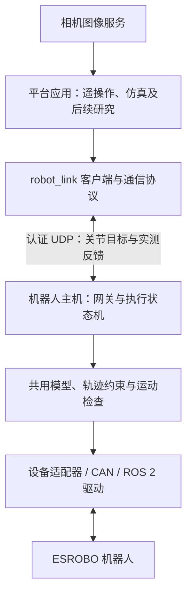

<div align="center">

# ESROBO

**移动双臂灵巧手机器人开发平台**

硬件与驱动 · 机器人模型 · 通信协议 · 遥操作与研究项目

[开发文档](document/README.md) · [设备驱动](src/README.md) · [通信接口](robot_link/README.md) · [平台应用](#平台应用)

</div>

---

ESROBO 是一套集成移动底盘、双七轴机械臂和双五指灵巧手的机器人平台。本仓库提供开发该平台所需的设备驱动、硬件文档、模型和机器人主机通信接口，供遥操作、仿真及后续研究项目复用。主要部署环境为 **Ubuntu 22.04 / ROS 2 Humble**。

平台代码与具体应用分层介绍：先了解机器人、接通设备和通信接口，再选择平台上的项目。当前仓库仍保留本机遥操作及共用控制组件；新组织与独立仓库的整理状态见 [组织与仓库布局](organization/README.md)。

## 机器人平台

| 子系统 | 硬件 | 开发内容 |
| --- | --- | --- |
| 移动底盘 | Ranger Mini 3 | 底盘 ROS 2 接口、CAN 通信和底层 SDK |
| 双臂 | 左右 NERO 七轴机械臂 | 关节控制、状态反馈、URDF 与运动约束 |
| 双手 | LinkerHand L20Lite | 十主动通道控制、反馈及联动关节模型 |
| 腰部与头部 | 三轴腰部、RS485 头部舵机 | 关节驱动、设备命名和调试接口 |
| RGB-D 视觉 | Orbbec 头部相机、RealSense 腕部相机 | 图像和深度采集、相机配置 |
| 测距与力觉 | RoboSense 雷达、双六维力传感器 | 点云、力/力矩及设备状态 |

每个设备的源码和说明见 [驱动索引](src/README.md)。整机连接、CAN/串口分配和逐部件操作见 [硬件调试指南](HARDWARE_BRINGUP.md)，厂家手册见 [文档中心](document/README.md)。设备可用范围由具体应用决定；底盘、腰部、头部驱动存在，并不表示所有遥操作项目都接入了全身控制。

## 平台架构



应用负责生成目标，机器人主机负责校验与执行。控制和反馈使用 UDP，SSH 用于部署及服务管理，图像走独立通道。机器人端始终保留反馈检查和执行约束；网络接纳目标不等于实体已执行到位。

## 基础开发资源

### 设备驱动与硬件接入

[`src/`](src/README.md) 收录机器人 ROS 2 驱动、第三方 SDK 和集成工具，涵盖机械臂、灵巧手、底盘、腰部、头部、相机、雷达与力传感器。驱动索引说明每项源码的职责、对应设备和阅读入口，也区分当前 ESROBO 主线与其他机器人配置。

[`start_can.sh`](start_can.sh) 与 [`99-fixed-can.rules`](99-fixed-can.rules) 提供机器人主机设备命名参考。首次部署按 [逐部件调试指南](HARDWARE_BRINGUP.md)核验各设备，再组合启动；已有总 launch 不作为首次上电入口。

### 文档与机器人模型

[`document/`](document/README.md) 是平台开发文档入口，集中索引整机及厂家 PDF、硬件调试、通信和应用开发资料。

当前运动学模型位于 [`teleoperation/urdf/`](teleoperation/urdf/)，包含机械臂与灵巧手的连接关系、关节限位和 mimic 联动。关节命名与零位说明见 [整机 URDF 模型](HARDWARE_BRINGUP.md#整机-urdf-模型)。网络机械臂目标使用 URDF 弧度；物理电机方向和偏置在机器人端处理，手部控制单位与模型角度需按标定转换。

### 机器人通信协议

[`robot_link/`](robot_link/README.md) 为平台应用提供 Python 客户端、UDP 协议和机器人端网关。它将上位机计算与机器人执行分离，支持单臂、单臂带同侧手、仅单手，以及双臂双手端点。

| 内容 | 说明 | 入口 |
| --- | --- | --- |
| 协议与数据约定 | HMAC 认证、独占会话、序号、配置合同、有效期、目标与反馈格式 | [PROTOCOL.md](robot_link/PROTOCOL.md) |
| 客户端 | 接收状态，发送新目标、保持或停止请求 | [client.py](robot_link/esrobo_link/client.py) |
| 执行网关 | 校验输入、保留最新目标、执行状态机和反馈检查 | [gateway.py](robot_link/esrobo_link/gateway.py) |
| 执行流程 | 从网络目标到受限命令、CAN/ROS 下发和实测反馈 | [ROBOT_EXECUTION.md](robot_link/ROBOT_EXECUTION.md) |
| 无硬件接入 | 使用 mock 网关检查协议与客户端连接 | [通信快速开始](robot_link/README.md#先做无硬件通信检查) |

默认控制端口为 **UDP 16000**，设计控制周期为 **50 Hz**，不作硬实时保证。HMAC 提供认证和完整性；双侧硬件按顺序发送，不具有原子同步保证。当前双臂自动准备／回零未开放，完整双臂互碰扫掠检查尚未实现。

## 开始开发

| 你的目标 | 阅读顺序 |
| --- | --- |
| 了解或搭建 ESROBO | [硬件与手册](document/README.md) → [逐部件调试](HARDWARE_BRINGUP.md) → [驱动索引](src/README.md) |
| 在平台上实现新控制程序 | [通信模块](robot_link/README.md) → [协议](robot_link/PROTOCOL.md) → [执行行为](robot_link/ROBOT_EXECUTION.md) → mock 端点联调 |
| 使用当前 PICO 遥操作 | [应用 README](laptop_teleop/README.md) → [两机连接](laptop_teleop/docs/02_ROBOT_CONNECTION.md) → [网页操作](laptop_teleop/docs/05_WEB_CONSOLE.md) |
| 研究重定向、IK 与灵巧手算法 | [代码与计算](laptop_teleop/docs/07_CODE_AND_COMPUTATION.md) → [技术方案](laptop_teleop/docs/09_TECHNICAL_SCHEME.md) |
| 运行仿真与回放 | [现有仿真项目](https://github.com/SaluteYan/Dual-arm-teleoperation)的环境、资产和复现说明 |

机器人驱动使用 ROS 2 工作空间，通信客户端和本机应用是独立 Python 包。安装方式以各模块 README 为准；只克隆源码不能替代 SDK、模型资产、环境与设备准备。

## 平台应用

每个项目围绕 ESROBO 的具体用途维护自己的安装说明、方法、实验和验证记录。项目独立仓库逐步整理，下面明确区分现有入口与待拆分内容。

| 项目 | 内容 | 当前入口与状态 |
| --- | --- | --- |
| **PICO 实机遥操作** | PICO Body/Hand 输入、人体标定、臂手重定向、IK、网页控制台和双机执行 | [`laptop_teleop`](laptop_teleop/README.md)；代码在本仓库，拟独立为 `esrobo-teleop` |
| **仿真遥操作与回放** | IsaacLab 仿真基线、ESROBO 资产、PICO/SenseGlove 输入与录制回放 | [Dual-arm-teleoperation](https://github.com/SaluteYan/Dual-arm-teleoperation)；现有独立仓库，新组织归属待整理 |

新的平台项目在此追加实际仓库链接、用途、所需平台版本和验证范围。尚未建立的项目不提供虚构仓库链接。

### 当前目录与项目边界

```text
esrobo/
├── README.md                平台总览、开发入口与应用导航
├── HARDWARE_BRINGUP.md      逐部件硬件接入和调试
├── src/                     ROS 2 设备驱动与第三方 SDK
├── document/                文档索引与厂家手册
├── robot_link/              通信协议、客户端和机器人执行网关
├── teleoperation/           当前共用模型、IK、驱动与旧一体式入口
├── laptop_teleop/           新实现的 PICO 本机遥操作项目
├── organization/            新 GitHub 组织主页及仓库整理说明
├── start_can.sh             CAN 初始化参考
└── 99-fixed-can.rules       设备命名参考
```

`teleoperation/` 的算法源自仿真项目，但当前目录还承载实机共用组件：`robot_link` 导入其中的 NERO/手部驱动，`laptop_teleop` 导入其中的配置、人体重定向和 IK。该目录的 `--no-robot` 与模拟人体输入用于离线检查，不能等同于完整 IsaacLab 动力学仿真。独立项目拆分需先明确这些公共组件的依赖和版本，详见 [仓库整理方案](organization/README.md)。

## 开发与验证

修改设备接口、配置或通信行为时，同步更新对应文档并记录验证范围。保持两端协议、关节语义、配置和模型版本一致。历史现场记录、软件测试与本次实机验收分开说明；当前运行限制及问题见 [故障排查](laptop_teleop/docs/04_TROUBLESHOOTING.md)。

第三方驱动、SDK 和模型沿用各目录的来源与许可说明。本机密钥、标定、环境、活动日志及部署备份不作为平台发布内容。
