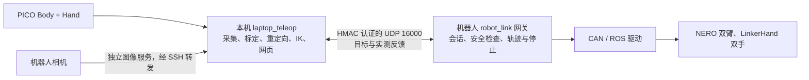

# ESROBO 移动双臂机器人

本仓库包含 ESROBO 移动双臂机器人的 ROS 2 工作空间、底层设备驱动，以及 PICO 遥操作程序。机器人主机运行 CAN/ROS 驱动和运动执行网关；本机采集 PICO Body 与 Hand 数据，完成标定、重定向和逆运动学（IK），再将关节目标发送给机器人。主要环境为 Ubuntu 22.04 与 ROS 2 Humble。

**当前日常入口**是 [`laptop_teleop`](laptop_teleop/README.md) 的网页控制台；[`robot_link`](robot_link/README.md) 负责两机通信和机器人端执行。[`teleoperation`](teleoperation/README.md) 保留模型、运动控制组件及较早的一体式运行入口。第一次接触真机，请先按[逐部件调试记录](HARDWARE_BRINGUP.md)核对设备，再按[部署文档](laptop_teleop/docs/README.md)操作。

## 系统如何工作



| 层次 | 主要职责 | 入口 |
| --- | --- | --- |
| 本机计算与界面 | PICO 身体及五指采集、输入时效检查、标定、IK、目标生成、状态显示 | [`laptop_teleop/README.md`](laptop_teleop/README.md) |
| 机器人执行 | 认证与配置合同、最新目标缓存、反馈校验、限速轨迹、故障停止、驱动调用 | [`robot_link/README.md`](robot_link/README.md)、[执行流程](robot_link/ROBOT_EXECUTION.md) |
| 模型与运动组件 | URDF、运动学、机械臂和灵巧手适配器、安全回零等；也保留原一体式遥操作 | [`teleoperation/README.md`](teleoperation/README.md) |
| ROS 2 设备层 | 底盘、双臂、腰部、灵巧手、相机、雷达、头部舵机和力传感器驱动 | [`src/`](src/) |

运动目标走 UDP 16000；SSH 用于机器人端程序管理和图像服务转发。网页和人体 IK 在本机运行，CAN 与硬件驱动在机器人主机运行。网络包被接收不等于机器人已执行或到位，实际状态以新鲜反馈为准。协议细节见 [`robot_link/PROTOCOL.md`](robot_link/PROTOCOL.md)。

## 硬件范围

| 部件 | 当前使用的设备或驱动 |
| --- | --- |
| 移动底盘 | Ranger Mini 3；`ranger_ros2`、`ugv_sdk` |
| 双臂 | 两台 NERO 七轴机械臂；`agx_arm_ros2`、`pyAgxArm-master` |
| 腰部与头部 | 三轴腰部 CAN 关节、RS485 头部舵机 |
| 双手 | LinkerHand 灵巧手；`linkerhand-ros2` |
| 视觉与测距 | Orbbec 头部相机、RealSense 腕部相机、RoboSense 雷达 |
| 力觉 | 双侧 RS422 六维力传感器 |

整机操作说明和厂家手册位于 [`document/`](document/)。遥操作当前使用 PICO Body 的肩、肘、腕数据和独立的 PICO Hand 五指追踪；SenseGlove 相关代码与文档用于旧设备维护，当前本机遥操作流程不需要启动手套软件。

## 仓库导航

```text
.
├── README.md                      项目总览与文档导航
├── HARDWARE_BRINGUP.md            逐部件真机调试记录
├── laptop_teleop/                 本机 PICO 计算、网页与操作文档
├── robot_link/                    双机通信协议、客户端和机器人网关
├── teleoperation/                 运动模型、控制组件及原一体式入口
│   ├── config/teleop_config.yaml  机器人运动与安全配置
│   └── urdf/                      当前遥操作使用的整机 URDF
├── src/                           ROS 2 工作空间源码与第三方驱动
├── document/                      整机及设备 PDF 手册
├── start_can.sh                   机器人端 CAN 接口初始化
└── 99-fixed-can.rules             机器人端设备命名规则参考
```

`build/`、`install/`、`log/` 是本机生成的构建或运行目录；外部 SDK 与本机标定文件也可能只存在于已部署机器上。新机器部署时按[环境安装](laptop_teleop/README.md#环境安装与配置)和[两机连接](laptop_teleop/docs/02_ROBOT_CONNECTION.md)准备，不能仅凭克隆源码推断设备已就绪。

## 从哪里开始

1. **首次部署**：阅读[环境安装](laptop_teleop/README.md#环境安装与配置)和[网络、SSH、共享密钥及网关](laptop_teleop/docs/02_ROBOT_CONNECTION.md)。本机与机器人端需使用相匹配的协议、配置和 URDF。
2. **真机上电或排障**：核对[逐部件调试记录](HARDWARE_BRINGUP.md)及[厂家手册](document/移动仿人形双臂机器人平台操作手册.pdf)，先确认 CAN、反馈、急停和运动空间。整机总 launch 会同时启动多个设备，不作为首次调试入口。
3. **日常遥操作**：在已安装本机环境后，从仓库根目录运行：

   ```bash
   ./laptop_teleop/scripts/run_dashboard.sh
   ```

   打开 `http://127.0.0.1:8080`，按[网页操作文档](laptop_teleop/docs/05_WEB_CONSOLE.md)连接机器人、选模式、检查输入、预览、标定并人工使能。命令行逐终端流程见[日常运行手册](laptop_teleop/docs/03_OPERATION_RUNBOOK.md)。启动网页本身不会使能机器人。
4. **先做只读或离线检查**：本机环境检查可用 `./laptop_teleop/scripts/run_laptop.sh check`；已启动网关时可用 `./laptop_teleop/scripts/run_laptop.sh inspect` 查看合同与反馈。无硬件通信模拟见 [`robot_link/README.md`](robot_link/README.md)。

模式包括双臂双手、单臂带同侧手、纯单臂和仅单侧灵巧手。各模式所需 PICO 输入和网关参数见 [`laptop_teleop/README.md`](laptop_teleop/README.md#运行模式)。当前双臂模式缺少两臂互碰的完整扫掠检查，网关会拒绝双臂自动回零与自动准备；不可把单臂回零流程直接组合用于双臂。现场运行还需以机器人控制器反馈确认停止、失能和故障状态。

## 文档索引

| 需求 | 文档 |
| --- | --- |
| 本机结构、数据流、模式 | [`laptop_teleop/README.md`](laptop_teleop/README.md) |
| 安装、连接、每日操作、故障排查、网页 | [`laptop_teleop/docs/README.md`](laptop_teleop/docs/README.md) |
| PICO Body/Hand 输入和计算细节 | [PICO 输入](laptop_teleop/docs/06_PICO_HAND_INPUT.md)、[代码与计算](laptop_teleop/docs/08_CODE_AND_COMPUTATION.md) |
| 通信协议与机器人收到目标后的行为 | [协议](robot_link/PROTOCOL.md)、[执行流程](robot_link/ROBOT_EXECUTION.md) |
| 原一体式遥操作及其运行记录 | [`teleoperation/README.md`](teleoperation/README.md)、[旧运行手册](teleoperation/TELEOPERATION_RUNBOOK.md) |
| 设备逐项调试和现场命令 | [`HARDWARE_BRINGUP.md`](HARDWARE_BRINGUP.md) |

修改代码或配置后，按现场安全流程停止并重启相关进程；已运行的 Python 进程不会自动加载工作区变更。软件回归入口为 `./laptop_teleop/scripts/test.sh`，它需要先完成本机环境安装；软件测试不代替实机验收。
