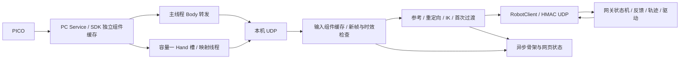

# 当前代码与遥操作计算逻辑

本文是当前源码实现说明。部署/依赖在 [本机 README](../README.md)，操作在 [03](03_OPERATION_RUNBOOK.md) 和 [05](05_WEB_CONSOLE.md)，性能测量在 [04](04_TROUBLESHOOTING.md#独立测试与耗时测量)。历史现场状态和耗时报告不作为此文的运行前提。

## 模块与数据流

### 输入恢复协议

`input_recovery.py` 管理源目标资格，机器人端原有轨迹负责真实命令限速。普通输入恢复已删除 `input_resume_arm_delta_deg` 参数，以及“相对中断前源目标”和“相邻候选源目标”的角度门限判断，不再分为两条角度资格路径。统一要求连续 3 个独立、新鲜、有效的输入帧（混合控制以 Body 推进，手指可复用但仍须满足原始源时间的 100 ms 时效），七轴源目标必须为有限值；角度偏移只作诊断，`arm_limit_deg=null`。手部仍要求十通道有限值及 0～255 合法范围，保留从反馈到最新目标的限速衔接。三个新帧必须经原始时间戳、100 ms 时效及反馈复检；失败发送不能提交接管计时或滤波状态。首次 ACTIVE 到位后的输入资格判断与普通恢复统一：不检查相对锁定姿态或相邻候选的源角差；发生输入等待时同样要求连续 3 个新鲜有效帧。固定接近路径、到位核验与机器人轨迹保护保持。

首次接近使用 `entry_protocol=7`：同一次标定锁定完整七轴目标，先完成 J1–J5，再完成 J6/J7，两段到位后才进入 ACTIVE。腕部不再在 ACTIVE 中追逐实时目标进行首次接管，因此不再使用该旧路径的 10 秒超时；运行中的输入恢复仍执行连续新鲜有效帧与时效检查。

运行中 `REACQUIRING` 使用最新合格目标，原有机械臂轨迹位置/速度状态不重置；手部使用跟随最新目标的有界 HandHandover。恢复不再因相邻源角度跳变重新计数或退出；无效/过期输入、健康检查失败或 3 秒期限失败仍阻止恢复。重复输入空档保留原始期限，重新收集 3 帧。恢复开始后再连续成功发送 3 个新鲜、有效且反馈健康的帧，即完成输入恢复；不再要求持续移动的机械臂/手指追到源目标 1.5°/2 单位以内。实际跟随误差保留在 `input_recovery.check.tracking_error`。这只确认输入链路恢复，机器人持续用原有碰撞、关节限位、力矩、速度、加速度和命令到反馈领先量约束接近目标，绝不重置轨迹。

首次手部接管仍使用 15 单位领先量、2 单位到位容差和 10 秒期限。完成首次接管后的 ACTIVE（含输入恢复）设置 `hand.live_feedback_lead=null`：取消手指指令与反馈的位置差限幅，以及由此差值触发的异常拒绝。单步 18、速度 900 单位/秒（50 Hz 时最多 18 单位）、合法行程和反馈时效检查保留。即使手指受阻不动，指令也可按速度限制继续趋近人手目标；可反向张手，无需等待原目标到位。速度限幅器跨输入恢复完成保留，不能下一帧跳到原始目标。`hand_following.feedback_lead_unit=null` 表示没有位置差门限；受限轴仅表示速度/单步限制。这不是力控或接触识别，不提高电流/力矩上限，也不改变回零与自然张开核验。

协议通过 `recovery={phase, epoch}` 区分接管与完成。网关独立记录原始 3 秒期限，拒绝换 epoch 重置期限；完成消息可幂等重发，完成的 epoch 不可再次接管。`close` 表示客户端结束，`stop` 表示显式急停，两者分开；硬件端未验收时保持原故障停止行为。已验收端对输入超时/客户端结束进入 `HOLD_LATCHED`，硬件健康检查失败则升级原急停；本机不能通过新目标解除锁存。

配置验收开关默认 false，并参与配置指纹。旧本机不能连接已启用恢复能力的网关，新本机拒绝缺少协议 1 的网关。当前部署配置已启用通过保持验收的左臂，右臂仍未启用。健康锁存保持可通过 `hold_return_protocol=1` 显式请求连续使能回零，到位后才失能；旧网关或故障使能状态拒绝自动恢复，不由网页隐式失能。

网页“停止并保持”使用独立 `motion_hold → h` 路径，网关声明 `controlled_stop_protocol=1` 和当前模式的验收能力。正常 ACTIVE 下转入现有 `HOLD_LATCHED`，不清零运动速度、不调用 backend.stop/cancel/disable；原实时制动、反馈和力矩检查继续生效。网关确认后本机以 SIGTERM 结束目标流，客户端 close 不将保持升级为急停。重复保持请求幂等，新目标不能解除锁存；人工急停或保持时硬件故障仍走原停止处理。回零和启动阶段不接受这个保持请求。

逐轴 `motion_diagnostics` 记录命令、实测速度、目标到命令及命令到反馈误差，统计配置速度、加速度、领先量刹停、反馈运动刹停。统计从轨迹初始化开始，比例可重叠；`limits` 同时记录当前速度（°/s）、加速度（°/s²）和领先量（°）。2026-10-15 候选配置统一将左右臂七轴速度设为 36°/s、领先量设为 10°；J1–J4 加速度为 80°/s²，J5–J7 为 100°/s²，控制器速度百分比为 30。最近一轮左臂 J1–J4 的加速度限制触发约 68%/50%/77%/61%，领先量刹停触发约 45%/23%/50%/33%，据此增加领先范围和加速度；离线模型的改善不代表实机验收通过。准备、接近、实时跟随及回零共用同一套关节速度及加速度限制，删除原有 `return_speed_scale` 参数及缩放计算。2026-10-16 将完成 ACTIVE 接管验证后的实时跟随领先量单独调整为15°（`tracking_command_trajectory_lead_deg`），准备、首次接管和回零继续使用10°（`command_trajectory_lead_deg`）。实时输入恢复和跟随结束时的受控减速沿用15°，不在运动中收紧范围或重置轨迹；新准备流程在静止核验后恢复10°。两个参数均进入配置指纹。领先量是命令与实测位置的最大允许差，不是固定刹停距离；刹停计算、反馈、力矩与输入恢复检查继续执行。保持转回零沿用已提交速度减速，不重置运动状态。新参数需同步指纹并重新实机验收，旧配置的保持验收不能替代新参数验收。



| 文件或目录 | 当前职责 |
| --- | --- |
| `acquisition.py`、`pico_transport.py` | 唯一 SDK 所有者、通知驱动 Body 与独立 Hand 转发、有界后台处理。 |
| `pico_hand.py` | 26 点有效性、掌面及十轴几何映射。 |
| `inputs.py` | UDP 批次合并、真实时间、组件去重、配对、必要快照。 |
| `pipeline.py` | 参考采集、输入捕获、骨段重定向、IK、映射和诊断快照。 |
| `mapping.py`、`orientation.py` | L10 单位映射、前臂/掌面坐标、绝对腕姿态与有界求解。 |
| `app.py` | 本机状态机、频率门禁、目标/保活/保持及发送后提交。 |
| `hand_handover.py` | 手指固定首次到位目标；首次腕部运动由机器人两段接近执行，`wrist_handover.py` 仅保留旧协议兼容实现。 |
| `diagnostics.py`、`visualization.py` | 有界异步文件/终端和骨架发布，保留故障及丢弃计数。 |
| `dashboard.py`、`web/` | 本机进程、SSH/tmux、页面所有权、模式和服务操作。 |
| `robot_link/esrobo_link/` | 合同、认证、会话、输入保持、网关与硬件后端。 |
| `teleoperation/src/esrobo_teleop/` | Body 重定向、IK、NERO 驱动、轨迹、规划和几何。 |
| `tests/` | 回归与独立测量；正式入口不导入测试模块。 |

机器人 CAN/ROS 执行在机器人主机，本机采集和 IK 在电脑。UDP 16000 传关节目标/反馈，SSH 用于管理和图像转发，不承载遥操作目标。

## 采集、接收与新帧门禁

SDK 组件提交语义见 [06](06_PICO_HAND_INPUT.md)。主采集线程等待最长 50 ms，优先 Body，默认上限 90 Hz；Hand 工作线程和录制/诊断不阻塞 Body。每组件保持真实本机单调接收时间，重读缓存和序列化不续期。

UDP 接收在锁外解析，最多处理有界批次，按 Body/左 Hand/右 Hand 分别选择最新有效帧。锁内只提交或复制必要快照；控制线程在锁外重定向和计算。无效、过期、倒退或重复数据不能替代有效帧，合并计数可见。

突发批次先逐包验证、选择最新有效组件，再只对保留的 Body 做坐标转换；不会为随后丢弃的历史帧重复转换，也不补发积压目标。转换后、锁内提交前仍检查原采样年龄。上游超过 100 ms 的空档不能靠改写时间戳掩盖。

完整新目标要求必要组件有效；纯臂由新 Body 推进，带手由新 Body/腕部推进并配对掌面、允许复用有效期内的手指结果，纯手仍须新 Hand。带手 Body/掌面配对间隔上限 40 ms，各组件输入年龄上限 100 ms。接收合并、映射和解算后再次检查年龄；读取时刻不作为样本时间。

配对采用的掌面可能早于最新手指样本，该掌面的原始时间单独写入本轮输入票据，解算后仍检查它的年龄，不能用最新 Hand 时间替代。

## 参考标定与模式状态机

正式计算先核验合同、版本、侧别和配置/URDF 指纹。`IDLE` 只回送机器人实测姿态。人工 `e` 后单臂自动准备先在健康失能状态受检归零手部，再受检回零机械臂并确认七轴失能，然后进入 `CALIBRATING`；自动准备不复位控制器故障。

本机 `FreshBodyDevice` 以首组有效输入完成初始参考采集：取消准备倒计时、身体多帧均值/位置标准差、掌面 12 帧/0.6 秒/5°稳定门限，以及人手自然张开和手指稳定门限。纯臂只需有效 Body；带手还需同侧有效手部及掌面；纯手只需有效 Hand。保留 100 ms 时效、40 ms Body/Hand 配对和原始时间戳检查。所选侧全部验证通过后才一次性锁定参考，后续帧不改写首次目标。通用 `BodyDevice` 的旧采样配置不再用于本机初始标定。

参考采集以一组有效的完整人体姿态为首次目标，记录肩肘腕、骨段及掌面；每次新准备清理旧参考、手腕缓存和 IK 种子。当前绝对骨段方向和肘角映射不减标定角度，标定用于首个锁定目标和坐标参考，不将现场人体姿态解释为零增量。

只在锁定的标定目标有效且完整时提交初始接近，继续执行关节范围和路径检查。`CHECKING_ENTRY/APPROACHING` 使用锁定目标和独立保活，暂缺 PICO 新帧不改写路径。到位进入 `WAITING_FOR_ACTIVE_TARGET`，保留 2 秒期限和完整新鲜输入核验，保活不能生成 ready 或延长期限。当前单臂接管协议为 6，保活协议为 1；旧协议不满足正式入口要求。

双臂后端没有互碰扫掠认证，拒绝自动准备和回零，不通过两次单臂调用伪装双臂检查。仅手不加载臂 IK，始终验证七轴失能。

## 映射与逆运动学

Body 肩→肘和肘→腕方向转换到机器人/腰部坐标，按机器人骨长生成肘/腕位置；使用绝对骨段方向与直接人体肘弯曲角，保留滤波与可观测性条件。肘接近伸直时弯曲平面不可观测，沿用相应保持/渐变逻辑，不由噪声直接翻转冗余轴。

分区位置 IK 主要求 J1–J4，带手腕任务求 J5–J7。纯臂实时末端三轴保持反馈值。手腕取 Hand 掌面在 Body 前臂坐标中的绝对姿态；当前轴含义为 J5 翻掌、J6 侧摆、J7 弯腕，按合同关节范围有界求解。绝对映射不减参考腕角。

### 滤波与连续死区

PICO 绝对腕部不再使用固定每次 2° 限步。上臂和前臂方向使用 2–8 Hz 自适应低通、速度系数 0.7，方向死区分别为 0.25°、0.30°；腕部使用独立的 `wrist_orientation_filter_min_cutoff_hz=2`、`max_cutoff_hz=8`、`speed_coefficient=0.7`（后两项同样带 `wrist_orientation_filter_` 前缀），以及 `wrist_orientation_deadband_deg=0.25`。方向／腕部滤波参数、三个死区及连续死区算法版本均纳入两端配置指纹。

腕部先在前臂局部坐标计算掌面旋转 `R`，令 `d=Log(R S_previousᵀ)`（旋转向量，弧度），`fc=clip(2+0.7*||d||/dt,2,8)`，`alpha=1-exp(-2*pi*fc*dt)`，`S=Exp(alpha*d) S_previous`。`dt` 使用配对 Body 样本原始接收时间之差；这里的速度指标是输入相对上一滤波姿态的残差除以时间，并非人手相邻原始帧速度。设 `S` 与上一已接受输出的夹角为 `theta`，死区为 `b`：`theta<=b` 保持，否则沿最短旋转只前进 `theta-b`。方向向量同样沿球面最短弧前进超出死区的部分。低通状态始终推进，慢速有效运动仍可累积；越过阈值时不再一次跳到低通结果，也不会对恒定输入持续爬行。

掌面这一层作用于完整姿态，避免 ±180° 换支造成数值跳跃。首次样本或时间空档超过输入有效期（当前 100 ms）只建立时钟并保持输出；重复、倒退时间不推进滤波。完整接近目标检查仍使用未滤波姿态，不能提前推进实时滤波状态。普通输入恢复不再检查源角度差；机器人轨迹的单步、速度、加速度、领先量、时效和碰撞保护不变。旧 SenseGlove/相对 IMU 路径的 `hand_imu_max_step_deg` 不控制当前 PICO 绝对腕部。

### J6/J7 独立稳定滤波

实时跟随专用的 J6/J7 稳定层，左右侧独立维护状态：保留上述掌面滤波，在有界腕部映射后、接管／输入恢复处理前，分别对 J6、J7 使用 1–4 Hz 自适应低通、速度系数 0.2、1° 连续死区。公式为 `speed=abs(goal-smoothed)/dt`（弧度／秒）、`fc=min(4,1+0.2*speed)`、`alpha=1-exp(-2*pi*fc*dt)`，低通后只向前推进超出 1° 死区的部分。这里直接处理已求解的有界关节坐标，不做欧拉角环绕。J1–J5 和手指映射不经过这一层。

新增层使用配对 PICO **掌面样本的原始接收时间**，不能以 Body 时钟或发送时间代替。准备／回零不经过新增层；ACTIVE 从已核验到位的目标初始化。重复或倒退时间不推进，超过 100 ms 的间隔只重建时钟；保持与失败候选不提交，成功发送后才提交，预览使用独立状态。保留 `source_arm_urdf_rad` 原始源目标与机器人轨迹的所有保护。参数为 `wrist_joint_filter_min_cutoff_hz=1`、`wrist_joint_filter_max_cutoff_hz=4`、`wrist_joint_filter_speed_coefficient=0.2`、`wrist_joint_filter_deadband_deg=1`，参数和算法版本均纳入两端指纹。

该层优先稳定性，单独作用于持续 2°/s 输入时，新增稳态等效滞后约 0.64 秒；反向微调还需跨过连续死区的迟滞带。它不能识别真实意图，也不保证数度的缓慢追踪漂移被完全消除。离线指标见 [修改日志](08_CHANGELOG.md)，回放入口见下文“详细运动记录”。


历史参数选择与离线指标见 [修改日志](08_CHANGELOG.md)。上述处理不能区分低频追踪漂移与有意微调，不增加自动静止锁定。

### 关节与手指映射

J1 软件范围：左右臂统一为 −75°～+75°（URDF 坐标，2026-10-14 本地更新）；YAML 与默认配置一致，网关有效限位经合同传给 IK。硬限位、速度、加速度及碰撞检查不变；同步配置并重启网关、核验指纹后才生效，新增行程尚需现场验证。

腕求解对可验证唯一分支先用欧拉种子及小牛顿修正，实际轴重构、关节边界和误差均通过才接受；否则使用热启动有界最小二乘，保留退化/奇异及不可达处理。SO(3) 残差用解析雅可比，同次求解复用残差/雅可比，不跨输入帧伪造新鲜度。

左手原始 26 点在独立进程中进行四指几何计算与拇指三轴有界求解；十个物理轴全部输出，角度直接映射 L10 0–255，不再重复施加旧增益。右手保持四指／拇指屈曲 1.25、拇指侧摆 0.60 增益及原启用轴。反馈标定独立，mimic 联动保持不变。范围、计算预算和回放见 [左手十轴重定向](07_CODE_AND_COMPUTATION.md#左手-l20lite-十轴重定向)。

左右带手模式均支持确认的不可达位置保持；上一有效目标、连续恢复帧和输入时效继续有效。输入缺失、控制器故障和一般 IK 异常不能当作可达性保持自动清除。

输入空档计时与最后可跟随源目标分开保存：完整新鲜帧通过检查并成功发送保持命令，也更新输入处理时间；不可达姿态不覆盖恢复用的源目标基准。偶尔一轮没有新帧时，按距最近完整输入的间隔判断是否进入输入等待，不能把持续的不可达保持时间算成断流。已有输入等待的 500 ms 期限和重新接管的 3 秒期限不因此刷新。IK 恢复可达只表示可以继续进行控制准入检查，不表示已实际恢复跟随。

## 标定后初始接近

所有实际进入标定后规划的臂模式使用两段固定目标接近：同一次标定锁定 J1–J7，第一段规划 J1–J5、保持 J6/J7 起点实测值；第一段确认到位和静止后，第二段保持 J1–J5 目标、规划 J6/J7 到标定值。手指始终保持实测姿态。两段完整路径及停车走廊均在使能前认证，执行时的前瞻不能越过两段之间的停止边界。碰撞 profile 为 `entry_arm`，覆盖机械臂及腕部，排除灵巧手掌体/手指。

启动仍要求两个连续一致反馈样本。执行周期读取已验证 SDK 来源的非阻塞快照；重复帧不续期或推进轨迹，缺失/倒退/跳变仍检查，接近读取不触发实时轨迹重置。

规划期间建立完整关节区间盒证书，执行时核验实测、上一命令、候选及制动范围。仅完整请求被单个证书覆盖才通过，不能扩大或拼接证书；上下文变化、重规划、无效反馈和退出清理。规划证书容量和细分预算保持有界；配对证明仅在父盒覆盖条件下供子盒复用。

`EntryCadence` 为独立 50 Hz、20 ms 固定期限：等待可被取消唤醒，重复帧/保持/路点切换也经过调度；超期跳过错过时刻，不连续补发。未发候选不提交轨迹状态，下次使用新鲜反馈重算。轨迹仍使用真实反馈时间，保留年龄、最大间隔、速度、加速度、领先量和执行超时。

相邻反馈间隔与距上次已提交轨迹状态时间是不同指标，必要故障记录分别指出。命令发送平稳不能证明 MOVE_J 真机运动无抖动，需要独立实测关节速度。

## 首次 J6/J7 和手指接管

两段接近都使用现有统一速度、加速度、领先量及反馈保护；第一段沿用 `full_arm_return_timeout_s=30` 秒、`full_arm_return_tolerance_deg=1.5`°；第二段沿用腕部 `wrist_return_timeout_s=10` 秒和 `wrist_return_tolerance_deg=1`°，从腕部段执行开始计时。两段均要求连续 3 次到位确认和 0.5°/s 静止判定。阶段切换保留已提交命令的位置和速度，只在确认静止后刷新时间基准；不把移动中的速度清零。第二段到位后等待新鲜完整 PICO 输入，才允许进入实时跟随。接近期间新 PICO 姿态不改写标定目标。

到位后的完整手部运动包络核验在 `APPROACHING` 阶段完成，核验后重取连续静止反馈并冻结证明，再发布 `WAITING_FOR_ACTIVE_TARGET`、启动 2 秒新鲜接管确认期限。此时仅打开手部软件指令通道，不发送手指目标。收到 ready 确认后只检查原目标、当前新鲜七轴反馈、使能/控制器/力矩及冻结证明的手部范围和上下文；不再重建网格、做距离计算或重置轨迹时钟。证明只能使用一次；反馈失效、姿态超出认证范围或手部包络变化仍拒绝。避免完整几何计算阻塞就绪阶段的反馈发布而触发 `robot feedback stale`，100 ms 反馈时效限制保持不变。

带手模式把同一快照的未滤波掌面和命令滤波掌面分别保留。`source_arm_urdf_rad` 的 J5–J7 来自未滤波掌面的有界腕部映射，用于首次接管及普通恢复的偏移诊断；发送的位置仍来自滤波和关节限速后的 `arm_urdf_rad`。源目标映射不改变命令 IK 历史。左右臂使用同一逻辑，初始接近使用固定标定目标，首次接管及普通恢复仅记录相对基准源目标的偏移，不再据此判定输入资格。纯臂无掌面映射，继续使用自身 IK 目标。

每次输入捕获只生成腕部滤波候选，成功发送后（预览为计算接受后）才提交。恢复的前两帧、过期输入、发送失败和位置保持均不推进腕部滤波。滤波候选仍仅在成功发送后提交，避免未接受的计算改变后续输出。

三个新鲜有效帧只代表候选具备恢复资格；成功发送前不清除原保持起点或期限。滤波后矩阵与源矩阵完全相同时复用该次腕部 IK，其他情况分别映射，不用近似相等条件代替源检查。

`HandHandover` 在第一次成功发送后锁定参考目标，首次阶段不会持续追逐变化的人手；输入时效、反馈、方向等待、领先量及 10 秒到位期限仍有效。过渡完成后使用实时手目标。发送失败或丢弃候选不锁定目标、不推进状态；hold 不重置固定目标和原期限。

机器人 `LinkerHandDriver` 对每条被接受的命令发布一次，移除第二层 20 ms 成功返回但不发送的门禁。软件移动预算使用真实调用间隔、最多一个标称周期，不累积停顿额度；只有发送成功更新已发布命令与序号。反馈单独记录实测 `position_unit`，不以命令冒充到位。

本地 L10 ROS 初始化的十轴速度配置为 255，扭矩参数保持原值。2026-10-20 首次速度设置更新将机器人实际 SDK 的启动速度从 `[200,250,...]` 改为十轴 255，并通过已有 ROS 设置接口向运行中的左手下发；当时没有重启手驱动。随后以 SocketCAN 的接收方向标记区分本机回显和总线接收，确认左手 `can_hand2`、ID `0x28` 对 `0x05/0x06` 两组全 255 设置均返回全 255 应答。周期查询仍返回十个 0，其含义尚未确认，不能表述为持续寄存器读回已确认，更不等于实测最大物理速度。后续执行链路升级要求核验实际安装路径支持 `move_on_start=false`，启动和退出均不得发送默认位置。

软件目标限速与电机速度档位独立：每轴本周期预算为 `min(18, floor(900 × min(实际发送间隔, 1/50)))` 个位置控制单位。50 Hz 时最多 18 单位，10 ms 时最多 9 单位；间隔缩短则进一步减小，空档不累积追赶额度。18 是单条命令的固定上限，900 单位/s 是随时间变化的上限，二者取更严格者。0–255 是位置控制量，各轴对应的角度行程不同，900 不表示统一的 900°/s。首次接管反馈领先量、右拇指止点及回零轨迹仍保留；正常跟随与输入恢复使用 `live_feedback_lead: null`。当前现场只接左手，在线档位设置及 CAN 核验只面向左手，不启动右手节点。

### 左手 L10 执行通道

左手位置发布及订阅采用深度 1，桥接每轮最多读取 64 个 UDP 报文并合并左手位置目标。SDK 回调只校验并替换一个最新目标槽；唯一 CAN 工作线程最高 50 Hz 发送位置及查询反馈，保留每帧协议等待，速度档位查询降为 1 Hz。设置请求使用独立的 32 项有界队列，在没有待发目标且停止接收目标至少 200 ms 后串行执行，不覆盖位置目标。右手仍走原路径。

内部元数据版本为 `esrobo-hand-v1`，包含脱敏会话、单调序号、原始发布时刻和截止时刻。普通目标有效期不超过 100 ms，并取当前网关消费目标的截止时刻与其较早者；桥接和 SDK 不刷新有效期。ROS 内部用 `JointState.header.frame_id` 传递元数据，左手新版 SDK 拒绝未带元数据的旧位置消息；机器人外部协议和十轴位置字段不变。

最后一层 CAN 输出再次按 900 单位/s、单步 18 和 `[0,255]` 限幅：基准为最近两帧完整成功发送的位置和完成时刻，初次基准来自两组均新鲜的实测反馈。初始化不发位置、不追赶过期目标、空档不累计预算。两帧发送全部成功后才提交；部分失败记录完成帧数并锁存 SDK 故障，停止后续位置输出，不在工作线程内重连或重放。停止与退出清空目标；已经发出的 CAN 帧无法撤回。

收到新的有效序号时，即使十轴位置与上次相同，也允许在下一个有预算的执行周期发送两帧，以保持原 SDK 的位置刷新行为。完成发送并到达该目标后清空目标槽；没有新输入就不重复发送已完成目标，重复序号继续拒绝，转发不刷新原有效期。首次建立实测基准时预算为零，保留待发目标到后续周期，不能因数值相同而把尚未发送的目标标记完成。日志 `same_position` 标明本次实际发送的位置是否与上次相同。首次手部接管的 ±2 单位到位容差及 10 秒期限保持原值。

`/esrobo_left_hand_transport` 发布缓存诊断，桥接把两组位置的原始 CAN 接收时刻（取较早值）交给网关；重复 ROS 发布不刷新反馈年龄。SDK 故障沿原网关故障路径上报。速度查询完成时刻也不能冒充寄存器采样时刻，未取得两组实际应答时采样时刻为空。

`robot_link/log/hand_gateway_*.jsonl`、`hand_bridge_*.jsonl`、`hand_sdk_*.jsonl` 使用现有 2048 容量异步日志及保留策略。记录发布、合并、接收、过期丢弃、两帧发送完成、限幅、部分失败及两组实际反馈时间／序号；以内部会话与序号关联，完整诊断不进入网页高频状态包。延迟验收方法与局限见 [09 技术方案](09_TECHNICAL_SCHEME.md#左手执行链路延迟优化2026-10-20)。

## 实时跟随、输入保持与停止

本机上限 50 Hz，完整目标两秒平均最低线为 35 Hz（40 Hz 配置减 5 Hz 容差），目标间隔上限 80 ms。网关独立校验 HMAC、序号、合同、会话 lease、反馈、限位和控制器状态。

主循环将源输入暂缺明确分为等待、已保持和不能继续三种结果。健康 ACTIVE 中距最近成功处理的完整输入小于 `input_hold_after_s=40 ms` 时，普通缺帧和 `SourceExpired`（含 Body/Hand 配对失败）均只等待；等待不算控制包、不更新输入时钟、不提交候选。达到保持门限或首次 ACTIVE 尚待输入时进入原保持流程。仅允许源输入异常使用该等待分支，反馈时效/使能/控制器检查仍执行，其他异常仍停止。

ACTIVE 短暂缺完整输入发送无位置字段的 hold，机械臂按原轨迹刹车，手部用新鲜实测位置保持；最多 500 ms。自动恢复须连续 3 帧新鲜有效目标，首次接管和普通恢复均不以机械臂源角差作准入条件；手指不设源目标差值门限，通过已有手部限速与反馈约束衔接最新目标。持续过期、无效输入或反馈/控制器异常闭锁，需要显式恢复。首次腕部运动在 APPROACHING 内完成，不占用运行中恢复期限。

当前配置 `teleop_torso_collision_enabled=false` 关闭实时跟随软件躯干几何检查；控制器碰撞保护、力矩/状态、关节、轨迹和时效检查仍执行。受检回零及初始接近通过各自几何路径。默认躯干间隙统一为 **5 mm**，左右臂初始接近、机械臂回零和手部回零共用该值；安装肩部间隙保持 5 mm。模型与实机误差仍需独立校准。

所有启用的几何判定统一使用原始 STL 网格顶点的凸包，包括机械臂、手掌、手指和躯干；不再用机械臂包围盒或手指的 26 方向支撑平面近似代替网格凸包。手指运动范围仍使用连续圆弧外包凸包，覆盖中间姿态、反馈误差和到位容差；关节区间与反馈时效规则不变。静态原始网格间隙不等于整段回零已通过。诊断 `collision_geometry=original_mesh_convex_hull`，手指包络标识为 `original_mesh_convex_arc_hull`。修改源码和间隙后需同步机器人并核验配置指纹，运行中的旧网关不会自动加载。

停止、电子急停、保持和失能分别处理；软件保持不是硬件重力支撑保证。异常以第一故障与新鲜反馈为依据，不能从软件模式推断机械臂已失能。

### 关节空间轨迹与碰撞候选

输入重定向和机器人命令轨迹均不再限制肘部、腕部的空间平移速度；删除 `max_endpoint_translation_velocity_m_s`、目标位置限速/回溯、专属端点雅可比、SLSQP 后备求解和 3/5 ms 超时路径。不会将原上限替换为更大的数值或隐式开关。Body 继续输出经过方向滤波、连续死区和弯曲平面可观测性处理的骨长匹配目标；日志用 `mapped_bend_deg`、`output_upper_direction`、`output_forearm_direction` 表示最终映射结果，不再产生旧限速诊断。

机器人每周期仍按新鲜反馈时间计算七轴速度可行区间，保留速度、加速度、单步、关节范围、命令/反馈领先、静态及反馈运动制动距离、持续领先时限和取消检查。普通跟随、输入恢复、受控保持、初始接近和受检回零共用该关节轨迹接口。保持继续沿已成功提交的位置和速度减速，不重置轨迹；发送失败与拒绝候选不提交。

启用几何检查的阶段仍验证未完成的命令/反馈区间和候选制动走廊；只有几何拒绝时才沿原跟踪与减速速度之间回退，诊断为 `collision_search_progress`、`collision_rejections`。实时几何开关保持当前配置；初始接近与受检回零认证不受影响。FK 仍用于准备核验、模型验证和碰撞认证，不从其他运动学任务删除。

删除只由端点速度后备求解产生的 `TrajectoryHoldTransition`、联合减速锁存分支和对应状态摘要；操作者停止、输入保持、位置保持与回零切换继续沿各自既有流程执行。真实反馈、力矩、控制器、发送或几何故障仍停止，不把它们转换成普通保持。算法版本 `joint-bounded-trajectory-v2` 加入两端合同指纹，机器人协议及七轴目标字段保持一致；部署须同步并重新加载配置。

## 显式受检回零：按保持或失能状态分流

### 异常停止分流（2026-10-21，本地修改待上线）

此节更新前文v2的异常处理，当前版本为 `joint-bounded-trajectory-v3-checked-failure-hold`，纳入两端合同指纹，外部运动协议不变。

| 场景 | 处理 |
|---|---|
| ACTIVE 输入超时、会话关闭、无效接管令牌；到位等待 ACTIVE 的租约／确认超时或参考变化 | 已验证保持能力的控制对象进入 `HOLD_LATCHED`，本地执行器继续减速／保持，需显式恢复 |
| 上述可保持阶段 UDP 收发失败或必要状态包超限 | 同样锁存保持；UDP线程退出不结束本地保持执行器 |
| 单臂受检回零／准备／接近执行中的候选拒绝或路点超时 | 健康使能、已验证保持能力、有已提交轨迹时尝试受检减速；成功并核验静止后保持，原操作仍未完成 |
| 日志写入／编码失败 | 禁用该日志输出并上报 `journal_error`，不改变运动状态；诊断队列最多256条，覆盖计入 `diagnostic_events_dropped` |
| 控制器、力矩、CAN发送故障，真实反馈过期，无可验证减速路径，明确急停／失能／进程退出 | 保留原故障停止和显式操作流程 |

受检减速沿用最后**成功发送**的位置、速度和时间戳，复用原轨迹约束逐周期制动，最多2秒；不继续追逐原路点，不重规划或扩大碰撞证书。每周期仍检查反馈、控制器、力矩、关节范围、领先量及完整制动包络，发送成功才提交。速度为零且连续反馈静止后，才允许为同一已提交位置建立保持时钟；不清零运动中的轨迹，不自动失能。后续保持验证失败仍故障停止。

`return_result` 完整诊断增加 `first_motion_rejection` 和 `failure_hold`，分别保留首次几何拒绝及制动结果，不把完整诊断放入高频状态包。普通保持不再占用 `first_fault_reason`，避免遮住后续硬件故障。双臂原统一保持、任一侧失败则双臂故障的处理不变；没有开放双臂自动回零。

本次手部111→254→111跳变使原手部包络证书失效，若减速也无法认证，仍执行原故障停止。该修改不能保证所有异常均停在原处；缺失的安全证据需要独立制动包络或硬件制动能力，不能通过忽略异常反馈补足。

### 正常受检回零流程

`HardwareBackend.return_zero(explicit_recovery=True)` 在**已失能**单臂带手恢复先预约本次回零、停止手部软件跟随，并调用 `recover_disabled_controller` 验证新鲜七轴失能和控制器健康。只按既有孤立电子急停条件复位，不隐式失能承重机械臂、不启动七轴运动。

`_restore_hand_before_return` 以当前非零实测姿态为锚，检查完整手部自然张开扫掠及 ±0.2° 臂漂移盒。细分认证时，整个父区间已证明安全的碰撞对由两个子区间继承，仅继续计算未认证的碰撞对；证明只在同一次检查内复用，不跨手部包络或调用缓存，原计算预算不变。每次手指发送前验证对应的失能或健康全使能状态、位置漂移、反馈年龄和手部区间；保持使能时另检查控制器和力矩；已到自然张开容差时无需重新运动。失败返回 `hand_open_before_arm`，不开始机械臂回零规划或运动。保持分支通过 `safe_return` 的制动后回调执行手部阶段。

近零位回零例外：以所选侧七轴新鲜 URDF 实测角度判定，每轴距零位不超过 `full_arm_return_tolerance_deg`（当前 1.5°）时，不构建或检查手指扫掠包络；仍检查机械臂、腕部和手掌几何，保留手部反馈新鲜、自然张开到位、控制器、力矩、取消及相对锚点 0.2° 漂移保护。手部阶段若离开零位容差立即拒绝。先手后臂的顺序不变；手部核验完成后，机械臂经连续静止零位复核即可结束，已失能时不重新使能，保持使能时仅在到位与健康核验通过后失能。例外仅用于回零（含自动准备），退出后恢复完整手部几何；非零位回零、实时跟随和 ACTIVE 接管不采用该例外。

手部回零入口可只读等待最多 `controller_status_timeout_s`（300 ms）取得初始完整样本。随后手部扫掠（近零位则为臂/腕/掌检查）在 `spawn` 独立计算进程中认证；传入配置、原始网格凸包快照及哈希、固定臂漂移盒、手部包络和请求编号。子进程无 CAN/ROS 驱动。主进程每 20 ms 核验新鲜反馈、取消、使能、控制器、力矩和原锚点 0.2° 漂移；保持时沿用原已提交静止命令，不重置轨迹或隐式失能。子进程启动与计算共用 `return_plan_timeout_s`（5 秒），超时、取消或异常会回收子进程，不接受迟到结果。认证成功后、第一条手指命令前再次核验反馈和包络覆盖。监控中的真实反馈/控制器/力矩/漂移失败会阻止恢复保持；普通几何拒绝仍须独立确认健康静止才允许保持。

回零结果只携带有限反馈摘要，网关状态原因不拼接完整结果字典。完整回零诊断写入 `return_result` 事件。UDP 继续使用 8192 字节上限，按最终 JSON/HMAC 字节数检查；超限时精简可选诊断并保留原序号、租约、合同和安全反馈，设置 `diagnostics_truncated`。必要状态仍超限则停止发送该包，按上述阶段及保持能力转入保持或故障，不关闭本地执行器。编码异常写入 `network_state_error`；日志失败单独降级报告，不能让最后一次写盘异常跳过资源清理。

手部归零成功后，在七轴启动边界独立重读手部到位状态；失效返回 `hand_open_before_arm`，不依赖之前缓存的 `hands_open`。通过后执行原七轴路径规划/限速/反馈检查及回零到位、失能核验；收尾再次确认三份新鲜健康控制器反馈和手部仍在零位。最终手部检查失败为 `hand_open_verify`，不在末尾重新展开。分别记录 `arm_returned`、`hands_open`、`disabled`，完整成功才 IDLE。

提前退出释放本次未开始的预约，但保留取消，不释放其他请求或正在执行的回零。健康失能下手部拒绝保留 FAULT，不额外重锁电子急停；显式停止、故障和不确定状态保留停止处理。纯单臂走原七轴流程，自动使能准备同样先归零手部、再回臂，仅手恢复不发臂目标。

健康 `HOLD_LATCHED` 的 `r/z` 走 `from_hold=True` 分支，要求 `hold_return_protocol=1`、新鲜七轴全使能和正常控制器/驱动。此分支不调用前置失能或复位；`safe_return(recover=False, preserve_hold=True)` 从已提交位置/速度受控制动并确认静止，再通过 `before_arm_return` 回调在保持使能时受检归零手部；手部到位及臂静止再次核验通过后，才规划、执行七轴回零，到位后失能。手部阶段不会为张手撤去臂承重。

保持转回零时，先保留实时轨迹及其反馈时钟，沿用运行中的制动算法和实时安全检查，完成零命令速度及实测静止确认后才进入完整回零几何计算。禁止在此制动前清空轨迹或插入离线几何计算，否则计算空档可能触发严格反馈读数超时。手部归零和规划阶段保留最后已提交的静止位置命令；规划后仍需新鲜静止、漂移和全路径认证。规划拒绝仅在硬件健康、静止保持可验证时返回锁存保持；真正的反馈、控制器或力矩故障仍进入故障处理，不能保证承重。

规划或前置检查拒绝时，只有已提交速度为零、新鲜连续静止反馈、原命令领先量、关节范围、控制器和力矩检查均通过，才能用原提交位置恢复锁存保持。不得重置运动中速度或把命令跳到反馈；取消、硬件故障或保持证明失败仍进入故障处理。网页不再调用 `remote_disable` 后串接 `remote_recover`，服务端也校验此分流。

网关状态单独发布 `return_protocol=3`，用于核对运行中的手部优先回零实现；旧版 2 的保持回零仍是先臂后手，新网页拒绝其回零及自动准备入口。带手的 `recover_disabled_controller` 在反馈缺失时可有界请求 CAN push，随后仍要求原始新鲜反馈、七轴失能、当前姿态/几何和连续三帧健康状态；请求自身不复位、不使能、不发送关节目标。

受检七轴回零同样读取已验证非阻塞反馈，启动/静止/最终仍需连续样本。规划阶段完成包含手部的完整路径及制动走廊认证，然后冻结证明；执行阶段只检查新鲜反馈、手部范围和上下文是否仍被完整单证书覆盖，不重建网格、不运行距离计算。缓存容量 32，反馈/上下文失效拒绝执行。使能前预装位置在几何和模式配置之后重新取样，必须落在认证的静止区域内；进入执行前重新核验静止反馈，不能沿用规划前的采样时钟。回零轨迹时钟上限 120 ms，单次位置采样有效期仍为 100 ms。

同一次完整几何规划期间，手部包络保留此前已覆盖的角度范围：新鲜反馈的不确定范围缩小时复用较大包络，超出时扩大包络并使旧认证失效，重新计算完整证明。每次新规划、反馈提供者/模型变化及普通实时检查均不累积旧包络；冻结后仍只允许新反馈落在已认证范围内。这样避免手部静止时因反馈年龄波动而反复重建网格、清空路径缓存。单次规划几何认证允许最多 256 次细分，普通几何检查仍为 64 次；5 秒路径搜索预算、碰撞间隙及执行覆盖规则不变。

机器人网关建立规划证书时，手部角度不确定范围按整个反馈有效期计算：`标定误差 + 最大速度 ×（geometry_feedback_timeout_s + 有效运动前瞻）`，当前有效期为 100 ms。手部输出关闭时前瞻仍为零。冻结后的执行核验使用实际反馈年龄，原始时间戳过期仍拒绝；不会因规划时收到很新的包而留下只能覆盖数毫秒反馈年龄的证书。更大的规划包络必须通过完整几何认证，不能沿用较小包络的证明。

规划结束、回零使能之前，若七轴位置反馈已更新但控制器/驱动状态帧仍过期，只读等待至多 `controller_status_timeout_s`（当前 300 ms）让状态刷新；期间不发送配置、使能或位置命令。真实驱动故障立即拒绝，取消或持续缺失同样拒绝；此等待不适用于运动中的反馈保护。

显式恢复若已失能且处于既有零位容差，`verifying_disabled_zero` 分支核验连续新鲜静止零位样本及最终健康失能状态；不重新使能或发送位置。带手模式仍执行前后手部核验，完整成功后才清除故障并进入 IDLE。

启动准备、保持回零与显式故障恢复统一先归零手部，再使用完整手部几何执行机械臂回零和走廊认证。冻结认证的 `include_fingers` 从当前运动检查范围统一派生，不能另传一个不一致的标志，否则会在几何已经通过时误报 `entry certificate context changed during planning`。

接近到位后的跟随初始化不再重新进行几何核验：只有刚成功完成受检接近的到位结果可使用此分支，且只允许使用一次。沿用接近阶段的路径与到位验证，重新确认连续静止反馈、姿态漂移不超过 0.2°、关节范围、命令领先量、七轴使能、控制器和力矩状态后建立跟随轨迹；不构建手部包络、不计算距离，也不重新生成碰撞证书。CPV 配置前后同样使用这项非几何核验。取消、失败或普通启动不能进入该分支。

普通启动和接受首个 ACTIVE 目标仍保留各自几何核验：先认证实测姿态附近 ±0.2° 的有界区域（裁剪到关节范围，并覆盖待核验目标），再独立采集连续静止反馈，最后只做证书覆盖与手部上下文核验；轨迹时钟使用这批新反馈。ACTIVE 边界保留最后提交的静止命令位置，禁止清零运动中轨迹的速度。反馈缺失、漂移、取消、力矩/控制器异常或证书上下文改变均拒绝接管；不放宽实时运行的 100 ms 反馈期限和空档恢复规则。

## 异步状态与测试边界

运行代码只保留真实输入/反馈时间、频率门禁、调度期限、超时、数据质量计数和必要事件。日志、终端和网页快照走有界后台队列，拥堵计数可见；控制线程不做文件写入或状态分位数汇总。

`tests/tools/profile_runtime.py` 在独立进程临时包装 SDK 等待、构包、UDP、输入、IK、几何和发送函数，结束恢复；测试记录有界异步保存，统计仅用于测试。正式入口不导入它或保留默认关闭的性能采样。测量方式和实际 IK 验收要求见 [04](04_TROUBLESHOOTING.md#独立测试与耗时测量)。

离线测试覆盖输入去重/同步、慢映射、队列、过渡、限速/加速度/领先量、证书覆盖及取消；测试数据不等于当前硬件已就绪。源码提交、机器人同步、进程重新加载和现场动作验收是不同步骤，不能用某次历史部署说明代替当前反馈。

## 七轴力矩记录

力矩保护的原有读取结果同时交给被动记录器；记录器不增加 SDK/CAN 读取，不改变门限判定、连续 5 次超限规则、反馈超时或控制器碰撞等级。当前左臂偏差门限为 `[60,50,40,40,12,12,10] Nm`，右臂为 `[42,42,24,24,12,12,10] Nm`。2026-10-19 按操作员要求将左右七轴原门限全部加倍，通用回退门限同步改为 `[32,32,24,24,12,12,10] Nm`，YAML 与代码默认值一致并纳入现有配置指纹。这降低了软件偏差保护的敏感度；未调整控制器碰撞等级或电机输出力矩上限，不代表已完成新增范围的实机验收。偏差是实测力矩相对本次静止基准的绝对差，不是电机允许输出的最大力矩。

每个硬件网关会话在同目录生成 `torque_<会话时间戳>.jsonl`。按实际保护读取记录，不固定补齐采样率；包括七轴力矩、基准及编号、偏差、门限、连续超限次数、各轴原始反馈时间戳和数据年龄。关联的命令、反馈位置与速度来自缓存并带时间戳，可能不是同一时刻；没有数据时记 `null`，不以零值代替。阶段包括基准采集、`approaching_arm`、`approaching_wrist`、ACTIVE、保持及回零。记录器仅按带时间戳的位置差分估计实测速度，重复反馈或超过 100 ms 的差分间隔不提供速度估计。

异步写入队列容量 2048；队列满或磁盘错误不会阻塞运动控制，但会产生数据缺口。网关可选 `feedback.torque_diagnostics` 提供最近记录及丢弃/错误状态，不能把已过期的最近记录当作实时力矩。首次力矩故障冻结触发记录及最近 32 个有效样本，存入网关首次故障的 `diagnostics.torque`；后续恢复与重新采集基准不会覆盖这份证据。力矩日志沿用现有日志保留策略。

本地分析命令（测试工具与报告不上传仓库）：

```bash
PYTHONPATH=teleoperation/src:laptop_teleop/src:robot_link \
  python laptop_teleop/tests/tools/summarize_torque.py /path/to/torque_<timestamp>.jsonl
```

工具按会话、侧别、运动阶段和基准编号分别统计逐轴偏差峰值、P95/P99、门限占用率、连续超限及持续时间，列出峰值关联姿态与命令误差。缺失、重复、超过 300 ms 或未来时间戳样本不参与统计；不插值，不自动产生或加载更高门限。持续时间只表示首尾已观察超限样本间隔。旧日志只有故障值，不能还原缺失的连续曲线；本次左 J4 的 13.27 Nm 构造回放只用于验证记录和保护逻辑。


## 详细运动记录

沿用自动 JSONL、有界异步队列及现有保留策略，不额外读取 CAN。已有约 5 Hz 状态摘要与独立力矩日志继续保留。

### 文件与关联

三个进程自动建立、关闭独立 JSONL：

| 进程 | 文件 | 主要事件 |
| --- | --- | --- |
| PICO 转发 | `laptop_teleop/log/pico_motion_<时间>.jsonl` | `raw_sample`、`sdk_receipts`、`body_forward`、`hand_forward`、拒绝原因 |
| 本机计算 | `laptop_teleop/log/motion_<时间>.jsonl` | 输入接收／合并／拒绝、`retarget_candidate`、`solve_candidate`、`frame_committed`、`network_send`、`cycle` |
| 机器人网关 | `robot_link/log/execution_<时间>.jsonl` | `network_accept`、`execution_cycle`、`driver` |

每个文件首条 metadata 保存源码 SHA256、Git 提交、模型／配置文件 SHA256、相关配置和主机 boot_id。文件名区分进程重启；Git 提交不代表未提交工作区，核对时同时使用文件哈希。

- Body／Hand 使用各自原生 source_sequence、源时间关联。完整原始输入仅记录 Python **实际观察到**的新组件；序号缺口表示未观察到的数据，不插值、不重复缓存。
- 原始 pose 格式是 `xyz + quaternion_xyzw`；Body 记录腰、双侧肩肘腕，双手记录全部 26 个点和有效标记。无效数值写为 null，不能作为有效姿态使用。
- SDK 接收时刻批次来自现有 5 Hz 诊断调用。接收历史有界，长时间停顿可能使历史缺失；结合 committed 计数、批次和 raw_sample 序号缺口判断，不能把它当作全量 SDK 原始帧。
- 本机 context 包括 capture_id、Body／Hand 序号及源时间；掌面配对使用的序号和时间另在 wrist 阶段中保存，可能与最新手指样本不同。
- 跨机用 SHA256 脱敏后的 `session_tag + command_seq` 关联。**两端 monotonic 时间不能直接相减**；同机阶段时延使用同机单调时间。
- `retarget_candidate`／`solve_candidate` 表示计算候选；`frame_committed` 表示本机接纳，仍不等于已发送。必须检查 `network_send.sent`、网关 `network_accept` 和 `driver.position_frame_sent`。
- 网关在消费目标的同一锁范围内冻结序号；执行期间新目标到达不会改变该周期的关联。保持状态没有新消费目标时 context 为 null，不冒用最新序号。
- 实测反馈复用驱动缓存，保留物理角度、原始时间、缓存接收时间；URDF 角度与物理角度依据配置中的方向和偏置区分。命令跳过、失败与实际发送分别记录。独立力矩日志按机器人本地时间关联。

### 计算阶段与健康信息

arm 阶段记录原始方向、映射方向、低通方向、死区后方向、弯曲平面处理后的方向及肘夹角；filter_details 记录 dt、截止频率、alpha、初始化／时钟复用和死区是否保持。wrist 阶段记录掌面滤波前后旋转、配对差、截止频率、系数、死区、时钟重置与弯曲平面可观测性。方向与旋转属于记录时注明的局部／映射坐标系。

七轴求解目标、腕部目标、最终网络发送目标和手部目标分别保存；输入恢复可能使最终发送目标不同于 IK 候选。循环记录开始／结束时刻、模式、保持和恢复阶段。

连续死区额外记录 `deadband_mode=continuous_excess_angle_v1`、`deadband_gap_deg`（低通值与上一输出夹角）、`deadband_update_deg`（实际更新角度）。方向初始样本没有上一输出，角差与更新为 null；腕部完整目标检查绕过滤波，更新为 null。方向／掌面进入死区时保持输出，低通仍继续演化；详情见 [连续死区与减抖验证](07_CODE_AND_COMPUTATION.md#滤波与连续死区)。

详细日志不放入机器人 UDP 状态包。已有低频摘要补充 `motion_trace`，网页显示本机／网关队列、丢弃和写入异常。PICO 记录健康在既有采集诊断中提供。`trace_seq` 不连续、dropped、serialization_errors、error 或 shutdown_incomplete 表示缺口，不能把缺口解释为静止。写盘错误还会在进程启动日志输出短消息。

### 开销与保留

默认开启；离线对照可设置 `ESROBO_MOTION_TRACE=0`。此开关仅用于诊断，不改变运动配置或协议。

生产线程复制小规模数值并非阻塞入队；容量 2048，后台每 200 ms 批量编码和写盘。满队列、非法诊断、写盘失败时丢弃并累计，不等待磁盘。正常退出最多等待 1 秒，并将排空结果写入已有退出摘要。后台线程仍占用 CPU、内存和 Python GIL，异步不等于零开销。

沿用现有保留规则：活动文件和 `.keep` 目录受保护，容量目标不是硬上限。完整 26 点使日志明显增大；具体 MB／分钟和测试开销见本次验收记录。性能测试脚本为 `laptop_teleop/tests/tools/benchmark_motion_trace.py`，只连接独立回环模拟网关，不接触硬件。

### 下一次运动

由操作者正常启动。安排两种姿态各约 10 秒的人体静止片段，记下开始／结束的大致时间，再缓慢运动。随后按源序号与命令序号对齐原始输入、滤波、IK、轨迹和反馈，区分输入噪声、映射放大、死区更新、短暂保持和执行误差。未经操作者标记的低运动片段，不作为静止噪声标定。

### J6/J7 稳定层诊断

本机详细日志新增 `wrist_joint_filter_candidate` 和 `wrist_joint_filter_committed`，使用现有 `capture_id` 关联 `solve_candidate`、`network_send` 与执行记录。双臂同周期合并为一条事件，各侧放在 `sides` 下；只复制关联用的 `capture_id`，完整源序号沿用关联的计算记录。候选含两轴映射目标、低通值、输出、源时间、截止频率、系数、角差、更新量和时钟重建标记；提交事件补充最终目标与 `sent`。预览提交标记 `preview=true,sent=false`，不能解释为发给机器人的命令。只有候选而没有提交，表示该候选未被正式接受；实际发送结果以关联的 `network_send` 为准。新增字段不进入机器人 UDP 高频状态包。

### 离线回放入口

复现命令（仅离线，不连接机器人）：

```bash
PYTHONPATH=laptop_teleop/src:teleoperation/src:robot_link \
  /home/ddc/miniforge3/envs/esrobo_laptop/bin/python \
  laptop_teleop/scripts/replay_wrist_joint_filter.py \
  --motion laptop_teleop/log/retained/wrist_joint_filter_20261019/motion_1792376340578699172.jsonl \
  --execution laptop_teleop/log/retained/jitter_analysis_20261019/execution_1792376202425273081.jsonl \
  --reference laptop_teleop/log/retained/wrist_joint_filter_20261019/pico_reference_1792376340570430240.jsonl \
  --output /tmp/wrist-joint-filter-replay
```

回放源数据及最终报告保留在 `log/retained/wrist_joint_filter_20261019/`；连续死区回放入口为 `scripts/replay_jitter_trace.py`，源数据保留在 `log/retained/continuous_deadband_20261016/`。回放不连接硬件，必须保留片段前的滤波历史，并按会话和实际消费命令关联。运行当前代码不能保证复现历史算法的全部数值；比较时同时核对源码和配置指纹。

## 左手 L20Lite 十轴重定向

左手使用 `hand.left_retarget_mode: urdf_10`，右手继续使用原有启发式映射。左手以对捏与抓取相似为主：拇指旋转、侧摆、屈伸，四指屈伸，以及食指、无名指、小指侧摆，共十轴。中指没有独立侧摆轴。

### 型号、范围和模型假设

依据仓库 `document/Linker Hand L20 Lite 产品手册202600509_1783585598663.pdf` 第 3–5 页，以及厂商模型固定版本 [075cc7d](https://github.com/linker-bot/linkerhand-urdf/tree/075cc7d42cc1e756bdcbece0fc069a0779fc5237/L20lite)。手册的 Thumb1/Finger1 从指尖开始编号，不能误当成主动根关节。项目 URDF 的轴、origin、mimic 联动保持原样。

取手册、URDF、命令角度范围交集，并把被动关节限制传回主动轴。当前上限：拇指屈伸 25.4362°（IP/1.49 约束）、侧摆 69°、旋转 59.0147°；四指屈伸各 77.2247°（DIP/0.46 约束）；食指侧摆 10.7°、无名指侧摆 11.4592°、小指侧摆 17.1887°。侧摆方向分别朝拇指、小指、外侧。整数控制值向可行范围内取整。

`left_control_calibration` 是沿用当前项目方向和端点的**名义命令模型**，不是新增实测标定；`geometry_feedback_calibration` 独立解释实测反馈，不能用命令反推反馈。手册与 URDF 存在行程／联动差异，因此模型误差不等于实际物理误差。根据操作者确认的实机反向现象，左拇指旋转采用反向控制映射 `raw = 255 × (1 − q / 1.03)`；它是求解向量第 1 项、L10 物理索引 9。侧摆、屈伸及其他轴的方向不变，右手保留原映射。左手旋转反馈按同一轴方向独立解释，误差包络、行程和速度参数不变；这次方向修正不是新增端点实测标定。自然张开／回零及到位核验目标仍为 raw 111，对应模型角度现在约 33.3°（旧正向映射解释为 25.7°）；不把回零控制值改成 144。控制与反馈配置均进入现有指纹，旧映射结果不能混入。回零姿态不等于 URDF 全零，也不等于每个人的人手自然张开姿态。

### 计算及保护

PICO SDK 仍只有一个采集所有者。采集线程直接从有效原始 26 点计算掌面，将 `pico_palms` 与 Body 放入同一消息（`palm_publication_version=1`）；接收端在同一锁内先提交掌面，再提交 Body／核验标定。二者保留各自原始源序号和时间，40 ms 配对限制不变。掌面不等待手指求解；手指消息不再携带掌面，迟到的手指结果不能覆盖新掌面。无效／过期掌面不能更新历史。带手臂控制由新的 Body／腕部帧推进，手指可复用最近仍在 100 ms 有效期内的结果；原始手指时间和序号不变，计算后再次检查包括手指在内的所有源年龄，过期仍触发原保持／恢复。仅手控制仍要求新手指样本。掌面与 Body 的 40 ms 配对不变。

左手原始 26 点另通过有界通道进入 `spawn` 计算进程，进程只加载模型，不创建 CAN、ROS、机器人驱动。掌心局部坐标去除整手位姿，按掌宽统一尺度。指尖标记取末节 STL 最远端 1 mm 区域中心，轴向坐标取末端；关节中心和联动来自 URDF。

左手光学输入在去除整手位姿、按掌宽映射之后，先进行手形滤波，再交给原有四指几何与拇指/对捏求解。`left_shape_filter_*` 默认启用：最低 2 Hz、最高 10 Hz、自适应系数 30 Hz/(m/s)、连续空间死区 0.5 mm，单位为机器人掌部局部坐标中的米。每条四节点手指链共用截止频率，频率根据该链最大 `|input-smoothed|/dt` 自适应；`alpha=1-exp(-2π fc dt)`。低通内部状态每个有效源样本更新，输出仅沿差值方向移动 `max(|smoothed-output|-0.5 mm,0)`。这会减少小幅往返，不是自动静止锁定；慢速微调可持续累积通过死区。它不作用于独立发布的掌面姿态、机械臂或右手旧映射。

`dt` 使用原始 Hand 接收源时间，重复/倒退输入拒绝，超过 100 ms 空档只重建时钟并保留滤波输出，不积累追赶额度。原始输入骨段先验证，不能把退化输入平滑成看似有效数据。滤波与求解、接触滞回共用候选/发布确认提交：发送失败、过期、超时、丢弃和旧确认均不提交状态。显式 URDF 可达目标测试不经过光学滤波。配置默认值与 YAML 一致，进入手部映射指纹及两端合同指纹；当前映射版本为 v12；参与判定与其历史也采用同一候选／发布确认提交。

接触识别使用下述 v9 独立运动、邻指牵连筛选、绝对／相对距离和持续证据，不再仅依赖 8/12 mm 双门限。节点间距不等于实体指腹间隙；本轮参数是日志回放得到的初始范围，不是逐指实体标定。投影中间态从平滑后的开口向量过渡，完全进入接触投影后仍使用原始测得的对捏方向和 2 mm 目标，以免滤波改变对捏关系。十轴解仍通过原有 URDF/联动限位，不在仍有接触约束时对解后各轴独立滤波。最后一个接触退出时，原求解的硬接触优先级会突然消失；此时仅把拇指三轴作为一组，按既有投影退出比例从上次已提交角度过渡到自由姿态解。只要还有任一接触激活就不做该过渡；四指协调范围不变。过渡后重新 FK 并记录真实模型误差，超预算仍拒绝，不把处理前的几何诊断当成实际输出。原始 26 点、实际用于求解的 `target_points`、滤波截止频率、时钟重建、输入输出偏差及实际更新量保存于手部独立日志；还记录逐指资格与拒绝原因、逐轴授权及证据剩余时长、接触确认计时、自身净运动／一致性、趋近量、突变冷却、允许／实际协调变化、参与判断耗时及仍有间隙的接触关系；日志包含判定算法、最近／第二近距离、接近候选、独立趋近及其占闭合量的比例、方向一致性、邻指牵连标记、证据剩余时间、进入／退出计时和判定耗时；完整滤波诊断不进入 UDP 高频数据包。

2026-10-19 两次正式运行回放见 `log/retained/hand_jitter_20261019/`：以新旧求解通过同一手部限速器生成的命令比较，六个低运动窗口累计往返量减少约 26%–54%，2 Hz 以上合成 RMS 减少约 19%–48%。低运动窗口由数据筛选，并非已标注静止；实际反馈仅属于旧运行，不能作为新方案实机效果。两次完整记录的典型动作等效额外滞后为 5–40 ms；另以 40 mm 骨段持续 2°/s 的合成微调测得约 0.42 s 滞后，稳态仍每 5 秒前进 10°。完整投影时的原始目标向量误差仍不超过 2 mm，但进入/退出过渡对原始未滤波目标的误差可短暂达到约 2.85 mm。这里的 2 mm 是向量拟合误差容差，不代表实机指腹距离或接触力测量。


本地实现 `left-urdf-10-v13`（上线状态见修改日志）在掌部局部手形滤波后使用相对骨段方向与有限对捏协调。距离投影、进入／退出滞回参考 [dex-retargeting 的 DexPilot 实现](https://github.com/dexsuite/dex-retargeting/blob/3f56141bc8bd2760d5e452e382937269554ebb21/src/dex_retargeting/optimizer.py)，本项目阈值与有界小规模求解独立实现：

1. 原始 26 点先进入掌部局部坐标系。PICO 拇指 2/3/4/5 对应模型 pitch 原点、MCP 原点、IP 原点和末节网格指尖。姿态目标使用相对方向，不将可动 pitch 原点固定在自然张开位置；日志中的骨长重建叠加图使用最终候选 FK 的实际根部，不参与优化。
2. 四指恢复三段骨姿态合成：将 MCP→PIP、PIP→DIP、DIP→指尖向量变换到该指 URDF 根部坐标，按近节方向求有符号侧摆并消除其旋转，计算三段相对零位的绝对屈曲方向 `theta`。根据真实 URDF 联动构造 `c=[1,1+pip,1+pip+dip]`（当前为 `[1,2.30,2.76]`），对骨段角度跨界展开后，用 `q=clip((c·theta)/(c·c),lower,upper)` 合成主动屈曲角。MCP、PIP、DIP 都对基准有贡献，不再采用 MCP 单关节直接映射。机器人仍按 mimic 联动运动，普通四指不迭代修正，随后仅有权限的轴参与对捏优化。拇指三轴联合匹配近端、中段、末段方向及弯曲平面。平面使用软归一化，并按人体弯曲平面的可信度缩放残差和雅可比，伸直时平面项趋于零，避免退化叉积产生任意法向。
3. 四组手指各自维护接近过程 `episode_id`。原始间距进入20 mm内时，以当帧姿态开始新的候选过程，禁止导入更早的接近或逐轴证据。未确认时，离开20 mm、相对过程最小间距退开2 mm、源空档超过100 ms或手形突变使过程失效。指尖相对MCP沿过程起始拇指方向每累计前进掌宽0.2%，更新一次进展时刻；100 ms无此进展则清除证据并重建基准。此判据用有界向量历史，不重复FK／IK。
   在当前过程内，仍要求最近300 ms（至少80 ms）自身趋近≥掌宽5%、方向净进展／累计变化≥0.8、原始间距减少≥2 mm、自身贡献≥25%。保持邻指按骨链长度归一化的牵连筛选：本指位移小于邻指50%且方向余弦≥0.85时，不作为独立接近。仍支持多个分别满足条件的手指，不强制选择唯一最近指。
   原距离准入保持：小于8 mm确认60 ms；明显最近的一组（比次近至少近5 mm、距离比≤0.6）小于16 mm确认100 ms；其他独立接近组小于12 mm确认100 ms。各条件必须与本过程的证据同时成立。确认后的12/20 mm退出及竞争对象逻辑保持；退出清除所属过程和授权。确认后的真实静态对捏允许保持，不要求每帧运动。
4. 逐轴证明只使用本过程内最近600 ms、至少100 ms和3个样本。屈曲净变化≥3°、侧摆≥1°，该轴方向一致性≥0.8，指尖向本过程拇指方向进展≥掌宽1%。接触确认瞬间冻结已有证明；之后满100 ms才允许对应轴协调。未获准轴从接触确认时刻重新建立基准，后来加入必须有新的该轴运动，侧摆不能替代屈曲。过程编号、证明来源时间和冻结状态同时传给Python参考实现及C++授权内核。
   突变检查在接触判定之前执行：100 ms内原始屈曲变化超过20°或侧摆超过6°，撤销对应接触与权限；300 ms冷却内不取证，结束后从新基准观察新的主动接近。单纯静止、近距离或冷却到期不能重新授权。普通直接映射继续运行；已有修正按原释放预算退出。此取舍可能要求一次很快的真实捏合在触发突变后轻微分开再靠近。
   **只有已确认接触且对应四指至少一轴有有效权限，目标才允许向2 mm模型向量投影。** 证据不足时，拇指也使用尺寸映射后的原始开口向量与普通姿态目标，不偷偷缩短柔和目标。保留80 ms投影和整体拇指过渡、160 ms四指修正释放；退出残余投影逐步衰减。2 mm是模型目标，非实体接触测量。输入空档不积累过渡时间；已确认接触可保留冻结证明，未获准轴清空新证据，确认计时扣除空档，当帧不授权也不提供变化预算。
   协调范围仍为屈曲±15°、侧摆±5°，单周期预算仍为15°／5°乘源时间过渡比例；关节范围、900单位/s、单步18、raw111回零不变。所有过程、证明、授权、修正和时钟均为候选，只有有效序号成功发布才提交；拒绝和迟到候选不修改正式状态。

5. 有界阻尼最小二乘最多 6 次更新、每次最多 2 次步长尝试。接触超出 2 mm 容差时先恢复接触；容差内再改善姿态和协调量，避免用亚毫米误差换取明显姿态偏差。候选先比较接触容差，再比较姿态损失，最后比较连续性及协调量；正则项也用于生成稳定步长。连续两轮未接受步长即提前结束。已有接触的线性半空间约束限制向外的姿态步长，最终仍以实际候选 FK 验证。限位活跃轴依据耦合求解方向确定，剩余步长整体缩放，避免逐轴截断破坏三轴协调关系。
6. 比较上一有效解与自然张开基准，并加入一次预计算 URDF 方向表的构型候选，避免关节边界局部解。初值按姿态、连续性与接触偏差的综合代价比较，避免为了少量接触误差切换到姿态很差的种子；最终选择仍以接触容差优先，并保留初始化时已找到的更优可行候选。方向表只在初始化生成；在线不增加迭代上限。模型表不是实机标定，不改变自然张开／回零 raw 111。

损失使用 Huber 稳健项，方向、平面、连续性与协调量参数集中在 `hand_retarget.POLICY` 并纳入指纹。四指直接角度与参与判定也在已有 C++ 数值模块内执行，保留 Python 参考实现作逐值比较；历史和提交权仍由父级状态拥有，不访问任何硬件。专用拇指和选中手指 FK／解析雅可比复用原模型；最终 26 点也由已接受的分链 FK 组装，不重复计算完整手部 FK。无参与权限／非接触向量权重为接近比例的平方，基础系数 0.1；普通状态三段方向权重为 4/1/1，随接近程度连续过渡到对捏的 5.3/3/3；平面权重为 0.02。这些是本次记录上的参数选择，不是独立实测验证。没有新增 Torch、Pinocchio 或 NLopt 依赖。

生产求解使用 `_hand_native.cpp` 的 C++17 数值内核，Python 保留独立参考实现用于逐值核对。两者采用相同 FK、解析雅可比、损失和步长规则；原生内核不访问硬件、不保存跨帧状态，提交仍由 Python 发布确认控制。构建只需要 C++17 编译器、Python 开发头文件和构建期 `pybind11`，运行不依赖额外优化器。`scripts/build_hand_native.sh` 显式构建；`run_pico.sh` 和 `test.sh` 在启动前调用，按源码、编译选项与 Python ABI 缓存在用户缓存目录，控制／采集循环不执行编译。缺少匹配内核时拒绝启动左手求解，不静默退回可能超时的实现。源码内核摘要进入映射指纹，5 Hz 诊断记录实际后端及指纹。

计算结果是候选。父进程确认请求序号、时效及实际本地 UDP 发送成功后，才通过内部进程通道确认提交热启动、接触滞回和过渡时钟。超时、过期、发送失败、取消及被替换候选不提交；旧确认不能覆盖新候选。录制模式以通过时效检查的本地记录输出为提交点，不发送机器人命令。普通不可达姿态输出本帧有界最优候选并记录剩余误差，不等同于接触已经成功。

新增详细日志包括接近过程编号／起点／失效原因、逐轴证据来源时间及所属过程、投影授权与拒绝原因、接触状态、投影比例、人手／投影目标／模型间隙、投影误差、骨段方向误差、四指修正量、更新／尝试次数及源时钟重建状态。网页仍使用现有有限摘要；完整诊断不嵌入机器人高频状态包。算法误差与驱动反馈滞后分别分析，模型指尖误差不能当作实机接触精度。

最高 50 Hz，每次计算预算 20 ms，父进程往返等待最多 30 ms，输入总新鲜度仍为 100 ms。排队、初始化、异常和迟到回复不能更新源时间；迟到结果丢弃，不给后续帧补发。计算进程退出时拒绝左手新目标，正常输入丢失处理继续生效。右手保持原映射。

本地消息携带映射版本和模型／配置／指尖网格指纹；运行端拒绝旧左手结果。左手输出不再重复应用旧屈伸 1.25 或拇指侧摆 0.60 增益。分侧启用轴贯穿映射、首次接管、输入恢复和机器人驱动。机器人协议不变；单步 18、速度 900 单位/s、首次接管反馈领先量及碰撞／取消保护继续生效；正常跟随和输入恢复沿用 `live_feedback_lead: null`，不以普通手指指令／反馈差值拒绝运动。

### 日志与离线回放

- `log/hand_raw_*.jsonl`：原始 26 点、有效标记、源序号／时钟、拟合点、十轴解和拒绝原因；v3 额外记录原掌宽缩放目标、骨长重建目标、求解姿态、三轴求解规模、联动轮数、接近权重、原始与重建误差。完整 `reconstructed_points` 不发布到输入 UDP；混合目标的 `trace_sources.hand_target_reused` 标记是否复用了手指结果。通过异步有界日志队列写入，丢日志计数见 PICO 日志健康状态。`body_forward.palms` 与接收端 `input_committed(component=left_palm/right_palm)` 关联独立掌面的原始时间和序号。
- `log/hand_execution_*.jsonl`：成功发送时冻结的源序号、实际发送目标、反馈快照及其年龄。首次接管／恢复阶段单独标记。反馈是发送时观测，包含硬件延迟，不能宣称对应目标已到位。
- 网页显示十轴目标／反馈、骨长适配后的拇指模型误差、接近对捏时的最近指误差、限位轴数、计算耗时；完整点数据不进入机器人状态包。

在与运行程序相同的 Python 环境和 PYTHONPATH 下执行：

```bash
python laptop_teleop/tools/replay_left_hand.py --raw laptop_teleop/log/hand_raw_<时间>.jsonl \
  --execution laptop_teleop/log/hand_execution_<时间>.jsonl --output /tmp/left_hand_replay.html
python laptop_teleop/tools/replay_left_hand.py --synthetic --output /tmp/left_hand_synthetic.html
```

HTML 无网络依赖，支持拖动旋转和逐帧播放，同时输出 JSON 指标。合成样例明确标注“非实测人手”。原有 `session_1792072656349886351.jsonl` 只有压缩后的十角度，不能恢复原始人手三维姿态；它可验证旧通道屏蔽，不能证明新算法的实测拟合精度。

### 同步与验收

同步本机和机器人共享代码／配置后核对合同指纹；停止且失能状态确认后重启网关、网页及 PICO 转发进程。重启不会自动使能或回零。模型离线验收与新增加的硬件轴实际跟随能力应分别记录；按后续真实人手记录评估对捏、抓取和侧摆效果。

### 手部回零正常收尾

手部到达自然张开位置后，网关发送内部 `finish`，SDK 清空最新目标槽；若一个位置帧对已经开始，只允许该帧对在原有效期及原取消保护下完成。SDK 回报匹配的会话／序号，网关同时核对新鲜手部反馈及机械臂静止条件，确认后再执行原软件停止和后续七轴回零。此等待上限沿用该内部消息100 ms有效期，不进入实时跟随循环。

显式停止、故障、退出仍逐帧取消；半帧发送仍锁存故障。`finish_protocol=1` 必须在SDK和桥接同时可见，缺少支持或确认超时不得进入机械臂回零。正常完成不代表可以清除已有硬件／SDK故障。

### 首次手部接管的到位判定

左手从保持姿态接近锁定手部目标时，命令仍受900单位/s、单步18及15单位命令领先边界限制；命令已到目标且反馈逐轴误差不超过 `hand.left_initial_handover_tolerance=5` 单位、连续三个有效周期才结束初始过渡。该值是0–255位置单位，不是度。右手及反向等待保留2单位阈值；10秒超时保留。此参数不改变普通实时跟随，也不复用自然张开回零的12单位容差。
