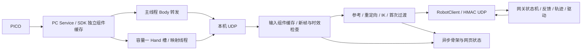

# 当前代码与遥操作计算逻辑

本文是当前源码实现说明。部署/依赖在 [本机 README](../README.md)，操作在 [03](03_OPERATION_RUNBOOK.md) 和 [05](05_WEB_CONSOLE.md)，性能测量在 [04](04_TROUBLESHOOTING.md#独立测试与耗时测量)。历史现场状态和耗时报告不作为此文的运行前提。

## 模块与数据流

| 文件或目录 | 当前职责 |
| --- | --- |
| `acquisition.py`、`pico_transport.py` | 唯一 SDK 所有者、通知驱动 Body 与独立 Hand 转发、有界后台处理。 |
| `pico_hand.py` | 26 点有效性、掌面及十轴几何映射。 |
| `inputs.py` | UDP 批次合并、真实时间、组件去重、配对、必要快照。 |
| `pipeline.py` | 参考采集、输入捕获、骨段重定向、IK、映射和诊断快照。 |
| `mapping.py`、`orientation.py` | L10 单位映射、前臂/掌面坐标、绝对腕姿态与有界求解。 |
| `app.py` | 本机状态机、频率门禁、目标/保活/保持及发送后提交。 |
| `hand_handover.py`、`wrist_handover.py` | 手指固定首次到位目标、J6/J7 实测起点过渡。 |
| `diagnostics.py`、`visualization.py` | 有界异步文件/终端和骨架发布，保留故障及丢弃计数。 |
| `dashboard.py`、`web/` | 本机进程、SSH/tmux、页面所有权、模式和服务操作。 |
| `robot_link/esrobo_link/` | 合同、认证、会话、输入保持、网关与硬件后端。 |
| `teleoperation/src/esrobo_teleop/` | Body 重定向、IK、NERO 驱动、轨迹、规划和几何。 |
| `tests/` | 回归与独立测量；正式入口不导入测试模块。 |

机器人 CAN/ROS 执行在机器人主机，本机采集和 IK 在电脑。UDP 16000 传关节目标/反馈，SSH 用于管理和图像转发，不承载遥操作目标。

## 采集、接收与新帧门禁

SDK 组件提交语义见 [06](06_PICO_HAND_INPUT.md)。主采集线程等待最长 50 ms，优先 Body，默认上限 90 Hz；Hand 工作线程和录制/诊断不阻塞 Body。每组件保持真实本机单调接收时间，重读缓存和序列化不续期。

UDP 接收在锁外解析，最多处理有界批次，按 Body/左 Hand/右 Hand 分别选择最新有效帧。锁内只提交或复制必要快照；控制线程在锁外重定向和计算。无效、过期、倒退或重复数据不能替代有效帧，合并计数可见。

完整新目标要求所选模式的必要组件推进并满足时效；纯臂只 Body，带手需同侧 Body/Hand/掌面，纯手只同侧 Hand。带手配对间隔上限 40 ms，输入年龄上限 100 ms。接收合并、映射和解算后再次检查年龄；读取时刻不作为样本时间。

## 参考标定与模式状态机

正式计算先核验合同、版本、侧别和配置/URDF 指纹。`IDLE` 只回送机器人实测姿态。人工 `e` 后单臂自动准备锁定手部反馈，受检回零并确认七轴失能，然后进入 `CALIBRATING`；此准备流程与显式 `z` 手部优先归零不同。

参考采集以稳定的完整人体姿态为首次目标，记录肩肘腕、骨段及掌面；每次新准备清理旧参考、手腕缓存和 IK 种子。当前绝对骨段方向和肘角映射不减标定角度，标定用于首个锁定目标和坐标参考，不将现场人体姿态解释为零增量。

只在标定目标稳定、有效且完整时提交初始接近。`CHECKING_ENTRY/APPROACHING` 使用锁定目标和独立保活，暂缺 PICO 新帧不改写路径。到位进入 `WAITING_FOR_ACTIVE_TARGET`，保留 2 秒期限和完整新鲜输入核验，保活不能生成 ready 或延长期限。当前单臂接管协议为 6，保活协议为 1；旧协议不满足正式入口要求。

双臂后端没有互碰扫掠认证，拒绝自动准备和回零，不通过两次单臂调用伪装双臂检查。仅手不加载臂 IK，始终验证七轴失能。

## 映射与逆运动学

Body 肩→肘和肘→腕方向转换到机器人/腰部坐标，按机器人骨长生成肘/腕位置；使用绝对骨段方向与直接人体肘弯曲角，保留滤波、端点速度及可观测性条件。肘接近伸直时弯曲平面不可观测，沿用相应保持/渐变逻辑，不由噪声直接翻转冗余轴。

分区位置 IK 主要求 J1–J4，带手腕任务求 J5–J7。纯臂实时末端三轴保持反馈值。手腕取 Hand 掌面在 Body 前臂坐标中的绝对姿态；当前轴含义为 J5 翻掌、J6 侧摆、J7 弯腕，按合同关节范围有界求解。绝对映射不减参考腕角。

腕求解对可验证唯一分支先用欧拉种子及小牛顿修正，实际轴重构、关节边界和误差均通过才接受；否则使用热启动有界最小二乘，保留退化/奇异及不可达处理。SO(3) 残差用解析雅可比，同次求解复用残差/雅可比，不跨输入帧伪造新鲜度。

十轴手指弧度映射到 L10 0–255 端点，未启用物理轴保持反馈。左右共用四指屈曲 1.25、拇指屈曲 1.25、拇指侧摆 0.60 增益；开闭端点、独立反馈标定和右拇指屈曲软止点仍各自配置。主动十轴通过 URDF mimic 展开被动手指几何。

左右带手模式均支持确认的不可达位置保持；上一有效目标、连续恢复帧和输入时效继续有效。输入缺失、控制器故障和一般 IK 异常不能当作可达性保持自动清除。

## 标定后初始接近

所有实际进入标定后规划的臂模式均使用同一规则：首次目标只规划 J1–J5；J6/J7 锁定起点实测值，手指保持实测姿态。规划、路点和最终到位核验均保持该约束。碰撞 profile 为 `entry_arm`，覆盖机械臂及腕部，排除灵巧手掌体/手指；不再有固定手部包络或手指最终认证。

启动仍要求两个连续一致反馈样本。执行周期读取已验证 SDK 来源的非阻塞快照；重复帧不续期或推进轨迹，缺失/倒退/跳变仍检查，接近读取不触发实时轨迹重置。

规划期间建立完整关节区间盒证书，执行时核验实测、上一命令、候选及制动范围。仅完整请求被单个证书覆盖才通过，不能扩大或拼接证书；上下文变化、重规划、无效反馈和退出清理。规划证书容量和细分预算保持有界；配对证明仅在父盒覆盖条件下供子盒复用。

`EntryCadence` 为独立 50 Hz、20 ms 固定期限：等待可被取消唤醒，重复帧/保持/路点切换也经过调度；超期跳过错过时刻，不连续补发。未发候选不提交轨迹状态，下次使用新鲜反馈重算。轨迹仍使用真实反馈时间，保留年龄、最大间隔、速度、加速度、领先量和执行超时。

相邻反馈间隔与距上次已提交轨迹状态时间是不同指标，必要故障记录分别指出。命令发送平稳不能证明 MOVE_J 真机运动无抖动，需要独立实测关节速度。

## 首次 J6/J7 和手指接管

接近到位后 J6/J7 从新鲜实测值初始化，按已有关节速度、单步和反馈领先量接向实时目标；候选成功发送后才提交。首次接管等待可暂停并从新的实测位置续接，但不消费等待时间作为运动额度，也不延长原期限。已经完成跟随后输入中断恢复仍检查与上次有效目标连续性。

`HandHandover` 在第一次成功发送后锁定参考目标，首次阶段不会持续追逐变化的人手；输入时效、反馈、方向等待、领先量及 10 秒到位期限仍有效。过渡完成后使用实时手目标。发送失败或丢弃候选不锁定目标、不推进状态；hold 不重置固定目标和原期限。

机器人 `LinkerHandDriver` 对每条被接受的命令发布一次，移除第二层 20 ms 成功返回但不发送的门禁。软件移动预算使用真实调用间隔、最多一个标称周期，不累积停顿额度；只有发送成功更新已发布命令与序号。反馈单独记录实测 `position_unit`，不以命令冒充到位。

L10 ROS 初始化的十轴速度寄存器为 255，扭矩参数保持原值；启动不移动手。软件 400 单位/s、单步 18、反馈领先量和右拇指止点仍生效。寄存器最大值不等于已测得最大物理速度。

## 实时跟随、输入保持与停止

本机上限 50 Hz，完整目标两秒平均最低线为 35 Hz（40 Hz 配置减 5 Hz 容差），目标间隔上限 80 ms。网关独立校验 HMAC、序号、合同、会话 lease、反馈、限位和控制器状态。

ACTIVE 短暂缺完整输入发送无位置字段的 hold，机械臂按原轨迹刹车，手部用新鲜实测位置保持；最多 500 ms。自动恢复须连续 3 帧新鲜目标满足每臂轴 5°、手指 15 单位连续性。持续过期、跳变或反馈/控制器异常闭锁，需要显式恢复。首次 J6/J7 接管另有状态，不误用已经跟随后的恢复条件。

当前配置 `teleop_torso_collision_enabled=false` 关闭实时跟随软件躯干几何检查；控制器碰撞保护、力矩/状态、关节、轨迹和时效检查仍执行。受检回零及初始接近通过各自几何路径。默认躯干间隙为 20 mm，安装肩部例外间隙为 5 mm；不能把两者或不同阶段混用。

停止、电子急停、保持和失能分别处理；软件保持不是硬件重力支撑保证。异常以第一故障与新鲜反馈为依据，不能从软件模式推断机械臂已失能。

## 显式受检回零：手部优先

`HardwareBackend.return_zero(explicit_recovery=True)` 在单臂带手恢复先预约本次回零、停止手部软件跟随，并调用 `recover_disabled_controller` 验证新鲜七轴失能和控制器健康。只按既有孤立电子急停条件复位，不隐式失能承重机械臂、不启动七轴运动。

`_restore_hand_before_return` 以当前非零实测姿态为锚，检查完整手部自然张开扫掠及 ±0.2° 臂漂移盒。每次手指发送前验证失能、位置漂移、反馈年龄和手部区间；已到自然张开容差时无需重新运动。失败返回 `hand_open_before_arm`，不调用七轴 `safe_return`。

手部归零成功后执行原七轴路径规划/限速/反馈检查及回零到位、失能核验；收尾再次确认三份新鲜健康控制器反馈和手部仍在零位。最终手部检查失败为 `hand_open_verify`，不在末尾重新展开。分别记录 `arm_returned`、`hands_open`、`disabled`，完整成功才 IDLE。

提前退出释放本次未开始的预约，但保留取消，不释放其他请求或正在执行的回零。健康失能下手部拒绝保留 FAULT，不额外重锁电子急停；显式停止、故障和不确定状态保留停止处理。纯单臂走原七轴流程，自动使能准备仍固定手指，仅手恢复不发臂目标。

受检七轴回零同样读取已验证非阻塞反馈，启动/静止/最终仍需连续样本；几何认证缓存容量 32，覆盖规划至执行，完整单证书包含才复用，反馈/上下文失效清理。回零反馈时钟上限 120 ms，与实时跟随 100 ms 区分。

## 异步状态与测试边界

运行代码只保留真实输入/反馈时间、频率门禁、调度期限、超时、数据质量计数和必要事件。日志、终端和网页快照走有界后台队列，拥堵计数可见；控制线程不做文件写入或状态分位数汇总。

`tests/profile_runtime.py` 在独立进程临时包装 SDK 等待、构包、UDP、输入、IK、几何和发送函数，结束恢复；测试记录有界异步保存，统计仅用于测试。正式入口不导入它或保留默认关闭的性能采样。测量方式和实际 IK 验收要求见 [04](04_TROUBLESHOOTING.md#独立测试与耗时测量)。

离线测试覆盖输入去重/同步、慢映射、队列、过渡、限速/加速度/领先量、证书覆盖及取消；测试数据不等于当前硬件已就绪。源码提交、机器人同步、进程重新加载和现场动作验收是不同步骤，不能用某次历史部署说明代替当前反馈。
