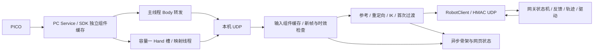

# 当前代码与遥操作计算逻辑

本文是当前源码实现说明。部署/依赖在 [本机 README](../README.md)，操作在 [03](03_OPERATION_RUNBOOK.md) 和 [05](05_WEB_CONSOLE.md)，性能测量在 [04](04_TROUBLESHOOTING.md#独立测试与耗时测量)。历史现场状态和耗时报告不作为此文的运行前提。

## 模块与数据流

### 输入恢复协议

`input_recovery.py` 管理源目标资格，机器人端原有轨迹负责真实命令限速。机械臂普通恢复为逐轴 5°、连续 3 帧；运行中的重新接管不再限制相对中断前固定基准的角度偏移，相邻资格帧仍逐轴检查 5°。中断前最后成功发送的源目标及逐轴偏移保留在诊断中，`arm_limit_deg=null` 表示没有固定基准门限。机械臂源目标必须为七个有限值。手部不设中断前差值或相邻帧差值门限，仍要求十通道有限值及 0～255 合法范围；连续 3 个独立新鲜有效帧后，以最新手部目标进入已有速度、单步和反馈领先量限制的衔接。带手恢复即使机械臂满足普通恢复范围，也保留手部衔接阶段，避免直接跳发远端目标。三个新帧必须经原始时间戳、100 ms 时效及反馈复检；失败发送不能提交接管计时或滤波状态。

首次接近使用 `entry_protocol=7`：同一次标定锁定完整七轴目标，先完成 J1–J5，再完成 J6/J7，两段到位后才进入 ACTIVE。腕部不再在 ACTIVE 中追逐实时目标进行首次接管，因此不再使用该旧路径的 10 秒超时；运行中的输入恢复仍执行现有连续性与时效检查。

运行中 `REACQUIRING` 使用最新合格目标，原有机械臂轨迹位置/速度状态不重置；手部使用跟随最新目标的有界 HandHandover。接管开始后，相邻连续性或 3 秒期限失败会请求锁存保持；资格收集阶段相邻帧突变会重新计数。重复输入空档保留原始期限，重新收集 3 帧。相对固定基准较远的目标也可取得恢复资格，但仍须通过原有碰撞、关节限位、力矩、速度、加速度和反馈领先量保护；较远目标可能因 3 秒内未到位而失败。机械臂目标/反馈都在 1.5°内、启用的手通道反馈在 2 单位内，连续 3 帧才完成。

协议通过 `recovery={phase, epoch}` 区分接管与完成。网关独立记录原始 3 秒期限，拒绝换 epoch 重置期限；完成消息可幂等重发，完成的 epoch 不可再次接管。`close` 表示客户端结束，`stop` 表示显式急停，两者分开；硬件端未验收时保持原故障停止行为。已验收端对输入超时/客户端结束进入 `HOLD_LATCHED`，硬件健康检查失败则升级原急停；本机不能通过新目标解除锁存。

配置验收开关默认 false，并参与配置指纹。旧本机不能连接已启用恢复能力的网关，新本机拒绝缺少协议 1 的网关。当前部署配置已启用通过保持验收的左臂，右臂仍未启用。健康锁存保持可通过 `hold_return_protocol=1` 显式请求连续使能回零，到位后才失能；旧网关或故障使能状态拒绝自动恢复，不由网页隐式失能。

网页“停止并保持”使用独立 `motion_hold → h` 路径，网关声明 `controlled_stop_protocol=1` 和当前模式的验收能力。正常 ACTIVE 下转入现有 `HOLD_LATCHED`，不清零运动速度、不调用 backend.stop/cancel/disable；原实时制动、反馈和力矩检查继续生效。网关确认后本机以 SIGTERM 结束目标流，客户端 close 不将保持升级为急停。重复保持请求幂等，新目标不能解除锁存；人工急停或保持时硬件故障仍走原停止处理。回零和启动阶段不接受这个保持请求。

逐轴 `motion_diagnostics` 记录命令、实测速度、目标到命令及命令到反馈误差，统计配置速度、加速度、领先量刹停、反馈运动刹停和末端速度限制。统计从轨迹初始化开始，比例可重叠；`limits` 同时记录当前速度（°/s）、加速度（°/s²）和领先量（°）。2026-10-15 候选配置统一将左右臂七轴速度设为 36°/s、领先量设为 10°；J1–J4 加速度为 80°/s²，J5–J7 为 100°/s²，控制器速度百分比为 30。最近一轮左臂 J1–J4 的加速度限制触发约 68%/50%/77%/61%，领先量刹停触发约 45%/23%/50%/33%，据此增加领先范围和加速度；离线模型的改善不代表实机验收通过。准备、接近、实时跟随及回零共用同一套关节和末端速度限制，删除原有 `return_speed_scale` 参数及缩放计算。10°是命令与实测位置的最大允许差，不是固定刹停距离；刹停计算、反馈、力矩与输入恢复检查继续执行。保持转回零沿用已提交速度减速，不重置运动状态。新参数需同步指纹并重新实机验收，旧配置的保持验收不能替代新参数验收。



| 文件或目录 | 当前职责 |
| --- | --- |
| `acquisition.py`、`pico_transport.py` | 唯一 SDK 所有者、通知驱动 Body 与独立 Hand 转发、有界后台处理。 |
| `pico_hand.py` | 26 点有效性、掌面及十轴几何映射。 |
| `inputs.py` | UDP 批次合并、真实时间、组件去重、配对、必要快照。 |
| `pipeline.py` | 参考采集、输入捕获、骨段重定向、IK、映射和诊断快照。 |
| `mapping.py`、`orientation.py` | L10 单位映射、前臂/掌面坐标、绝对腕姿态与有界求解。 |
| `app.py` | 本机状态机、频率门禁、目标/保活/保持及发送后提交。 |
| `hand_handover.py` | 手指固定首次到位目标；首次腕部运动由机器人两段接近执行，`wrist_handover.py` 仅保留旧协议兼容实现。 |
| `diagnostics.py`、`visualization.py` | 有界异步文件/终端和骨架发布，保留故障及丢弃计数。 |
| `dashboard.py`、`web/` | 本机进程、SSH/tmux、页面所有权、模式和服务操作。 |
| `robot_link/esrobo_link/` | 合同、认证、会话、输入保持、网关与硬件后端。 |
| `teleoperation/src/esrobo_teleop/` | Body 重定向、IK、NERO 驱动、轨迹、规划和几何。 |
| `tests/` | 回归与独立测量；正式入口不导入测试模块。 |

机器人 CAN/ROS 执行在机器人主机，本机采集和 IK 在电脑。UDP 16000 传关节目标/反馈，SSH 用于管理和图像转发，不承载遥操作目标。

## 采集、接收与新帧门禁

SDK 组件提交语义见 [06](06_PICO_HAND_INPUT.md)。主采集线程等待最长 50 ms，优先 Body，默认上限 90 Hz；Hand 工作线程和录制/诊断不阻塞 Body。每组件保持真实本机单调接收时间，重读缓存和序列化不续期。

UDP 接收在锁外解析，最多处理有界批次，按 Body/左 Hand/右 Hand 分别选择最新有效帧。锁内只提交或复制必要快照；控制线程在锁外重定向和计算。无效、过期、倒退或重复数据不能替代有效帧，合并计数可见。

突发批次先逐包验证、选择最新有效组件，再只对保留的 Body 做坐标转换；不会为随后丢弃的历史帧重复转换，也不补发积压目标。转换后、锁内提交前仍检查原采样年龄。上游超过 100 ms 的空档不能靠改写时间戳掩盖。

完整新目标要求所选模式的必要组件推进并满足时效；纯臂只 Body，带手需同侧 Body/Hand/掌面，纯手只同侧 Hand。带手配对间隔上限 40 ms，输入年龄上限 100 ms。接收合并、映射和解算后再次检查年龄；读取时刻不作为样本时间。

配对采用的掌面可能早于最新手指样本，该掌面的原始时间单独写入本轮输入票据，解算后仍检查它的年龄，不能用最新 Hand 时间替代。

## 参考标定与模式状态机

正式计算先核验合同、版本、侧别和配置/URDF 指纹。`IDLE` 只回送机器人实测姿态。人工 `e` 后单臂自动准备先在健康失能状态受检归零手部，再受检回零机械臂并确认七轴失能，然后进入 `CALIBRATING`；自动准备不复位控制器故障。

本机 `FreshBodyDevice` 以首组有效输入完成初始参考采集：取消准备倒计时、身体多帧均值/位置标准差、掌面 12 帧/0.6 秒/5°稳定门限，以及人手自然张开和手指稳定门限。纯臂只需有效 Body；带手还需同侧有效手部及掌面；纯手只需有效 Hand。保留 100 ms 时效、40 ms Body/Hand 配对和原始时间戳检查。所选侧全部验证通过后才一次性锁定参考，后续帧不改写首次目标。通用 `BodyDevice` 的旧采样配置不再用于本机初始标定。

参考采集以一组有效的完整人体姿态为首次目标，记录肩肘腕、骨段及掌面；每次新准备清理旧参考、手腕缓存和 IK 种子。当前绝对骨段方向和肘角映射不减标定角度，标定用于首个锁定目标和坐标参考，不将现场人体姿态解释为零增量。

只在锁定的标定目标有效且完整时提交初始接近，继续执行关节范围和路径检查。`CHECKING_ENTRY/APPROACHING` 使用锁定目标和独立保活，暂缺 PICO 新帧不改写路径。到位进入 `WAITING_FOR_ACTIVE_TARGET`，保留 2 秒期限和完整新鲜输入核验，保活不能生成 ready 或延长期限。当前单臂接管协议为 6，保活协议为 1；旧协议不满足正式入口要求。

双臂后端没有互碰扫掠认证，拒绝自动准备和回零，不通过两次单臂调用伪装双臂检查。仅手不加载臂 IK，始终验证七轴失能。

## 映射与逆运动学

Body 肩→肘和肘→腕方向转换到机器人/腰部坐标，按机器人骨长生成肘/腕位置；使用绝对骨段方向与直接人体肘弯曲角，保留滤波、端点速度及可观测性条件。肘接近伸直时弯曲平面不可观测，沿用相应保持/渐变逻辑，不由噪声直接翻转冗余轴。

分区位置 IK 主要求 J1–J4，带手腕任务求 J5–J7。纯臂实时末端三轴保持反馈值。手腕取 Hand 掌面在 Body 前臂坐标中的绝对姿态；当前轴含义为 J5 翻掌、J6 侧摆、J7 弯腕，按合同关节范围有界求解。绝对映射不减参考腕角。

J1 软件范围：左右臂统一为 −75°～+75°（URDF 坐标，2026-10-14 本地更新）；YAML 与默认配置一致，网关有效限位经合同传给 IK。硬限位、速度、加速度及碰撞检查不变；同步配置并重启网关、核验指纹后才生效，新增行程尚需现场验证。

腕求解对可验证唯一分支先用欧拉种子及小牛顿修正，实际轴重构、关节边界和误差均通过才接受；否则使用热启动有界最小二乘，保留退化/奇异及不可达处理。SO(3) 残差用解析雅可比，同次求解复用残差/雅可比，不跨输入帧伪造新鲜度。

左手原始 26 点在独立进程中进行 URDF 十轴有界拟合，以对捏向量为主；十个物理轴全部参与，拟合角度直接映射 L10 0–255，不再重复施加旧增益。右手保持四指／拇指屈曲 1.25、拇指侧摆 0.60 增益及原启用轴。反馈标定独立，mimic 联动保持不变。范围、计算预算和回放见 [左手十轴重定向](09_LEFT_HAND_RETARGET.md)。

左右带手模式均支持确认的不可达位置保持；上一有效目标、连续恢复帧和输入时效继续有效。输入缺失、控制器故障和一般 IK 异常不能当作可达性保持自动清除。

输入空档计时与最后可跟随源目标分开保存：完整新鲜帧通过检查并成功发送保持命令，也更新输入处理时间；不可达姿态不覆盖恢复用的源目标基准。偶尔一轮没有新帧时，按距最近完整输入的间隔判断是否进入输入等待，不能把持续的不可达保持时间算成断流。已有输入等待的 500 ms 期限和重新接管的 3 秒期限不因此刷新。IK 恢复可达只表示可以继续进行控制准入检查，不表示已实际恢复跟随。

## 标定后初始接近

所有实际进入标定后规划的臂模式使用两段固定目标接近：同一次标定锁定 J1–J7，第一段规划 J1–J5、保持 J6/J7 起点实测值；第一段确认到位和静止后，第二段保持 J1–J5 目标、规划 J6/J7 到标定值。手指始终保持实测姿态。两段完整路径及停车走廊均在使能前认证，执行时的前瞻不能越过两段之间的停止边界。碰撞 profile 为 `entry_arm`，覆盖机械臂及腕部，排除灵巧手掌体/手指。

启动仍要求两个连续一致反馈样本。执行周期读取已验证 SDK 来源的非阻塞快照；重复帧不续期或推进轨迹，缺失/倒退/跳变仍检查，接近读取不触发实时轨迹重置。

规划期间建立完整关节区间盒证书，执行时核验实测、上一命令、候选及制动范围。仅完整请求被单个证书覆盖才通过，不能扩大或拼接证书；上下文变化、重规划、无效反馈和退出清理。规划证书容量和细分预算保持有界；配对证明仅在父盒覆盖条件下供子盒复用。

`EntryCadence` 为独立 50 Hz、20 ms 固定期限：等待可被取消唤醒，重复帧/保持/路点切换也经过调度；超期跳过错过时刻，不连续补发。未发候选不提交轨迹状态，下次使用新鲜反馈重算。轨迹仍使用真实反馈时间，保留年龄、最大间隔、速度、加速度、领先量和执行超时。

相邻反馈间隔与距上次已提交轨迹状态时间是不同指标，必要故障记录分别指出。命令发送平稳不能证明 MOVE_J 真机运动无抖动，需要独立实测关节速度。

## 首次 J6/J7 和手指接管

两段接近都使用现有统一速度、加速度、领先量及反馈保护；第一段沿用 `full_arm_return_timeout_s=30` 秒、`full_arm_return_tolerance_deg=1.5`°；第二段沿用腕部 `wrist_return_timeout_s=10` 秒和 `wrist_return_tolerance_deg=1`°，从腕部段执行开始计时。两段均要求连续 3 次到位确认和 0.5°/s 静止判定。阶段切换保留已提交命令的位置和速度，只在确认静止后刷新时间基准；不把移动中的速度清零。第二段到位后等待新鲜完整 PICO 输入，才允许进入实时跟随。接近期间新 PICO 姿态不改写标定目标。

到位后的完整手部运动包络核验在 `APPROACHING` 阶段完成，核验后重取连续静止反馈并冻结证明，再发布 `WAITING_FOR_ACTIVE_TARGET`、启动 2 秒新鲜接管确认期限。此时仅打开手部软件指令通道，不发送手指目标。收到 ready 确认后只检查原目标、当前新鲜七轴反馈、使能/控制器/力矩及冻结证明的手部范围和上下文；不再重建网格、做距离计算或重置轨迹时钟。证明只能使用一次；反馈失效、姿态超出认证范围或手部包络变化仍拒绝。避免完整几何计算阻塞就绪阶段的反馈发布而触发 `robot feedback stale`，100 ms 反馈时效限制保持不变。

带手模式把同一快照的未滤波掌面和命令滤波掌面分别保留。`source_arm_urdf_rad` 的 J5–J7 来自未滤波掌面的有界腕部映射，仅用于本机恢复连续性比较；发送的位置仍来自滤波和关节限速后的 `arm_urdf_rad`。源目标映射不改变命令 IK 历史。左右臂使用同一逻辑，初始接近使用固定标定目标，已有跟随后采用上次成功发送时的源目标，不能每帧重置基准。纯臂无掌面映射，继续使用自身 IK 目标。

每次输入捕获只生成腕部滤波候选，成功发送后（预览为计算接受后）才提交。恢复的前两帧、过期输入、发送失败和位置保持均不推进腕部滤波。否则恒定人手也可能因滤波自身追赶而超过 5°，使三帧恢复反复清零。

三个匹配帧只代表候选具备恢复资格；成功发送前不清除原保持起点或期限。滤波后矩阵与源矩阵完全相同时复用该次腕部 IK，其他情况分别映射，不用近似相等条件代替源检查。

`HandHandover` 在第一次成功发送后锁定参考目标，首次阶段不会持续追逐变化的人手；输入时效、反馈、方向等待、领先量及 10 秒到位期限仍有效。过渡完成后使用实时手目标。发送失败或丢弃候选不锁定目标、不推进状态；hold 不重置固定目标和原期限。

机器人 `LinkerHandDriver` 对每条被接受的命令发布一次，移除第二层 20 ms 成功返回但不发送的门禁。软件移动预算使用真实调用间隔、最多一个标称周期，不累积停顿额度；只有发送成功更新已发布命令与序号。反馈单独记录实测 `position_unit`，不以命令冒充到位。

L10 ROS 初始化的十轴速度寄存器为 255，扭矩参数保持原值；启动不移动手。软件 400 单位/s、单步 18、反馈领先量和右拇指止点仍生效。寄存器最大值不等于已测得最大物理速度。

## 实时跟随、输入保持与停止

本机上限 50 Hz，完整目标两秒平均最低线为 35 Hz（40 Hz 配置减 5 Hz 容差），目标间隔上限 80 ms。网关独立校验 HMAC、序号、合同、会话 lease、反馈、限位和控制器状态。

ACTIVE 短暂缺完整输入发送无位置字段的 hold，机械臂按原轨迹刹车，手部用新鲜实测位置保持；最多 500 ms。自动恢复须连续 3 帧新鲜有效目标，机械臂按普通或有界接管范围检查；手指不设源目标差值门限，通过已有手部限速与反馈约束衔接最新目标。持续过期、跳变或反馈/控制器异常闭锁，需要显式恢复。首次腕部运动在 APPROACHING 内完成，不占用运行中恢复期限。

当前配置 `teleop_torso_collision_enabled=false` 关闭实时跟随软件躯干几何检查；控制器碰撞保护、力矩/状态、关节、轨迹和时效检查仍执行。受检回零及初始接近通过各自几何路径。默认躯干间隙统一为 **5 mm**，左右臂初始接近、机械臂回零和手部回零共用该值；安装肩部间隙保持 5 mm。模型与实机误差仍需独立校准。

所有启用的几何判定统一使用原始 STL 网格顶点的凸包，包括机械臂、手掌、手指和躯干；不再用机械臂包围盒或手指的 26 方向支撑平面近似代替网格凸包。手指运动范围仍使用连续圆弧外包凸包，覆盖中间姿态、反馈误差和到位容差；关节区间与反馈时效规则不变。静态原始网格间隙不等于整段回零已通过。诊断 `collision_geometry=original_mesh_convex_hull`，手指包络标识为 `original_mesh_convex_arc_hull`。修改源码和间隙后需同步机器人并核验配置指纹，运行中的旧网关不会自动加载。

停止、电子急停、保持和失能分别处理；软件保持不是硬件重力支撑保证。异常以第一故障与新鲜反馈为依据，不能从软件模式推断机械臂已失能。

## 显式受检回零：按保持或失能状态分流

`HardwareBackend.return_zero(explicit_recovery=True)` 在**已失能**单臂带手恢复先预约本次回零、停止手部软件跟随，并调用 `recover_disabled_controller` 验证新鲜七轴失能和控制器健康。只按既有孤立电子急停条件复位，不隐式失能承重机械臂、不启动七轴运动。

`_restore_hand_before_return` 以当前非零实测姿态为锚，检查完整手部自然张开扫掠及 ±0.2° 臂漂移盒。细分认证时，整个父区间已证明安全的碰撞对由两个子区间继承，仅继续计算未认证的碰撞对；证明只在同一次检查内复用，不跨手部包络或调用缓存，原计算预算不变。每次手指发送前验证对应的失能或健康全使能状态、位置漂移、反馈年龄和手部区间；保持使能时另检查控制器和力矩；已到自然张开容差时无需重新运动。失败返回 `hand_open_before_arm`，不开始机械臂回零规划或运动。保持分支通过 `safe_return` 的制动后回调执行手部阶段。

近零位回零例外：以所选侧七轴新鲜 URDF 实测角度判定，每轴距零位不超过 `full_arm_return_tolerance_deg`（当前 1.5°）时，不构建或检查手指扫掠包络；仍检查机械臂、腕部和手掌几何，保留手部反馈新鲜、自然张开到位、控制器、力矩、取消及相对锚点 0.2° 漂移保护。手部阶段若离开零位容差立即拒绝。先手后臂的顺序不变；手部核验完成后，机械臂经连续静止零位复核即可结束，已失能时不重新使能，保持使能时仅在到位与健康核验通过后失能。例外仅用于回零（含自动准备），退出后恢复完整手部几何；非零位回零、实时跟随和 ACTIVE 接管不采用该例外。

手部回零入口可只读等待最多 `controller_status_timeout_s`（300 ms）取得初始完整样本。随后手部扫掠（近零位则为臂/腕/掌检查）在 `spawn` 独立计算进程中认证；传入配置、原始网格凸包快照及哈希、固定臂漂移盒、手部包络和请求编号。子进程无 CAN/ROS 驱动。主进程每 20 ms 核验新鲜反馈、取消、使能、控制器、力矩和原锚点 0.2° 漂移；保持时沿用原已提交静止命令，不重置轨迹或隐式失能。子进程启动与计算共用 `return_plan_timeout_s`（5 秒），超时、取消或异常会回收子进程，不接受迟到结果。认证成功后、第一条手指命令前再次核验反馈和包络覆盖。监控中的真实反馈/控制器/力矩/漂移失败会阻止恢复保持；普通几何拒绝仍须独立确认健康静止才允许保持。

回零结果只携带有限反馈摘要，网关状态原因不拼接完整结果字典。完整回零诊断写入 `return_result` 事件。UDP 继续使用 8192 字节上限，按最终 JSON/HMAC 字节数检查；超限时精简可选诊断并保留原序号、租约、合同和安全反馈，设置 `diagnostics_truncated`。必要状态仍超限则故障处理并停止发送该包，但不关闭网关。编码异常写入 `network_state_error`，退出前排空日志；原通信故障和急停规则保留。

手部归零成功后，在七轴启动边界独立重读手部到位状态；失效返回 `hand_open_before_arm`，不依赖之前缓存的 `hands_open`。通过后执行原七轴路径规划/限速/反馈检查及回零到位、失能核验；收尾再次确认三份新鲜健康控制器反馈和手部仍在零位。最终手部检查失败为 `hand_open_verify`，不在末尾重新展开。分别记录 `arm_returned`、`hands_open`、`disabled`，完整成功才 IDLE。

提前退出释放本次未开始的预约，但保留取消，不释放其他请求或正在执行的回零。健康失能下手部拒绝保留 FAULT，不额外重锁电子急停；显式停止、故障和不确定状态保留停止处理。纯单臂走原七轴流程，自动使能准备同样先归零手部、再回臂，仅手恢复不发臂目标。

健康 `HOLD_LATCHED` 的 `r/z` 走 `from_hold=True` 分支，要求 `hold_return_protocol=1`、新鲜七轴全使能和正常控制器/驱动。此分支不调用前置失能或复位；`safe_return(recover=False, preserve_hold=True)` 从已提交位置/速度受控制动并确认静止，再通过 `before_arm_return` 回调在保持使能时受检归零手部；手部到位及臂静止再次核验通过后，才规划、执行七轴回零，到位后失能。手部阶段不会为张手撤去臂承重。

保持转回零时，先保留实时轨迹及其反馈时钟，沿用运行中的制动算法和实时安全检查，完成零命令速度及实测静止确认后才进入完整回零几何计算。禁止在此制动前清空轨迹或插入离线几何计算，否则计算空档可能触发严格反馈读数超时。手部归零和规划阶段保留最后已提交的静止位置命令；规划后仍需新鲜静止、漂移和全路径认证。规划拒绝仅在硬件健康、静止保持可验证时返回锁存保持；真正的反馈、控制器或力矩故障仍进入故障处理，不能保证承重。

规划或前置检查拒绝时，只有已提交速度为零、新鲜连续静止反馈、原命令领先量、关节范围、控制器和力矩检查均通过，才能用原提交位置恢复锁存保持。不得重置运动中速度或把命令跳到反馈；取消、硬件故障或保持证明失败仍进入故障处理。网页不再调用 `remote_disable` 后串接 `remote_recover`，服务端也校验此分流。

网关状态单独发布 `return_protocol=3`，用于核对运行中的手部优先回零实现；旧版 2 的保持回零仍是先臂后手，新网页拒绝其回零及自动准备入口。带手的 `recover_disabled_controller` 在反馈缺失时可有界请求 CAN push，随后仍要求原始新鲜反馈、七轴失能、当前姿态/几何和连续三帧健康状态；请求自身不复位、不使能、不发送关节目标。

受检七轴回零同样读取已验证非阻塞反馈，启动/静止/最终仍需连续样本。规划阶段完成包含手部的完整路径及制动走廊认证，然后冻结证明；执行阶段只检查新鲜反馈、手部范围和上下文是否仍被完整单证书覆盖，不重建网格、不运行距离计算。缓存容量 32，反馈/上下文失效拒绝执行。使能前预装位置在几何和模式配置之后重新取样，必须落在认证的静止区域内；进入执行前重新核验静止反馈，不能沿用规划前的采样时钟。回零轨迹时钟上限 120 ms，单次位置采样有效期仍为 100 ms。

同一次完整几何规划期间，手部包络保留此前已覆盖的角度范围：新鲜反馈的不确定范围缩小时复用较大包络，超出时扩大包络并使旧认证失效，重新计算完整证明。每次新规划、反馈提供者/模型变化及普通实时检查均不累积旧包络；冻结后仍只允许新反馈落在已认证范围内。这样避免手部静止时因反馈年龄波动而反复重建网格、清空路径缓存。单次规划几何认证允许最多 256 次细分，普通几何检查仍为 64 次；5 秒路径搜索预算、碰撞间隙及执行覆盖规则不变。

机器人网关建立规划证书时，手部角度不确定范围按整个反馈有效期计算：`标定误差 + 最大速度 ×（geometry_feedback_timeout_s + 有效运动前瞻）`，当前有效期为 100 ms。手部输出关闭时前瞻仍为零。冻结后的执行核验使用实际反馈年龄，原始时间戳过期仍拒绝；不会因规划时收到很新的包而留下只能覆盖数毫秒反馈年龄的证书。更大的规划包络必须通过完整几何认证，不能沿用较小包络的证明。

规划结束、回零使能之前，若七轴位置反馈已更新但控制器/驱动状态帧仍过期，只读等待至多 `controller_status_timeout_s`（当前 300 ms）让状态刷新；期间不发送配置、使能或位置命令。真实驱动故障立即拒绝，取消或持续缺失同样拒绝；此等待不适用于运动中的反馈保护。

显式恢复若已失能且处于既有零位容差，`verifying_disabled_zero` 分支核验连续新鲜静止零位样本及最终健康失能状态；不重新使能或发送位置。带手模式仍执行前后手部核验，完整成功后才清除故障并进入 IDLE。

启动准备、保持回零与显式故障恢复统一先归零手部，再使用完整手部几何执行机械臂回零和走廊认证。冻结认证的 `include_fingers` 从当前运动检查范围统一派生，不能另传一个不一致的标志，否则会在几何已经通过时误报 `entry certificate context changed during planning`。

接近到位后的跟随初始化不再重新进行几何核验：只有刚成功完成受检接近的到位结果可使用此分支，且只允许使用一次。沿用接近阶段的路径与到位验证，重新确认连续静止反馈、姿态漂移不超过 0.2°、关节范围、命令领先量、七轴使能、控制器和力矩状态后建立跟随轨迹；不构建手部包络、不计算距离，也不重新生成碰撞证书。CPV 配置前后同样使用这项非几何核验。取消、失败或普通启动不能进入该分支。

普通启动和接受首个 ACTIVE 目标仍保留各自几何核验：先认证实测姿态附近 ±0.2° 的有界区域（裁剪到关节范围，并覆盖待核验目标），再独立采集连续静止反馈，最后只做证书覆盖与手部上下文核验；轨迹时钟使用这批新反馈。ACTIVE 边界保留最后提交的静止命令位置，禁止清零运动中轨迹的速度。反馈缺失、漂移、取消、力矩/控制器异常或证书上下文改变均拒绝接管；不放宽实时运行的 100 ms 反馈期限和空档恢复规则。

## 异步状态与测试边界

运行代码只保留真实输入/反馈时间、频率门禁、调度期限、超时、数据质量计数和必要事件。日志、终端和网页快照走有界后台队列，拥堵计数可见；控制线程不做文件写入或状态分位数汇总。

`tests/profile_runtime.py` 在独立进程临时包装 SDK 等待、构包、UDP、输入、IK、几何和发送函数，结束恢复；测试记录有界异步保存，统计仅用于测试。正式入口不导入它或保留默认关闭的性能采样。测量方式和实际 IK 验收要求见 [04](04_TROUBLESHOOTING.md#独立测试与耗时测量)。

离线测试覆盖输入去重/同步、慢映射、队列、过渡、限速/加速度/领先量、证书覆盖及取消；测试数据不等于当前硬件已就绪。源码提交、机器人同步、进程重新加载和现场动作验收是不同步骤，不能用某次历史部署说明代替当前反馈。

## 七轴力矩记录

力矩保护的原有读取结果同时交给被动记录器；记录器不增加 SDK/CAN 读取，不改变门限判定、连续 5 次超限规则、反馈超时或控制器碰撞等级。当前左臂偏差门限为 `[30,25,20,20,6,6,5] Nm`，右臂为 `[21,21,12,12,6,6,5] Nm`。2026-10-15 按操作员指定将左臂 J1/J3/J4 分别调整为 30/20/20 Nm；这是指定配置值，不代表已经完成新增范围的实机验收。偏差是实测力矩相对本次静止基准的绝对差，不是电机允许输出的最大力矩。

每个硬件网关会话在同目录生成 `torque_<会话时间戳>.jsonl`。按实际保护读取记录，不固定补齐采样率；包括七轴力矩、基准及编号、偏差、门限、连续超限次数、各轴原始反馈时间戳和数据年龄。关联的命令、反馈位置与速度来自缓存并带时间戳，可能不是同一时刻；没有数据时记 `null`，不以零值代替。阶段包括基准采集、`approaching_arm`、`approaching_wrist`、ACTIVE、保持及回零。记录器仅按带时间戳的位置差分估计实测速度，重复反馈或超过 100 ms 的差分间隔不提供速度估计。

异步写入队列容量 2048；队列满或磁盘错误不会阻塞运动控制，但会产生数据缺口。网关可选 `feedback.torque_diagnostics` 提供最近记录及丢弃/错误状态，不能把已过期的最近记录当作实时力矩。首次力矩故障冻结触发记录及最近 32 个有效样本，存入网关首次故障的 `diagnostics.torque`；后续恢复与重新采集基准不会覆盖这份证据。力矩日志沿用现有日志保留策略。

本地分析命令（测试工具与报告不上传仓库）：

```bash
PYTHONPATH=teleoperation/src:laptop_teleop/src:robot_link \
  python laptop_teleop/tests/summarize_torque.py /path/to/torque_<timestamp>.jsonl
```

工具按会话、侧别、运动阶段和基准编号分别统计逐轴偏差峰值、P95/P99、门限占用率、连续超限及持续时间，列出峰值关联姿态与命令误差。缺失、重复、超过 300 ms 或未来时间戳样本不参与统计；不插值，不自动产生或加载更高门限。持续时间只表示首尾已观察超限样本间隔。旧日志只有故障值，不能还原缺失的连续曲线；本次左 J4 的 13.27 Nm 构造回放只用于验证记录和保护逻辑。
