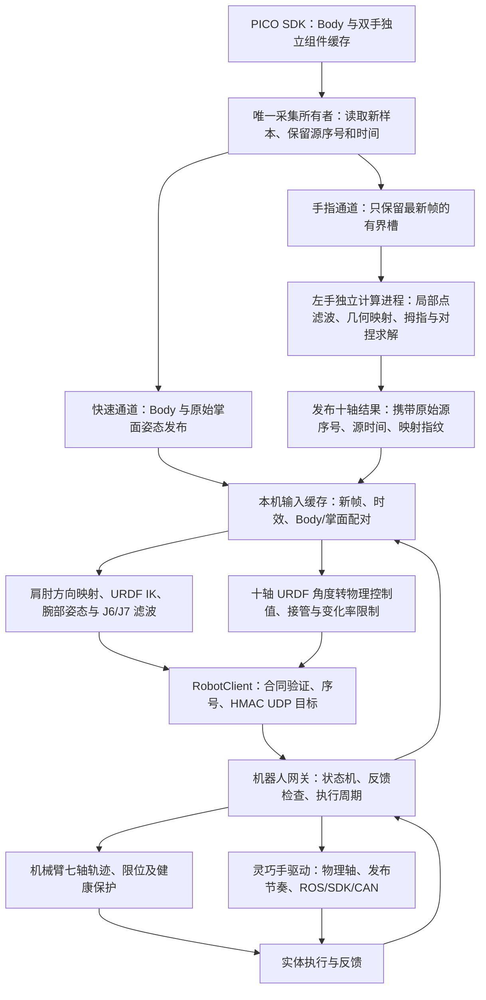

# 遥操作与灵巧手重定向技术方案

本文记录 `laptop_teleop` 当前运行链路、左手 L20Lite 十自由度重定向，以及 **2026-10-20 10:14—10:18** 正式遥操作的单指运动问题分析。后续维护此长期主题文件，不按每次试验另建技术方案。日常参数与接口以 [07 代码与计算](07_CODE_AND_COMPUTATION.md) 为准，操作见 [03 运行手册](03_OPERATION_RUNBOOK.md)。

本次范围是源码核对、记录分析、离线对照和文档整理，**没有修改运行算法、控制参数或操作实体机器人**。核对版本为当前本地工作区（基于 `1d70e2a`，含尚未提交的后续修改），不能仅用 Git HEAD 代表全部运行源码。左手映射为 `left-urdf-10-v5`；记录与当前手模型／策略指纹均为 `102b52a9e686ceccfbca86a72d4b0404855d66a17874a3b78959a53dbefca28b`。

## 1. 本次结论与证据范围

用户明确描述的是：**人手只有拇指在动，机器人四指中的某一根却大幅运动，甚至试图与拇指对捏**，不是四指一起大幅运动。

本次定位到两个可以叠加的来源：

1. **输入已发生大幅单指姿态变化。** 两个代表事件中，对捏协调尚未激活，PICO 原始节点计算出的食指／无名指屈曲目标就在约 80 ms 内增加 43°—47°。SDK 仍标记有效，现有滤波把它视为快速动作，直接映射因此快速改变目标。
2. **对捏协调会主动改变另一根手指。** 拇指与某个指尖距离足够近时，算法允许该指屈伸相对直接几何结果修正 ±15°、已有侧摆轴修正 ±5°；没有“该指本人是否主动运动”的资格条件。固定四指全部输入、只重放拇指变化的离线对照仍产生了约 8.48° 的食指屈伸变化和 9.95° 的无名指屈伸变化。

此外，机器人反馈对快速目标存在明显滞后，可能使操作者看到“人手已停，机械手还在动”。这与重定向计算耗时、坐标映射误差是不同问题。

记录没有同步视频或人工逐帧动作标签。用户确认了整次测试及现象，但没有指定哪一秒只动拇指。因此，下面的真实事件证明“输入变化”和“协调修正”确实存在，不能把选出的每一帧都认定为真实人手静止。离线固定输入实验则直接验证了协调机制的因果作用。

### 数据选择与关联

| 项目 | 本次范围 |
|---|---|
| 正式 ACTIVE 时间 | 10:14:24.346—10:18:33.486，约 249.14 s，Asia/Shanghai |
| 原始重定向候选 | ACTIVE 时间内 12,126 条左手成功结果；候选不等于已发送 |
| 本文主要统计 | 排除首次手部接管和输入恢复发送，11,942 次本机目标发送，对应 11,169 个不同手部源序号 |
| 关联检查 | 上述发送全部找到原始重定向结果，全部找到成功 `hand_forward` 发布记录 |
| 排除数据 | 10:37 之后仅 PICO 采集的记录，不当作本次实机执行数据 |
| 时间规则 | 本机样本接收时间与本机发送时间可相减；不直接相减两台机器的单调时钟 |
| 反馈规则 | 使用发送时取得的网关反馈快照；它是已观测反馈，不能宣称本条新目标已被执行或已到位 |

主要输入文件位于 `laptop_teleop/log/`：

- `session_1792462442827378815.jsonl`：模式和会话摘要。
- `hand_raw_1792462340258715793.jsonl`：26 点、源序号、求解候选与中间诊断。
- `pico_motion_1792462339845796901.jsonl`：实际发布事件，区分候选与成功发布。
- `hand_execution_1792462442827221154.jsonl`：本机最终发送目标及反馈快照。
- `motion_1792462442827378815.jsonl`：整条运动诊断记录；本次单指归因主要使用前四项。

完整数字见 [统计报告](../log/retained/hand_scheme_review_20261020/report.json)、[离线对照](../log/retained/hand_scheme_review_20261020/details.json)、[原始输入突变事件](../log/retained/hand_scheme_review_20261020/input_events.json)。分析产物留在带 `.keep` 的保留目录，不进入控制消息或网页高频状态。

## 2. 系统组成与一帧数据的路径



采集、计算和硬件执行分别负责不同任务：SDK 由原采集线程独占；左手求解子进程不访问 CAN、ROS 或机器人驱动；本机主要计算目标；机器人端依据实际反馈生成并发送受约束命令。

**身体／掌面与手指已经分开发送。** 身体和掌面不必等待每一次手指求解完成。混合臂手模式由新 Body／腕部输入推进，在手指原始源时间仍有效时，可以复用最近一次手指结果；复用不能改写时间戳。纯手模式仍要求新手部结果。

Body／掌面配对上限为 40 ms，输入年龄上限为 100 ms。掌面与手指可能来自不同源序号，日志分别保存。配对失败属于等待、保持和恢复流程的输入问题，不能混同为手指运动学误差。

## 3. PICO 节点、坐标和形状预处理

### 3.1 节点对应关系

每只手输入 26 个姿态点，每点为位置与四元数，另带有效标志。当前左手指形求解主要使用位置；掌面也由位置构造，不把单个节点的欧拉角直接赋给某个电机。

| 手部 | 节点链 | 几何含义 |
|---|---|---|
| 掌、腕 | 0、1 | 掌部点、腕点 |
| 拇指 | 2 → 3 → 4 → 5 | CMC、MCP、IP、指尖 |
| 食指 | 6；7 → 8 → 9 → 10 | 掌骨点；MCP、PIP、DIP、指尖 |
| 中指 | 11；12 → 13 → 14 → 15 | 同上 |
| 无名指 | 16；17 → 18 → 19 → 20 | 同上 |
| 小指 | 21；22 → 23 → 24 → 25 | 同上 |

对应源码：[pico_hand.py](../src/esrobo_laptop/pico_hand.py)、[hand_retarget.py](../src/esrobo_laptop/hand_retarget.py)。

拇指 PICO 2/3/4/5 在模型比较中对应拇指 pitch 关节起点、MCP 起点、IP 起点和末节网格指尖。由于两者掌根结构与骨长不同，这是一种运动学对应，不是要求这些点在统一缩放后处处重合。模型里的可动起点由当前关节角 FK 计算，没有固定在自然张开的位置。

### 3.2 掌部局部坐标

设位置为 `p[i]`：

```text
forward = normalize(p[12] - p[1])
lateral = normalize(p[7] - p[22])
normal = normalize(cross(lateral, forward))
B_human = [normal, cross(forward, normal), forward]
origin_human = mean(p[7], p[12], p[17], p[22])
width_human = norm(p[7] - p[22])
```

转入机器人掌部模型坐标：

```text
p_model_target = (p - origin_human) @ B_human @ B_model.T
                 * (width_model / width_human) + origin_model
```

它消除整手平移和旋转，并按掌宽统一尺寸。`B_model` 来自 URDF 自然张开参考姿态。

掌面基准**没有使用拇指节点**：只改变拇指节点，不会直接旋转掌部坐标系。但是，若 SDK 同时改变了食指／中指／小指根部或腕点，掌面和掌宽也会变化，可能影响多根手指的局部方向。局部坐标只能去除刚体运动，不能消除识别器内部的手形重建变化。

### 3.3 点空间滤波与连续死区

左手当前在掌部局部、尺寸映射之后，对 26 点滤波。每根手指四节点采用相同的自适应截止频率，以该链最快点的变化为依据：

```text
speed = norm(input - previous_smoothed) / dt
fc = clip(2 + 30 * speed, 2, 10)       # Hz，speed 单位 m/s
alpha = 1 - exp(-2*pi*fc*dt)
smoothed = previous_smoothed + alpha*(input - previous_smoothed)
gap = smoothed - previous_output
output = previous_output + gap*max(1 - 0.0005/norm(gap), 0)
```

零距离单独处理，避免除零。死区为 0.5 mm；`dt` 来自原始源时间。低通内部状态继续更新，小动作可以累计越过死区，不做自动静止锁定。重复或倒退时间不推进；超过 100 ms 的空档只重建时钟，不累积追赶量。

这是一种减小小幅噪声、兼顾快速动作的滤波器，**不是手势识别纠错器**。若 SDK 把不动的手指重建成明显弯曲，较大的点速度反而会让 `fc` 升到 10 Hz，快速跟随错误手形。本次事件中确实记录到这一行为，见第 8 节。

## 4. 机器人手的自由度、联动和控制映射

当前手按十主动轴控制，URDF 通过十个 mimic 关节展开被动联动。十主动轴并不意味着人手所有关节都能独立复现。

| 求解索引 | 主动轴 | 物理控制索引 | 当前求解范围 |
|---:|---|---:|---:|
| 0 | 拇指旋转 `thumb_cmc_roll` | 9 | 0—59.015° |
| 1 | 拇指侧摆 `thumb_cmc_yaw` | 1 | 0—69.000° |
| 2 | 拇指屈伸 `thumb_cmc_pitch` | 0 | 0—25.436° |
| 3 | 食指侧摆 | 6 | 0—10.700° |
| 4 | 食指屈伸 | 2 | 0—77.225° |
| 5 | 中指屈伸 | 3 | 0—77.225° |
| 6 | 无名指侧摆 | 7 | 0—11.459° |
| 7 | 无名指屈伸 | 4 | 0—77.225° |
| 8 | 小指侧摆 | 8 | 0—17.189° |
| 9 | 小指屈伸 | 5 | 0—77.225° |

这些是手册范围、[当前 URDF](../../teleoperation/urdf/esrobo_waist_with_head.urdf)、控制配置和被动联动限位的交集，不是本次新做的实机标定。中指没有独立侧摆轴；其余三路侧摆是各自 URDF 正方向的有界行程，不能假定都是对称 ± 范围。

四指每根只有一个屈伸主动量 `q`：

```text
MCP = q
PIP = 1.30*q
DIP = 0.46*q
```

拇指 MCP 与 IP 分别随主动屈伸的 1.38 和 1.49 倍联动。关节轴、安装旋转、原点和联动均参与 FK／雅可比；被动关节限位反向约束主动关节。

指尖标记由末节 STL 的最远端薄层几何构造，而不是电机轴位置。这个模型标记与真实指腹接触点仍可能不同，模型 2 mm 间距不能等同于真实抓持接触或抓持力。

求解角度经过 [hand_control_mapping.py](../../teleoperation/src/esrobo_teleop/robot/hand_control_mapping.py) 线性转换为 0—255 控制值，裁剪到允许角度后量化，保证量化值仍在允许区间。物理顺序为：

```text
拇指屈伸、拇指侧摆、食指屈伸、中指屈伸、无名指屈伸、小指屈伸、
食指侧摆、无名指侧摆、小指侧摆、拇指旋转
```

左手不再叠加旧映射的屈伸 1.25、拇指侧摆 0.60 增益或侧摆绝对值。左拇指旋转已按现场观察单独反向，目前 `q=0 → raw=255`、`q=1.03 rad → raw=0`。其他两个拇指轴没有随之反向。自然张开旋转控制值仍为 **111**，在当前反向映射下约为 **33.3°**；旧文档中反向前的 25.7° 不适用于当前映射。

控制映射和反馈几何标定分别维护。不能用希望达到的命令反推出实测关节姿态；模型图也不能代替外部实测几何。

## 5. 四指直接几何映射

### 5.1 侧摆

对每根手指取 MCP→PIP、PIP→DIP、DIP→指尖三段向量，变换到该指 URDF 根部坐标。对于有侧摆轴的手指：

```text
side = atan2(-axis_sign * bone0.y, bone0.z)
       - atan2(-axis_sign * neutral_bone0.y, neutral_bone0.z)
side = clip(side, lower, upper)
```

保留符号，然后消除已求出的侧摆旋转，再计算屈伸。中指跳过侧摆求解。

### 5.2 三段姿态合成为一个屈伸角

在消除侧摆后的屈伸平面，以 `atan2(bone.x, bone.z)` 求每段相对模型零位的角度，得到 `theta[0:3]`。处理骨段方向跨界后：

```text
c = [1, 1 + 1.30, 1 + 1.30 + 0.46] = [1, 2.30, 2.76]
q_direct = clip(dot(c, theta) / dot(c, c), lower, upper)
```

这是在固定联动下拟合三段**绝对方向**，不是直接把人体 MCP 角度作为电机角度。

在理想共面、没有侧摆误差、没有限位裁剪且以模型零位为参考的情形，人体相对屈曲角为 `a=MCP`、`b=PIP`、`c=DIP` 时：

```text
q_direct ≈ 0.43573*a + 0.36383*b + 0.19845*c
```

因此，人体仅 MCP 弯曲 30°，输出约 13.07°；仅 PIP 弯曲 30°，输出约 10.91°；仅 DIP 弯曲 30°，输出约 5.95°。机器人随后按自身比例同时弯曲三个关节。它无法复现人体“只弯某个指节，其他指节不动”的姿态，单指动作不够相似可能来自这种结构与拟合取舍，而非串轴。

非对捏状态下，四指输出就是这些直接几何结果，不做普通四指迭代优化。代码中不存在“拇指角度直接复制给食指”的逐轴映射关系。

## 6. 拇指三轴与对捏协调

### 6.1 拇指姿态目标

拇指的旋转、侧摆和屈伸共同影响其骨段方向及指尖位置，不能按人体三个欧拉角分别赋值。当前联合求解三轴，用候选角度的真实 FK 计算：

- 三段单位方向，与人手三段方向比较；近端方向权重较大。
- 近端与末段形成的弯曲平面；接近伸直时降低其可靠性，避免退化叉积产生突变。
- 拇指至其他四个指尖的相对向量。
- 与上一有效解的变化，以及参与对捏的四指对直接几何基准的偏离。

方向权重在自然展开时为 `(4,1,1)`，接近对捏时趋向 `(5.3,3,3)`；平面权重 0.02，时间正则 0.001，四指修正正则 0.01，方向残差使用稳健损失。不同项按代码中的方向归一化和掌宽缩放构造，这些数字不能作为具有相同物理单位的误差直接比较。

接触阈值之外还有柔和的指尖向量引导：用滤波后的模型空间间距 `distance` 和模型掌宽 `width` 计算 `x=clip((1.1-distance/width)/0.6,0,1)`，再取 `g=x*x*(3-2*x)`，并与投影比例取较大值。它使较小开口时的拇指解更关注指尖关系。**只有接触或退出过渡才把对应四指轴加入求解**，不能把这项软引导误读为所有距离下都允许四指联动。

### 6.2 接触状态并非实际接触检测

每组拇指—另一指，用**未缩放、未经过形状滤波的原始人手指尖距离**独立判定：

| 条件 | 行为 |
|---|---|
| 距离 <8 mm | 进入该组接触状态 |
| 距离 >12 mm | 退出 |
| 8—12 mm | 保留上次状态 |
| 状态转换 | 源时间驱动 80 ms 投影过渡；超过 100 ms 空档不积累过渡量 |

代码没有要求另一指主动弯曲、没有要求两指都在接近，也没有真实触觉／力传感验证。SDK 的指尖距离满足条件，就会进入软件对捏状态。

设尺寸映射后的指尖相对向量为 `v`，原始方向的 2 mm 投影为 `v_projected`，过渡比例为 `lambda`：

```text
v_target = (1-lambda)*v + lambda*v_projected
```

完全投影时目标向量长度为 2 mm；另有 2 mm 的向量误差容差。两者是不同量，不能要求每一帧机器人模型实际间距恰好为 2 mm。

### 6.3 为什么拇指能带动另一根手指

一旦某组接触激活，求解变量就从拇指三轴扩展到对应手指：

- 食指、无名指、小指：加入屈伸及侧摆。
- 中指：仅加入屈伸。
- 屈伸允许偏离当前直接基准 ±15°，侧摆允许 ±5°，再与合法关节范围求交。
- 退出接触后的过渡期间仍可有修正，范围随剩余投影比例缩小。
- 未参与协调的其他手指保持直接几何结果。

优化优先满足接触误差容差，再改善拇指姿态，最后比较连续性与四指修正量。**“尽量不改变另一指”是较低优先级的代价，不是禁止条件。** 所以即便另一指输入完全不变，也可以为了对捏而移动它。

程序支持多个接触组共同求解，但本次已发送源样本中，没有两组 `contact_active` 同时为真；不能用多指同时接触解释这次的单根手指被带动。

### 6.4 求解实现与状态提交

当前使用项目自有 C++17 内核，保留 Python 参考实现；不依赖在线 Torch／Pinocchio／NLopt。固定变换、索引和 7×7×5 的拇指方向种子表在初始化缓存。每帧比较上一有效解、自然张开基准与方向表选出的初值，做有界阻尼最小二乘更新，最多 6 次更新、每次最多 2 次步长尝试，只计算拇指和参与协调的手指。

计算进程每帧预算 20 ms，父侧等待及回包校验还有 30 ms 上限；不积压第二个计算请求，迟到结果丢弃。最高提交频率 50 Hz。20 ms 计算期限和 100 ms 源输入有效期必须同时满足，不通过改写旧时间绕过。

热启动角度、点滤波、接触滞回、投影比例都是候选状态；手部结果实际发布成功后才确认提交。注意它与本机控制目标的发送提交是**两个层次**：手形求解状态以手部组件发布确认，本机 IK／腕部滤波／接管候选以机器人目标发送成功确认。二者不能混称“实体执行成功”。

## 7. 臂手遥操作与执行限制

### 7.1 机械臂目标计算

Body 提供腰部及双侧肩、肘、腕数据。肩→肘、肘→腕方向变换到机器人参考坐标，按照机器人骨长构造目标；位置求解主要处理 J1—J4。带手模式使用掌面相对前臂的姿态求 J5—J7，当前含义为翻掌、侧摆、弯腕。它与十轴手指求解是两套运动学问题。

上臂、前臂方向采用 2—8 Hz 自适应低通和 0.25°／0.30° 连续角度死区；掌面旋转也有 2—8 Hz 滤波及 0.25° 死区。腕部映射后的 J6/J7 再分别采用 1—4 Hz、速度系数 0.2、1° 连续死区。该独立层只作用于实时跟随，不叠加到手指。

初始参考锁定七轴目标，先完成 J1—J5、再完成 J6/J7 的接近；到位后通过新鲜输入核验转入实时目标。输入恢复不再使用相对旧目标的 5° 资格门限，而按现有连续新鲜有效输入和反馈检查恢复；机器人轨迹状态不重置。

### 7.2 机械臂执行

机器人端维持已提交位置、速度与计时，按每周期反馈生成有界关节轨迹。当前配置七轴速度 36°/s，J1—J4 加速度 80°/s²、J5—J7 为 100°/s²；准备／接近／回零命令到反馈领先范围为 10°，完成接管后的跟随为 15°。力矩、反馈年龄、关节限位和各阶段现有几何保护继续独立起作用。

当前已经删除肘／腕笛卡尔 0.22 m/s 上限及其专用后备联合速度求解，不应再用旧限制描述本次运行。FK 仍用于 IK、几何核验和诊断。普通输入等待、受控保持与真实硬故障采用不同状态处理；保持不代表自动恢复跟随。

### 7.3 手指目标变化与实体响应

当前软件每轴控制值变化预算为：

```text
budget = min(18, floor(900 * min(actual_dt, 1/50)))
```

50 Hz 下单次最多 18 单位，间隔更短则预算更小，空档不累计追赶额度。**900 单位/s 和 18 单位是目标变化限制，不是实际电机角速度。** 左手 SDK 速度档位设为十轴 255；档位、命令限速、真实负载下的运动速度是三件事。既有设置与 CAN 应答核对见 [07](07_CODE_AND_COMPUTATION.md)，本次没有重新下发或实测最高速度。

普通 ACTIVE 及输入恢复已不限制手指命令与反馈的差值，`live_feedback_lead=null`。首次手部接管仍有 15 单位领先范围、2 单位到位容差和 10 秒期限。当前普通跟随可在反馈尚未追到时继续更新目标，因此大幅输入变化可形成明显执行滞后；最大档位并不能消除这个差值。

自然张开仍使用既定十轴目标，受检回零仍先手后臂。回零的反馈、到位和几何检查不是正常对捏求解的一部分。

## 8. 本次实际数据揭示的问题

### 8.1 较大动作首先出现在原始输入，而非协调求解

以下两个事件均已关联到实际发送的源序号：

| 指标 | 无名指事件 | 食指事件 |
|---|---:|---:|
| 时间 | 10:17:34.709→34.787 | 10:16:44.403→44.485 |
| 源序号 | 28238→28245 | 23713→23721 |
| 间隔 | 77.71 ms | 81.77 ms |
| 未滤波节点直接计算的屈伸角 | 5.48°→48.76° | 2.22°→49.25° |
| 滤波后直接目标＝最终模型目标 | 5.57°→46.09° | 1.82°→48.54° |
| 这两帧的接触状态 | 均未激活 | 均未激活 |
| 三段原始骨方向变化 | 49.43°／100.44°／116.54° | 57.23°／106.70°／126.32° |
| 原始拇指至该指距离 | 140.13→20.15 mm | 102.71→13.64 mm |

节点方向是在掌部局部坐标比较，已去除整手刚体运动。两事件全部 26 点 flags 均为 15，`valid=true`，样本本身新鲜；这不是用过期缓存替代新数据造成的现象。

两事件后帧，该指的点滤波截止频率均升到 10 Hz；无名指事件后帧还记录到最大点输出更新约 25.37 mm。因此 0.5 mm 连续死区不可能挡住这种手形变化，且自适应低通正按“快速动作”逻辑放行。

**可确定的是：较大的闭合目标已经由 PICO 节点给出，协调修正在这些帧为零。** 结合用户描述，识别器把静止手指重建成弯曲是需要优先验证和处理的原因；没有视频，不能进一步断言具体是遮挡、内部手势先验切换还是实际误动。SDK 的有效位不能作为姿态准确性的保证。


图中灰色虚线为原始节点变化前，蓝色为变化后，橙色为模型结果；粗线突出拇指和被分析的单根手指。采用统一掌部模型坐标、掌宽缩放，两个正交视图。模型根部结构不同，不能把蓝橙起点位置差直接当作求解器误差；这里主要观察骨段方向和输入手形变化。

### 8.2 随后对捏协调又改变了单根手指

| 指标 | 无名指片段 | 食指片段 |
|---|---:|---:|
| 时间 | 10:17:35.028—36.028 | 10:16:44.528—45.528 |
| 源序号范围 | 28267—28355 | 23726—23813 |
| 直接几何屈伸目标峰峰值 | 2.61° | 2.37° |
| 协调后屈伸目标峰峰值 | 9.37° | 8.31° |
| 协调修正范围 | −9.93°—0° | −8.42°—0° |
| 原始指尖距离范围 | 7.06—13.88 mm | 5.51—16.86 mm |

这些片段的直接基准变化较小，但接触进入／退出带来了更明显的目标变化。此处修正为负，意味着相对直接屈曲基准更张开，**不是所有协调都让手指继续闭合**；优化器可以通过侧摆、张开或弯曲共同实现指尖接近。“向拇指对捏”不能简单等同于屈伸角一直增加。

该秒之前的原始目标已有大幅闭合变化，执行端又有滞后，所以不能把用户看到的整个大幅动作全部归为这 8°—10° 的协调修正。


图中保留片段前后上下文：上方是直接／协调后模型角；中间是原始指尖距离与接触／投影状态；下方是本机最终发送控制值及当时反馈。蓝色“发送目标”是网络发送事件，不代表 CAN 恰在同一时刻执行。

整个普通跟随样本中：

| 手指 | 接触状态占比 | 观测到的接触进入次数 | 协调／退出过渡样本数 | 协调屈伸修正范围 |
|---|---:|---:|---:|---:|
| 食指 | 6.20% | 14 | 735 | −11.29°—+11.00° |
| 中指 | 1.75% | 9 | 223 | −12.65°—+7.17° |
| 无名指 | 1.77% | 6 | 216 | −10.38°—+7.05° |
| 小指 | 2.33% | 3 | 270 | −5.63°—+8.90° |

占比按不同已发送手部源样本统计，不是严格按时间积分；进入次数是该采样集合中观察到的次数。对每根手指，未参与协调或退出过渡时，最终屈伸与直接基准的最大差值均为 **0°**。

### 8.3 固定四指、仅改变拇指的离线因果对照

从上述两个片段取拇指节点历史，将其转换到固定掌部坐标；四指所有节点、掌与腕节点固定为片段首帧，保留原始人体尺寸。先用固定姿态预热滤波，再只改变拇指 2—5 点。分别运行当前算法与仅在分析进程中屏蔽接触协调的对照。

| 输入四指完全不变 | 当前算法四指输出变化 | 离线关闭协调后 |
|---|---:|---:|
| 无名指片段构造 | 无名指屈伸 9.95°，其他四指轴为 0° | 全部为 0° |
| 食指片段构造 | 食指屈伸 8.48°、侧摆 3.85°，其余为 0° | 全部为 0° |

两组实验直接四指基准的七轴峰峰值均为零，固定输入差值严格为零。这说明**仅靠当前对捏机制，就足以生成另一根手指的主动运动**，不需要假设串轴、CAN 错位或四指原始输入变化。

这是一项刻意构造的因果实验，不是原会话完整重放，也不是关闭协调的效果验收。它在片段前预热固定输入，不复用原会话滤波历史；只用来分离机制，不拿它评估真实对捏成功率或部署新参数。

### 8.4 单指姿态相似度还有结构性损失

比较每个已发送源样本的滤波后人体骨段方向，与直接几何目标的 URDF FK 方向，三段方向误差 P95 为：

| 手指 | 近段／中段／末段方向误差 P95 |
|---|---|
| 食指 | 17.50°／8.52°／10.11° |
| 中指 | 16.67°／14.32°／15.00° |
| 无名指 | 10.89°／12.11°／13.99° |
| 小指 | 27.34°／26.26°／26.29° |

这是**输入识别形状到模型形状**的误差，不是相对真实人手的测量误差，更不是实际机械手反馈误差。食指加入协调后近段方向误差 P95 从 17.50° 到 22.23°，说明当前策略会为对捏让出部分单指姿态相似度。

食指／无名指／小指侧摆约 51.7%／59.0%／62.7% 样本在某一边界附近（1e−3 rad 内）。其中包括自然张开合法零边界，不能全部称为错误饱和；但单边有限行程、中指无侧摆、固定 PIP/DIP 比例，确实限制了人体动作复现。不能靠更高速度档位解决这种运动学差异。

### 8.5 执行滞后与计算耗时应分开

本次普通跟随实际使用的手部求解结果耗时：中位 1.32 ms，P95 3.41 ms，P99 4.26 ms，最大 8.29 ms。原始手部接收至本机发送的延迟：中位 30.69 ms，P95 48.38 ms，最大 82.76 ms。后一项包含排队、调度、组件复用、求解及本机发送，不是纯求解耗时，也不是采集到实体到位的总延迟。

网关反馈快照中的已发布命令与实测位置差，四指屈伸 P95 分别约 **84、83、104、84 控制单位**。它们是动态跟随差值，不能全部解读为静态误差、接触力或卡住。现有普通跟随不以此差值限制继续运动。

两个代表事件中，以同一控制值中间阈值比较本机目标曲线和缓存实测反馈曲线的穿越时刻，无名指相差约 648 ms，食指约 570 ms。这个描述性差值包含整条执行与反馈链，且依赖选定阈值，不是已标定的电机固有延迟；它足以说明“求解只需几毫秒”不意味着实体手马上到位。必须保留事件前的目标历史，才能解释为什么某一秒目标变化不大、反馈却仍大幅运动。

## 9. 后续修改应解决什么

本次只定位，不自动改变已经确认的对捏策略。根据证据，后续需要同时处理以下层次：

1. **输入形状可靠性。** 对每根手指保留独立骨段历史，识别“指形在极短时间内重构、但 SDK 仍报有效”的候选；结合骨长一致性、连续帧和可观测性作有界过渡。不能只降低最低截止频率，因为本次大变化已经把自适应频率推到最高。也不能单凭变化快就永久否决真实快速单指动作。
2. **对捏协助应显式受单指忠实度约束。** 先尝试固定其他指、仅求拇指；只有确实需要且该指有可信参与证据时，才允许有限协调。若要求“静止另一指绝不被带动”，它应是明确约束，而非当前较低权重的正则。这样会牺牲一部分结构上不可达对捏，需要分别报告间距和姿态，不能声称两者都完全保留。
3. **不能只依赖本身可能出错的指尖距离。** 当前原始节点既决定直接屈曲，又决定接触激活；一次手形误识别可能同时触发两条路径。仅增加连续帧确认，仍可能接受持续的错误手形。需要结合标记的单指试验、视频或更可靠的观测确认，评估误识别和动作意图门控的边界。
4. **分别验收单指与抓取。** 固定拇指逐指屈伸、固定四指仅动拇指、靠近但不对捏、主动对捏和接触退出都要覆盖。评价独立手指输出、骨段方向、真实／模型间隙和命令反馈差，不能只以指尖对上了判为成功。
5. **执行跟随单独量化。** 在不增加目标速度的前提下，按实际发布命令和反馈建立响应曲线；区分软件目标过快、SDK／驱动发布、反馈缓存与实体动作。不能把当前大跟随差一概归因于重定向计算。

若仅删除协调，固定四指的离线实验确实不再产生额外运动，但第 8.1 节中约 40°—47° 的直接目标变化仍会存在。因此它不足以独立解决用户报告的全部现象。

## 10. 核验、复现与源码入口

本次验证：

- 记录手模型指纹与当前代码／配置一致。
- 每隔 25 个匹配样本重新 FK，记录点与当前计算最大差约 `8.33e−17 m`。
- 同样抽样重算四指直接基准，与日志最大差约 `1.91e−14°`。
- 固定四指因果对照如第 8.3 节，运行于独立离线对象，无硬件访问。
- `test_hand_geometry.py`、`test_hand_shape_filter.py`、`test_hand_handover.py` 共 **152 项通过**，包含解析雅可比、联动、接触边界、过滤与候选提交等测试。这证明既有实现符合当前测试约定，不能代替真实单指忠实度验收。
- 本次只修改文档与保留目录分析脚本，未运行新的实机动作，也没有因此重启服务；未将这 152 项表述为完整项目回归。

| 环节 | 主要源码 |
|---|---|
| SDK 采集、独立掌面／手指发布 | [acquisition.py](../src/esrobo_laptop/acquisition.py)、[pico_transport.py](../src/esrobo_laptop/pico_transport.py) |
| 输入有效性、节点和掌面 | [pico_hand.py](../src/esrobo_laptop/pico_hand.py)、[inputs.py](../src/esrobo_laptop/inputs.py) |
| 模型、四指直接映射、拇指／接触策略 | [hand_retarget.py](../src/esrobo_laptop/hand_retarget.py) |
| 点滤波 | [hand_shape_filter.py](../src/esrobo_laptop/hand_shape_filter.py) |
| 计算内核与进程提交 | [_hand_native.cpp](../src/esrobo_laptop/_hand_native.cpp)、[hand_worker.py](../src/esrobo_laptop/hand_worker.py) |
| 臂腕计算、目标发送与控制状态 | [pipeline.py](../src/esrobo_laptop/pipeline.py)、[app.py](../src/esrobo_laptop/app.py) |
| 十轴控制映射与实体手驱动 | [hand_control_mapping.py](../../teleoperation/src/esrobo_teleop/robot/hand_control_mapping.py)、[linker_hand_driver.py](../../teleoperation/src/esrobo_teleop/robot/linker_hand_driver.py) |
| 网关与机械臂轨迹 | [gateway.py](../../robot_link/esrobo_link/gateway.py)、[command_trajectory.py](../../teleoperation/src/esrobo_teleop/robot/command_trajectory.py) |
| 运行配置 | [teleop_config.yaml](../../teleoperation/config/teleop_config.yaml) |

复现脚本、输入文件哈希、统计口径与环境见 [分析目录说明](../log/retained/hand_scheme_review_20261020/README.md)。保留目录不是运行依赖；原始日志需按现有保留规则另行保存，不能仅凭摘要重新生成全会话。
