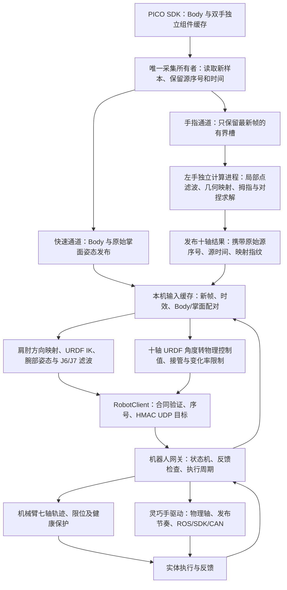

# 遥操作与灵巧手重定向技术方案

本文记录 `laptop_teleop` 当前运行链路、左手 L20Lite 十自由度重定向，以及 **2026-10-20 10:14—10:18** 正式遥操作的单指运动问题分析。后续维护此长期主题文件，不按每次试验另建技术方案。日常参数与接口以 [07 代码与计算](07_CODE_AND_COMPUTATION.md) 为准，操作见 [03 运行手册](03_OPERATION_RUNBOOK.md)。

本文第 1–10 节保存修改前的现场分析，所述 v5 协调行为属于历史基线，已随 `e6d03c5` 提交并推送。当前 v12 实现见文末“对齐最新仓库的四指映射与参数”及 [07 计算说明](07_CODE_AND_COMPUTATION.md#左手-l20lite-十轴重定向)。分析时左手映射为 `left-urdf-10-v5`，记录与当时手模型／策略指纹均为 `102b52a9e686ceccfbca86a72d4b0404855d66a17874a3b78959a53dbefca28b`。

## 1. 本次结论与证据范围

用户明确描述的是：**人手只有拇指在动，机器人四指中的某一根却大幅运动，甚至试图与拇指对捏**，不是四指一起大幅运动。

本次定位到两个可以叠加的来源：

1. **输入已发生大幅单指姿态变化。** 两个代表事件中，对捏协调尚未激活，PICO 原始节点计算出的食指／无名指屈曲目标就在约 80 ms 内增加 43°—47°。SDK 仍标记有效，现有滤波把它视为快速动作，直接映射因此快速改变目标。
2. **对捏协调会主动改变另一根手指。** 拇指与某个指尖距离足够近时，算法允许该指屈伸相对直接几何结果修正 ±15°、已有侧摆轴修正 ±5°；没有“该指本人是否主动运动”的资格条件。固定四指全部输入、只重放拇指变化的离线对照仍产生了约 8.48° 的食指屈伸变化和 9.95° 的无名指屈伸变化。

此外，机器人反馈对快速目标存在明显滞后，可能使操作者看到“人手已停，机械手还在动”。这与重定向计算耗时、坐标映射误差是不同问题。

记录没有同步视频或人工逐帧动作标签。用户确认了整次测试及现象，但没有指定哪一秒只动拇指。因此，下面的真实事件证明“输入变化”和“协调修正”确实存在，不能把选出的每一帧都认定为真实人手静止。离线固定输入实验则直接验证了协调机制的因果作用。

### 数据选择与关联

| 项目 | 本次范围 |
|---|---|
| 正式 ACTIVE 时间 | 10:14:24.346—10:18:33.486，约 249.14 s，Asia/Shanghai |
| 原始重定向候选 | ACTIVE 时间内 12,126 条左手成功结果；候选不等于已发送 |
| 本文主要统计 | 排除首次手部接管和输入恢复发送，11,942 次本机目标发送，对应 11,169 个不同手部源序号 |
| 关联检查 | 上述发送全部找到原始重定向结果，全部找到成功 `hand_forward` 发布记录 |
| 排除数据 | 10:37 之后仅 PICO 采集的记录，不当作本次实机执行数据 |
| 时间规则 | 本机样本接收时间与本机发送时间可相减；不直接相减两台机器的单调时钟 |
| 反馈规则 | 使用发送时取得的网关反馈快照；它是已观测反馈，不能宣称本条新目标已被执行或已到位 |

主要输入文件位于 `laptop_teleop/log/`：

- `session_1792462442827378815.jsonl`：模式和会话摘要。
- `hand_raw_1792462340258715793.jsonl`：26 点、源序号、求解候选与中间诊断。
- `pico_motion_1792462339845796901.jsonl`：实际发布事件，区分候选与成功发布。
- `hand_execution_1792462442827221154.jsonl`：本机最终发送目标及反馈快照。
- `motion_1792462442827378815.jsonl`：整条运动诊断记录；本次单指归因主要使用前四项。

完整数字见 [统计报告](../log/retained/hand_scheme_review_20261020/report.json)、[离线对照](../log/retained/hand_scheme_review_20261020/details.json)、[原始输入突变事件](../log/retained/hand_scheme_review_20261020/input_events.json)。分析产物留在带 `.keep` 的保留目录，不进入控制消息或网页高频状态。

## 2. 系统组成与一帧数据的路径



采集、计算和硬件执行分别负责不同任务：SDK 由原采集线程独占；左手求解子进程不访问 CAN、ROS 或机器人驱动；本机主要计算目标；机器人端依据实际反馈生成并发送受约束命令。

**身体／掌面与手指已经分开发送。** 身体和掌面不必等待每一次手指求解完成。混合臂手模式由新 Body／腕部输入推进，在手指原始源时间仍有效时，可以复用最近一次手指结果；复用不能改写时间戳。纯手模式仍要求新手部结果。

Body／掌面配对上限为 40 ms，输入年龄上限为 100 ms。掌面与手指可能来自不同源序号，日志分别保存。配对失败属于等待、保持和恢复流程的输入问题，不能混同为手指运动学误差。

## 3. PICO 节点、坐标和形状预处理

### 3.1 节点对应关系

每只手输入 26 个姿态点，每点为位置与四元数，另带有效标志。当前左手指形求解主要使用位置；掌面也由位置构造，不把单个节点的欧拉角直接赋给某个电机。

| 手部 | 节点链 | 几何含义 |
|---|---|---|
| 掌、腕 | 0、1 | 掌部点、腕点 |
| 拇指 | 2 → 3 → 4 → 5 | CMC、MCP、IP、指尖 |
| 食指 | 6；7 → 8 → 9 → 10 | 掌骨点；MCP、PIP、DIP、指尖 |
| 中指 | 11；12 → 13 → 14 → 15 | 同上 |
| 无名指 | 16；17 → 18 → 19 → 20 | 同上 |
| 小指 | 21；22 → 23 → 24 → 25 | 同上 |

对应源码：[pico_hand.py](../src/esrobo_laptop/pico_hand.py)、[hand_retarget.py](../src/esrobo_laptop/hand_retarget.py)。

拇指 PICO 2/3/4/5 在模型比较中对应拇指 pitch 关节起点、MCP 起点、IP 起点和末节网格指尖。由于两者掌根结构与骨长不同，这是一种运动学对应，不是要求这些点在统一缩放后处处重合。模型里的可动起点由当前关节角 FK 计算，没有固定在自然张开的位置。

### 3.2 掌部局部坐标

设位置为 `p[i]`：

```text
forward = normalize(p[12] - p[1])
lateral = normalize(p[7] - p[22])
normal = normalize(cross(lateral, forward))
B_human = [normal, cross(forward, normal), forward]
origin_human = mean(p[7], p[12], p[17], p[22])
width_human = norm(p[7] - p[22])
```

转入机器人掌部模型坐标：

```text
p_model_target = (p - origin_human) @ B_human @ B_model.T
                 * (width_model / width_human) + origin_model
```

它消除整手平移和旋转，并按掌宽统一尺寸。`B_model` 来自 URDF 自然张开参考姿态。

掌面基准**没有使用拇指节点**：只改变拇指节点，不会直接旋转掌部坐标系。但是，若 SDK 同时改变了食指／中指／小指根部或腕点，掌面和掌宽也会变化，可能影响多根手指的局部方向。局部坐标只能去除刚体运动，不能消除识别器内部的手形重建变化。

### 3.3 点空间滤波与连续死区

左手当前在掌部局部、尺寸映射之后，对 26 点滤波。每根手指四节点采用相同的自适应截止频率，以该链最快点的变化为依据：

```text
speed = norm(input - previous_smoothed) / dt
fc = clip(2 + 30 * speed, 2, 10)       # Hz，speed 单位 m/s
alpha = 1 - exp(-2*pi*fc*dt)
smoothed = previous_smoothed + alpha*(input - previous_smoothed)
gap = smoothed - previous_output
output = previous_output + gap*max(1 - 0.0005/norm(gap), 0)
```

零距离单独处理，避免除零。死区为 0.5 mm；`dt` 来自原始源时间。低通内部状态继续更新，小动作可以累计越过死区，不做自动静止锁定。重复或倒退时间不推进；超过 100 ms 的空档只重建时钟，不累积追赶量。

这是一种减小小幅噪声、兼顾快速动作的滤波器，**不是手势识别纠错器**。若 SDK 把不动的手指重建成明显弯曲，较大的点速度反而会让 `fc` 升到 10 Hz，快速跟随错误手形。本次事件中确实记录到这一行为，见第 8 节。

## 4. 机器人手的自由度、联动和控制映射

当前手按十主动轴控制，URDF 通过十个 mimic 关节展开被动联动。十主动轴并不意味着人手所有关节都能独立复现。

| 求解索引 | 主动轴 | 物理控制索引 | 当前求解范围 |
|---:|---|---:|---:|
| 0 | 拇指旋转 `thumb_cmc_roll` | 9 | 0—59.015° |
| 1 | 拇指侧摆 `thumb_cmc_yaw` | 1 | 0—69.000° |
| 2 | 拇指屈伸 `thumb_cmc_pitch` | 0 | 0—25.436° |
| 3 | 食指侧摆 | 6 | 0—10.700° |
| 4 | 食指屈伸 | 2 | 0—77.225° |
| 5 | 中指屈伸 | 3 | 0—77.225° |
| 6 | 无名指侧摆 | 7 | 0—11.459° |
| 7 | 无名指屈伸 | 4 | 0—77.225° |
| 8 | 小指侧摆 | 8 | 0—17.189° |
| 9 | 小指屈伸 | 5 | 0—77.225° |

这些是手册范围、[当前 URDF](../../teleoperation/urdf/esrobo_waist_with_head.urdf)、控制配置和被动联动限位的交集，不是本次新做的实机标定。中指没有独立侧摆轴；其余三路侧摆是各自 URDF 正方向的有界行程，不能假定都是对称 ± 范围。

四指每根只有一个屈伸主动量 `q`：

```text
MCP = q
PIP = 1.30*q
DIP = 0.46*q
```

拇指 MCP 与 IP 分别随主动屈伸的 1.38 和 1.49 倍联动。关节轴、安装旋转、原点和联动均参与 FK／雅可比；被动关节限位反向约束主动关节。

指尖标记由末节 STL 的最远端薄层几何构造，而不是电机轴位置。这个模型标记与真实指腹接触点仍可能不同，模型 2 mm 间距不能等同于真实抓持接触或抓持力。

求解角度经过 [hand_control_mapping.py](../../teleoperation/src/esrobo_teleop/robot/hand_control_mapping.py) 线性转换为 0—255 控制值，裁剪到允许角度后量化，保证量化值仍在允许区间。物理顺序为：

```text
拇指屈伸、拇指侧摆、食指屈伸、中指屈伸、无名指屈伸、小指屈伸、
食指侧摆、无名指侧摆、小指侧摆、拇指旋转
```

左手不再叠加旧映射的屈伸 1.25、拇指侧摆 0.60 增益或侧摆绝对值。左拇指旋转已按现场观察单独反向，目前 `q=0 → raw=255`、`q=1.03 rad → raw=0`。其他两个拇指轴没有随之反向。自然张开旋转控制值仍为 **111**，在当前反向映射下约为 **33.3°**；旧文档中反向前的 25.7° 不适用于当前映射。

控制映射和反馈几何标定分别维护。不能用希望达到的命令反推出实测关节姿态；模型图也不能代替外部实测几何。

## 5. 四指直接几何映射

### 5.1 侧摆

对每根手指取 MCP→PIP、PIP→DIP、DIP→指尖三段向量，变换到该指 URDF 根部坐标。对于有侧摆轴的手指：

```text
side = atan2(-axis_sign * bone0.y, bone0.z)
       - atan2(-axis_sign * neutral_bone0.y, neutral_bone0.z)
side = clip(side, lower, upper)
```

保留符号，然后消除已求出的侧摆旋转，再计算屈伸。中指跳过侧摆求解。

### 5.2 三段姿态合成为一个屈伸角

在消除侧摆后的屈伸平面，以 `atan2(bone.x, bone.z)` 求每段相对模型零位的角度，得到 `theta[0:3]`。处理骨段方向跨界后：

```text
c = [1, 1 + 1.30, 1 + 1.30 + 0.46] = [1, 2.30, 2.76]
q_direct = clip(dot(c, theta) / dot(c, c), lower, upper)
```

这是在固定联动下拟合三段**绝对方向**，不是直接把人体 MCP 角度作为电机角度。

在理想共面、没有侧摆误差、没有限位裁剪且以模型零位为参考的情形，人体相对屈曲角为 `a=MCP`、`b=PIP`、`c=DIP` 时：

```text
q_direct ≈ 0.43573*a + 0.36383*b + 0.19845*c
```

因此，人体仅 MCP 弯曲 30°，输出约 13.07°；仅 PIP 弯曲 30°，输出约 10.91°；仅 DIP 弯曲 30°，输出约 5.95°。机器人随后按自身比例同时弯曲三个关节。它无法复现人体“只弯某个指节，其他指节不动”的姿态，单指动作不够相似可能来自这种结构与拟合取舍，而非串轴。

非对捏状态下，四指输出就是这些直接几何结果，不做普通四指迭代优化。代码中不存在“拇指角度直接复制给食指”的逐轴映射关系。

## 6. 拇指三轴与对捏协调

### 6.1 拇指姿态目标

拇指的旋转、侧摆和屈伸共同影响其骨段方向及指尖位置，不能按人体三个欧拉角分别赋值。当前联合求解三轴，用候选角度的真实 FK 计算：

- 三段单位方向，与人手三段方向比较；近端方向权重较大。
- 近端与末段形成的弯曲平面；接近伸直时降低其可靠性，避免退化叉积产生突变。
- 拇指至其他四个指尖的相对向量。
- 与上一有效解的变化，以及参与对捏的四指对直接几何基准的偏离。

方向权重在自然展开时为 `(4,1,1)`，接近对捏时趋向 `(5.3,3,3)`；平面权重 0.02，时间正则 0.001，四指修正正则 0.01，方向残差使用稳健损失。不同项按代码中的方向归一化和掌宽缩放构造，这些数字不能作为具有相同物理单位的误差直接比较。

接触阈值之外还有柔和的指尖向量引导：用滤波后的模型空间间距 `distance` 和模型掌宽 `width` 计算 `x=clip((1.1-distance/width)/0.6,0,1)`，再取 `g=x*x*(3-2*x)`，并与投影比例取较大值。它使较小开口时的拇指解更关注指尖关系。**只有接触或退出过渡才把对应四指轴加入求解**，不能把这项软引导误读为所有距离下都允许四指联动。

### 6.2 接触状态并非实际接触检测

每组拇指—另一指，用**未缩放、未经过形状滤波的原始人手指尖距离**独立判定：

| 条件 | 行为 |
|---|---|
| 距离 <8 mm | 进入该组接触状态 |
| 距离 >12 mm | 退出 |
| 8—12 mm | 保留上次状态 |
| 状态转换 | 源时间驱动 80 ms 投影过渡；超过 100 ms 空档不积累过渡量 |

代码没有要求另一指主动弯曲、没有要求两指都在接近，也没有真实触觉／力传感验证。SDK 的指尖距离满足条件，就会进入软件对捏状态。

设尺寸映射后的指尖相对向量为 `v`，原始方向的 2 mm 投影为 `v_projected`，过渡比例为 `lambda`：

```text
v_target = (1-lambda)*v + lambda*v_projected
```

完全投影时目标向量长度为 2 mm；另有 2 mm 的向量误差容差。两者是不同量，不能要求每一帧机器人模型实际间距恰好为 2 mm。

### 6.3 为什么拇指能带动另一根手指

一旦某组接触激活，求解变量就从拇指三轴扩展到对应手指：

- 食指、无名指、小指：加入屈伸及侧摆。
- 中指：仅加入屈伸。
- 屈伸允许偏离当前直接基准 ±15°，侧摆允许 ±5°，再与合法关节范围求交。
- 退出接触后的过渡期间仍可有修正，范围随剩余投影比例缩小。
- 未参与协调的其他手指保持直接几何结果。

优化优先满足接触误差容差，再改善拇指姿态，最后比较连续性与四指修正量。**“尽量不改变另一指”是较低优先级的代价，不是禁止条件。** 所以即便另一指输入完全不变，也可以为了对捏而移动它。

程序支持多个接触组共同求解，但本次已发送源样本中，没有两组 `contact_active` 同时为真；不能用多指同时接触解释这次的单根手指被带动。

### 6.4 求解实现与状态提交

当前使用项目自有 C++17 内核，保留 Python 参考实现；不依赖在线 Torch／Pinocchio／NLopt。固定变换、索引和 7×7×5 的拇指方向种子表在初始化缓存。每帧比较上一有效解、自然张开基准与方向表选出的初值，做有界阻尼最小二乘更新，最多 6 次更新、每次最多 2 次步长尝试，只计算拇指和参与协调的手指。

计算进程每帧预算 20 ms，父侧等待及回包校验还有 30 ms 上限；不积压第二个计算请求，迟到结果丢弃。最高提交频率 50 Hz。20 ms 计算期限和 100 ms 源输入有效期必须同时满足，不通过改写旧时间绕过。

热启动角度、点滤波、接触滞回、投影比例都是候选状态；手部结果实际发布成功后才确认提交。注意它与本机控制目标的发送提交是**两个层次**：手形求解状态以手部组件发布确认，本机 IK／腕部滤波／接管候选以机器人目标发送成功确认。二者不能混称“实体执行成功”。

## 7. 臂手遥操作与执行限制

### 7.1 机械臂目标计算

Body 提供腰部及双侧肩、肘、腕数据。肩→肘、肘→腕方向变换到机器人参考坐标，按照机器人骨长构造目标；位置求解主要处理 J1—J4。带手模式使用掌面相对前臂的姿态求 J5—J7，当前含义为翻掌、侧摆、弯腕。它与十轴手指求解是两套运动学问题。

上臂、前臂方向采用 2—8 Hz 自适应低通和 0.25°／0.30° 连续角度死区；掌面旋转也有 2—8 Hz 滤波及 0.25° 死区。腕部映射后的 J6/J7 再分别采用 1—4 Hz、速度系数 0.2、1° 连续死区。该独立层只作用于实时跟随，不叠加到手指。

初始参考锁定七轴目标，先完成 J1—J5、再完成 J6/J7 的接近；到位后通过新鲜输入核验转入实时目标。输入恢复不再使用相对旧目标的 5° 资格门限，而按现有连续新鲜有效输入和反馈检查恢复；机器人轨迹状态不重置。

### 7.2 机械臂执行

机器人端维持已提交位置、速度与计时，按每周期反馈生成有界关节轨迹。当前配置七轴速度 36°/s，J1—J4 加速度 80°/s²、J5—J7 为 100°/s²；准备／接近／回零命令到反馈领先范围为 10°，完成接管后的跟随为 15°。力矩、反馈年龄、关节限位和各阶段现有几何保护继续独立起作用。

当前已经删除肘／腕笛卡尔 0.22 m/s 上限及其专用后备联合速度求解，不应再用旧限制描述本次运行。FK 仍用于 IK、几何核验和诊断。普通输入等待、受控保持与真实硬故障采用不同状态处理；保持不代表自动恢复跟随。

### 7.3 手指目标变化与实体响应

当前软件每轴控制值变化预算为：

```text
budget = min(18, floor(900 * min(actual_dt, 1/50)))
```

50 Hz 下单次最多 18 单位，间隔更短则预算更小，空档不累计追赶额度。**900 单位/s 和 18 单位是目标变化限制，不是实际电机角速度。** 左手 SDK 速度档位设为十轴 255；档位、命令限速、真实负载下的运动速度是三件事。既有设置与 CAN 应答核对见 [07](07_CODE_AND_COMPUTATION.md)，本次没有重新下发或实测最高速度。

普通 ACTIVE 及输入恢复已不限制手指命令与反馈的差值，`live_feedback_lead=null`。首次手部接管仍有 15 单位领先范围、2 单位到位容差和 10 秒期限。当前普通跟随可在反馈尚未追到时继续更新目标，因此大幅输入变化可形成明显执行滞后；最大档位并不能消除这个差值。

自然张开仍使用既定十轴目标，受检回零仍先手后臂。回零的反馈、到位和几何检查不是正常对捏求解的一部分。

### 左手执行链路延迟优化（2026-10-20）

旧 SDK 在同一回调线程执行位置查询、速度查询、CAN 发送及多次额外休眠，模拟常规周期约 27 ms，长于 50 Hz 输入的 20 ms。位置订阅队列深度 10，因此存在持续消费旧目标的条件。新实现使用桥接／SDK 深度 1 与最新目标槽，接收和 CAN 工作分离；保留帧间等待，位置查询最高 50 Hz，速度查询 1 Hz，设置操作延后到停止跟随时串行执行。

合并目标后在实际 CAN 边界重新限幅，仍为 900 单位/s、单步 18；从新鲜实测位置建立基准，只提交完整成功发送的两帧。内部有效期不因转发刷新，停止／失败／退出清空待执行目标。两组实际 CAN 反馈分别携带原始时间与序号，不以重复发布刷新采样时间。详见 [07 执行通道](07_CODE_AND_COMPUTATION.md#左手-l10-执行通道)。

验收使用 14:57—15:02 和 15:12—15:14 两次完整正式发送序列，分别为 15,783／7,489 条普通发送，新旧各回放三次。旧实现直接执行提交 `57f00cf` 中的 SDK 回调，模拟深度 10 消费；新实现执行实际最新目标调度器。CAN 查询模拟 6 ms、位置两帧共 4 ms：

| 记录 | 旧链路 P95／P99 | 新链路 P95／P99 |
|---|---:|---:|
| 14:57 | 238.96／252.61 ms | 23.69／31.27 ms |
| 15:12 | 242.58／257.08 ms | 22.46／33.33 ms |

另在机器人计算环境中以真实线程、异步日志和模拟 CAN 等待，新旧各运行三次、每次 30 秒、50 Hz 输入。新链路 P95 为 23.04–23.37 ms、P99 为 23.94–24.10 ms，旧链路 P95 约 220.29–220.68 ms；无模拟发送故障或日志丢弃。实际输出均检查单步与按发送时间计算的速度边界。完整记录回放覆盖原始发送时间，真实线程测试使用这两次记录的目标值按 50 Hz 重放，两种实验不混称。

这些是**模拟接收到两帧 CAN 完成的传输延迟**，不是实体手命令到位延迟，也没有测量实际 DDS 调度。不同的目标合并会减少发送次数，反馈里的电机跟随滞后仍需人工复测。v7 重定向、滤波、死区、对捏资格与过渡、拇指回零 111、机械臂算法及右手行为不变；未通过放宽速度或时效门限获得指标。

可重复脚本、源文件哈希、两次目标序列和测试记录保存于 `log/retained/hand_execution_latency_20261020/`。部署前必须核对实际安装路径与 `move_on_start=false`；只在新鲜 IDLE、机械臂失能且手部静止时重启左手 SDK、桥接和网关。下一次人工测试分别比较传输时延、真实反馈滞后和对捏效果。

16:07 实测中，首次接管目标的拇指旋转控制值为 255，CAN 在约 1.3 秒后已完整发送该值，随后约 8.4 秒、418 次新鲜反馈稳定在 252；其他轴误差为 0–1 单位。原 ±2 单位到位条件未满足，10 秒后退出。重放 488 帧接管计算得到完全相同的命令及报错，不能将此归为新链路排队超时，也不能仅据该记录确定机械端点。

经用户确认，执行器恢复新鲜相同目标的周期发送：每次接受新序号均有一次完成发送机会，已经达到目标的旧序号不再自动重发，持续更新仍最高 50 Hz。最新目标合并、原有效期、限幅和部分发送失败处理继续有效。此修复撤销了首版优化额外引入的“位置相同即跳过”行为；实体是否从 252 进一步收敛仍待人工验证，接管容差和期限未放宽。记录归入同一证据目录的 `identical_refresh/`。

## 8. 本次实际数据揭示的问题

### 8.1 较大动作首先出现在原始输入，而非协调求解

以下两个事件均已关联到实际发送的源序号：

| 指标 | 无名指事件 | 食指事件 |
|---|---:|---:|
| 时间 | 10:17:34.709→34.787 | 10:16:44.403→44.485 |
| 源序号 | 28238→28245 | 23713→23721 |
| 间隔 | 77.71 ms | 81.77 ms |
| 未滤波节点直接计算的屈伸角 | 5.48°→48.76° | 2.22°→49.25° |
| 滤波后直接目标＝最终模型目标 | 5.57°→46.09° | 1.82°→48.54° |
| 这两帧的接触状态 | 均未激活 | 均未激活 |
| 三段原始骨方向变化 | 49.43°／100.44°／116.54° | 57.23°／106.70°／126.32° |
| 原始拇指至该指距离 | 140.13→20.15 mm | 102.71→13.64 mm |

节点方向是在掌部局部坐标比较，已去除整手刚体运动。两事件全部 26 点 flags 均为 15，`valid=true`，样本本身新鲜；这不是用过期缓存替代新数据造成的现象。

两事件后帧，该指的点滤波截止频率均升到 10 Hz；无名指事件后帧还记录到最大点输出更新约 25.37 mm。因此 0.5 mm 连续死区不可能挡住这种手形变化，且自适应低通正按“快速动作”逻辑放行。

**可确定的是：较大的闭合目标已经由 PICO 节点给出，协调修正在这些帧为零。** 结合用户描述，识别器把静止手指重建成弯曲是需要优先验证和处理的原因；没有视频，不能进一步断言具体是遮挡、内部手势先验切换还是实际误动。SDK 的有效位不能作为姿态准确性的保证。


图中灰色虚线为原始节点变化前，蓝色为变化后，橙色为模型结果；粗线突出拇指和被分析的单根手指。采用统一掌部模型坐标、掌宽缩放，两个正交视图。模型根部结构不同，不能把蓝橙起点位置差直接当作求解器误差；这里主要观察骨段方向和输入手形变化。

### 8.2 随后对捏协调又改变了单根手指

| 指标 | 无名指片段 | 食指片段 |
|---|---:|---:|
| 时间 | 10:17:35.028—36.028 | 10:16:44.528—45.528 |
| 源序号范围 | 28267—28355 | 23726—23813 |
| 直接几何屈伸目标峰峰值 | 2.61° | 2.37° |
| 协调后屈伸目标峰峰值 | 9.37° | 8.31° |
| 协调修正范围 | −9.93°—0° | −8.42°—0° |
| 原始指尖距离范围 | 7.06—13.88 mm | 5.51—16.86 mm |

这些片段的直接基准变化较小，但接触进入／退出带来了更明显的目标变化。此处修正为负，意味着相对直接屈曲基准更张开，**不是所有协调都让手指继续闭合**；优化器可以通过侧摆、张开或弯曲共同实现指尖接近。“向拇指对捏”不能简单等同于屈伸角一直增加。

该秒之前的原始目标已有大幅闭合变化，执行端又有滞后，所以不能把用户看到的整个大幅动作全部归为这 8°—10° 的协调修正。


图中保留片段前后上下文：上方是直接／协调后模型角；中间是原始指尖距离与接触／投影状态；下方是本机最终发送控制值及当时反馈。蓝色“发送目标”是网络发送事件，不代表 CAN 恰在同一时刻执行。

整个普通跟随样本中：

| 手指 | 接触状态占比 | 观测到的接触进入次数 | 协调／退出过渡样本数 | 协调屈伸修正范围 |
|---|---:|---:|---:|---:|
| 食指 | 6.20% | 14 | 735 | −11.29°—+11.00° |
| 中指 | 1.75% | 9 | 223 | −12.65°—+7.17° |
| 无名指 | 1.77% | 6 | 216 | −10.38°—+7.05° |
| 小指 | 2.33% | 3 | 270 | −5.63°—+8.90° |

占比按不同已发送手部源样本统计，不是严格按时间积分；进入次数是该采样集合中观察到的次数。对每根手指，未参与协调或退出过渡时，最终屈伸与直接基准的最大差值均为 **0°**。

### 8.3 固定四指、仅改变拇指的离线因果对照

从上述两个片段取拇指节点历史，将其转换到固定掌部坐标；四指所有节点、掌与腕节点固定为片段首帧，保留原始人体尺寸。先用固定姿态预热滤波，再只改变拇指 2—5 点。分别运行当前算法与仅在分析进程中屏蔽接触协调的对照。

| 输入四指完全不变 | 当前算法四指输出变化 | 离线关闭协调后 |
|---|---:|---:|
| 无名指片段构造 | 无名指屈伸 9.95°，其他四指轴为 0° | 全部为 0° |
| 食指片段构造 | 食指屈伸 8.48°、侧摆 3.85°，其余为 0° | 全部为 0° |

两组实验直接四指基准的七轴峰峰值均为零，固定输入差值严格为零。这说明**仅靠当前对捏机制，就足以生成另一根手指的主动运动**，不需要假设串轴、CAN 错位或四指原始输入变化。

这是一项刻意构造的因果实验，不是原会话完整重放，也不是关闭协调的效果验收。它在片段前预热固定输入，不复用原会话滤波历史；只用来分离机制，不拿它评估真实对捏成功率或部署新参数。

### 8.4 单指姿态相似度还有结构性损失

比较每个已发送源样本的滤波后人体骨段方向，与直接几何目标的 URDF FK 方向，三段方向误差 P95 为：

| 手指 | 近段／中段／末段方向误差 P95 |
|---|---|
| 食指 | 17.50°／8.52°／10.11° |
| 中指 | 16.67°／14.32°／15.00° |
| 无名指 | 10.89°／12.11°／13.99° |
| 小指 | 27.34°／26.26°／26.29° |

这是**输入识别形状到模型形状**的误差，不是相对真实人手的测量误差，更不是实际机械手反馈误差。食指加入协调后近段方向误差 P95 从 17.50° 到 22.23°，说明当前策略会为对捏让出部分单指姿态相似度。

食指／无名指／小指侧摆约 51.7%／59.0%／62.7% 样本在某一边界附近（1e−3 rad 内）。其中包括自然张开合法零边界，不能全部称为错误饱和；但单边有限行程、中指无侧摆、固定 PIP/DIP 比例，确实限制了人体动作复现。不能靠更高速度档位解决这种运动学差异。

### 8.5 执行滞后与计算耗时应分开

本次普通跟随实际使用的手部求解结果耗时：中位 1.32 ms，P95 3.41 ms，P99 4.26 ms，最大 8.29 ms。原始手部接收至本机发送的延迟：中位 30.69 ms，P95 48.38 ms，最大 82.76 ms。后一项包含排队、调度、组件复用、求解及本机发送，不是纯求解耗时，也不是采集到实体到位的总延迟。

网关反馈快照中的已发布命令与实测位置差，四指屈伸 P95 分别约 **84、83、104、84 控制单位**。它们是动态跟随差值，不能全部解读为静态误差、接触力或卡住。现有普通跟随不以此差值限制继续运动。

两个代表事件中，以同一控制值中间阈值比较本机目标曲线和缓存实测反馈曲线的穿越时刻，无名指相差约 648 ms，食指约 570 ms。这个描述性差值包含整条执行与反馈链，且依赖选定阈值，不是已标定的电机固有延迟；它足以说明“求解只需几毫秒”不意味着实体手马上到位。必须保留事件前的目标历史，才能解释为什么某一秒目标变化不大、反馈却仍大幅运动。

## 9. 后续修改应解决什么

本次只定位，不自动改变已经确认的对捏策略。根据证据，后续需要同时处理以下层次：

1. **输入形状可靠性。** 对每根手指保留独立骨段历史，识别“指形在极短时间内重构、但 SDK 仍报有效”的候选；结合骨长一致性、连续帧和可观测性作有界过渡。不能只降低最低截止频率，因为本次大变化已经把自适应频率推到最高。也不能单凭变化快就永久否决真实快速单指动作。
2. **对捏协助应显式受单指忠实度约束。** 先尝试固定其他指、仅求拇指；只有确实需要且该指有可信参与证据时，才允许有限协调。若要求“静止另一指绝不被带动”，它应是明确约束，而非当前较低权重的正则。这样会牺牲一部分结构上不可达对捏，需要分别报告间距和姿态，不能声称两者都完全保留。
3. **不能只依赖本身可能出错的指尖距离。** 当前原始节点既决定直接屈曲，又决定接触激活；一次手形误识别可能同时触发两条路径。仅增加连续帧确认，仍可能接受持续的错误手形。需要结合标记的单指试验、视频或更可靠的观测确认，评估误识别和动作意图门控的边界。
4. **分别验收单指与抓取。** 固定拇指逐指屈伸、固定四指仅动拇指、靠近但不对捏、主动对捏和接触退出都要覆盖。评价独立手指输出、骨段方向、真实／模型间隙和命令反馈差，不能只以指尖对上了判为成功。
5. **执行跟随单独量化。** 在不增加目标速度的前提下，按实际发布命令和反馈建立响应曲线；区分软件目标过快、SDK／驱动发布、反馈缓存与实体动作。不能把当前大跟随差一概归因于重定向计算。

若仅删除协调，固定四指的离线实验确实不再产生额外运动，但第 8.1 节中约 40°—47° 的直接目标变化仍会存在。因此它不足以独立解决用户报告的全部现象。

## 10. 核验、复现与源码入口

本次验证：

- 记录手模型指纹与当前代码／配置一致。
- 每隔 25 个匹配样本重新 FK，记录点与当前计算最大差约 `8.33e−17 m`。
- 同样抽样重算四指直接基准，与日志最大差约 `1.91e−14°`。
- 固定四指因果对照如第 8.3 节，运行于独立离线对象，无硬件访问。
- `test_hand_geometry.py`、`test_hand_shape_filter.py`、`test_hand_handover.py` 共 **152 项通过**，包含解析雅可比、联动、接触边界、过滤与候选提交等测试。这证明既有实现符合当前测试约定，不能代替真实单指忠实度验收。
- 本次只修改文档与保留目录分析脚本，未运行新的实机动作，也没有因此重启服务；未将这 152 项表述为完整项目回归。

| 环节 | 主要源码 |
|---|---|
| SDK 采集、独立掌面／手指发布 | [acquisition.py](../src/esrobo_laptop/acquisition.py)、[pico_transport.py](../src/esrobo_laptop/pico_transport.py) |
| 输入有效性、节点和掌面 | [pico_hand.py](../src/esrobo_laptop/pico_hand.py)、[inputs.py](../src/esrobo_laptop/inputs.py) |
| 模型、四指直接映射、拇指／接触策略 | [hand_retarget.py](../src/esrobo_laptop/hand_retarget.py) |
| 点滤波 | [hand_shape_filter.py](../src/esrobo_laptop/hand_shape_filter.py) |
| 计算内核与进程提交 | [_hand_native.cpp](../src/esrobo_laptop/_hand_native.cpp)、[hand_worker.py](../src/esrobo_laptop/hand_worker.py) |
| 臂腕计算、目标发送与控制状态 | [pipeline.py](../src/esrobo_laptop/pipeline.py)、[app.py](../src/esrobo_laptop/app.py) |
| 十轴控制映射与实体手驱动 | [hand_control_mapping.py](../../teleoperation/src/esrobo_teleop/robot/hand_control_mapping.py)、[linker_hand_driver.py](../../teleoperation/src/esrobo_teleop/robot/linker_hand_driver.py) |
| 网关与机械臂轨迹 | [gateway.py](../../robot_link/esrobo_link/gateway.py)、[command_trajectory.py](../../teleoperation/src/esrobo_teleop/robot/command_trajectory.py) |
| 运行配置 | [teleop_config.yaml](../../teleoperation/config/teleop_config.yaml) |

复现脚本、输入文件哈希、统计口径与环境见 [分析目录说明](../log/retained/hand_scheme_review_20261020/README.md)。保留目录不是运行依赖；原始日志需按现有保留规则另行保存，不能仅凭摘要重新生成全会话。


## 对捏参与权限修订（2026-10-20，v6）

针对“只动拇指却带动另一指”，现在把接触距离与另一指是否主动参与分开。距离近仍会产生对捏目标，但不会单凭拇指靠近就授予另一指运动权限。参与条件、150 ms 历史、突变冷却和每周期偏移预算见 [07 计算说明](07_CODE_AND_COMPUTATION.md#左手-l20lite-十轴重定向)。

另一指停止时，保留已提交的协调偏移；直接几何基准仍按该指输入变化。只有该指再次可信运动且退出接触，才逐步回收偏移，不因拇指离开就自动回正。原始输入本身发生 43°—47° 的错误弯曲时，直接几何路径仍会反映该输入；本次修订只阻止额外协调，不宣称解决所有光学误识别。

用户进一步确认：另一指无权限时，如果精确对捏和拇指姿态冲突，优先保持拇指姿态，允许保留间隙。因此无权限关系采用基础权重 0.1 的柔和向量目标，不再用硬接触优先级迫使拇指大幅补偿。日志继续报告所有接触关系的模型误差，不把“无可动手指”标记成“已满足对捏”。有权限关系仍使用原有接触容差和全局协调边界。权限进入／退出时，拇指三轴从上次已提交姿态整体进行 80 ms 源时间过渡；过渡期间允许留有间隙，重新 FK 后记录真实误差。过渡状态也只在发布确认后提交，输入空档不累计追赶额度。

历史、冷却、协调偏移和接触状态只在结果通过发布确认后提交；过期、丢弃、超时及旧确认不改变状态。100 ms 输入空档只重建时间和证据，保留已接受偏移。右手、机械臂、回零 111、900 单位/s、单步 18 及既有保护均未改变。

验证资料保存在 `log/retained/hand_participation_20261020/`：包含修改前源码、完整输入及发布标记、同源回放、隔离进程性能对照和回归结果。命令层模型结果与实体执行效果分别报告，新的实机接触效果需要人工复测。

### v6 离线验收结果

保留完整历史回放 18,048 个候选，按原实际消费源序号匹配 11,169 个样本；不在片段开始重置状态。以下按原接触关系分组，方向指拇指近端方向，间隙为新算法 URDF 模型指尖距离，**不是实体反馈或真实人手误差**：

| 接触另一指 | 近端方向误差中位数，旧→新 | 近端方向误差 P95，旧→新 | 新模型间隙中位数／P95 |
|---|---:|---:|---:|
| 食指 | 20.73°→7.43° | 24.02°→14.18° | 46.22／50.71 mm |
| 中指 | 24.78°→12.58° | 26.57°→14.61° | 49.89／52.32 mm |
| 无名指 | 16.08°→11.17° | 17.71°→12.36° | 36.96／40.62 mm |
| 小指 | 12.08°→5.04° | 15.32°→8.68° | 29.35／34.32 mm |

旧模型间隙中位数约 2.77–3.56 mm；新策略多数接触帧没有另一指的可信运动权限，因此明显保留间隙。这是已选择的姿态优先取舍，不能表述为对捏精度改善。新算法在这些实际消费样本中食／中／无名／小指分别只有 60／4／4／0 帧获得协调权限；日志中的权限不是人工标注的运动意图真值。两组严格固定四指的对照，旧食指 8.48°、无名指 9.95° 的额外屈伸变化均降为 0。80 ms 过渡降低权限切换跳变，但不约束所有上游目标变化，实际发送仍受已有单步／速度保护。

同机隔离进程新旧各三次、每次 60 秒的性能对照：

| 指标 | 旧算法，三轮范围 | 新算法，三轮范围 |
|---|---:|---:|
| 求解 P95 | 4.45–4.52 ms | 3.99–4.03 ms |
| 求解 P99 | 4.77–4.92 ms | 4.34–4.46 ms |
| 新增参与判定 P99 | — | 0.42–0.45 ms |
| 源时刻至回环接收 P95 | 15.79–15.99 ms | 15.68–15.92 ms |

每轮无求解失败、超时或迟到发布；两种实现每轮均有两个超过 40 ms、一个超过 100 ms 的发送间隔，对应共同注入的输入空档。三轮端到端 P95 平均约 15.91→15.80 ms；第三轮单独比较新实现增加约 0.13 ms，不能声称每轮所有延迟指标都下降。

原始 SDK 到达日志已被既有保留策略清理，本次性能复测使用已归档真实左手形状、合成 90 Hz 身体／双手时序与输入空档；右手数据用于模拟采集负载。它运行真实独立求解进程和回环接收，但没有实体机器人或完整机械臂 IK，不能作为实机端到端延迟实测。数值质量回放保留原源时间、序号及发布标记；性能对照不冒用原始到达时序。

完整回归从修改前 1361 项增加到 1387 项通过，另有 55 子测试通过、2 项既有排除。中间曾出现计时敏感用例失败：清理数值测试的闭包引用后身体转发用例通过；回零计算进程监控间隔失败也在修改前源码复现。最终完整回归全部通过，未放宽任何计时断言或生产期限。详细数据见 [acceptance.json](../log/retained/hand_participation_20261020/acceptance.json)，部署及状态核验见同目录 `deployment.json`。

### 12:06—12:09 实测复核：v6 对捏退化与手指运动对象

本次复核正式 ACTIVE 时段 **2026-10-20 12:06:48.814—12:09:31.626（北京时间）**，共 7,839 次普通发送、7,405 个已消费的手部源序号，全部找到成功发布记录。映射指纹为 `a98269bb359569ce417b0bf60871924612190f4e5ec5f32e1d8050985af3e419`，确认运行 v6。分析资料与输入副本保存于 `log/retained/hand_pinch_review_20261020_1206/`；本次不修改运行算法、不重启服务、不执行实机运动。

**主要问题是接触关系和另一指的即时运动权限绑在一起，而不是必须先假设 PICO 识别错误。** `hand_retarget.py` 把 `contact & eligible` 传给求解器作为高优先级接触关系。原始接触仍存在、但另一指停止时，150 ms 内 3° 屈伸／1° 侧摆和本周期运动条件不再满足，实际对捏即降为系数 0.1 的柔和向量目标。先运动、再捏住、最后保持，是正常操作，却不能持续满足这条资格链。80 ms 过渡只平滑资格切换，不能消除最终数厘米间隙。

| 与拇指接触的另一指 | 接触样本数 | 获协调权限样本 | 人手间距中位数 | URDF 输出间距中位数／P95 |
|---|---:|---:|---:|---:|
| 食指 | 2,317 | 131（5.65%） | 5.60 mm | 44.98／51.75 mm |
| 中指 | 524 | 7（1.34%） | 7.44 mm | 44.80／50.57 mm |
| 无名指 | 204 | 6（2.94%） | 7.95 mm | 40.00／42.77 mm |
| 小指 | 497 | 0 | 5.44 mm | 25.18／31.95 mm |

以上接触统计使用 8／12 mm 滞回标记，故接触样本可能大于 8 mm；每个源序号只计一次。模型间隙不是实体指尖实测距离。中指的 524 个接触样本中，480 个因运动弱／不一致失去资格，37 个处于形状跳变冷却，只有 7 个生效；主要原因不是冷却。499 个样本的拇指侧摆目标达到 69° 边界，而中指目标中位数 51.81°、尚未达到约 77.22° 屈伸上限。

**食指比中指更容易得到额外动作权限。** 食指 131 个获准样本中有 115 个屈伸净变化未达 3°，由侧摆等其余条件获得权限；获准样本屈伸净变化中位数仅 0.28°、侧摆 1.75°。代码随后同时开放该指屈伸和侧摆，预算也取两轴运动量的较大者。因此侧摆的小幅变化可以许可更大的屈伸修正。中指没有独立侧摆，只有屈伸资格路径。这解释一种偏向，但不等于每个中指对捏都在主动协调食指。

**没有在日志中发现中指接触被标成食指。** 对原始间距小于 8 mm 且其他三指均大于 12 mm 的无歧义样本，四指分别有 2,103／360／111／485 个；均没有错误的其他指接触标记。中指全部 524 个接触样本中，食指协调权限为 0。主动关节与物理索引检查也没有发现食指／中指交换；但这不是独立的实体轴标定，不能仅凭软件命名排除硬件校准问题。

代表证据：

- **12:09:15.510，源序号 23092**：原始拇指到食／中／无名／小指间距为 **52.05／3.94／40.69／94.68 mm**；正确识别中指接触，四指均无新增协调权限。URDF 对应间距为 **71.68／46.38／50.50／116.71 mm**。这是输入已经明确对合、输出仍明显张开的直接证据。
- **12:07:06.481—12:07:07.492**：中指接触、四指无额外协调，中指目标约 49.81°→50.07°；食指直接基准和最终目标同时约 20.28°→39.93°。该片段的食指动作来自记录输入的直接几何映射，而非把中指接触错误分配给食指。记录输入的变化究竟是实际伴随动作、掌部参考变化还是识别误差，没有同步影像不能定性为 PICO 错误。
- **12:09:14.201／14.741**：中指发送目标与缓存反馈分别越过 130 控制单位，相差约 **540 ms**。这是该次过渡的描述性链路滞后，不是电机固定延迟。中指反馈随后到位且基本稳定；此时食指可能仍在跟随自身目标或前一动作，视觉上会表现为“中指不动、食指在动”。这不能代替对用户特定观察瞬间的定位。
- **12:09:02.945—12:09:03.266**：PICO 中指最接近拇指，模型无名指却比中指更近（中位间距约 43.52 与 46.24 mm）；两者均未对合。这是输出几何关系未实现输入接触，并不是日志选择了无名指作为对捏对象。
- 中指曾获得约 **−7.78°** 屈伸修正；资格消失后该偏移继续保留。先为接触解做出的偏移，在拇指恢复姿态优先后未必仍有利，却不能随接触需求继续调整，可能进一步维持间隙。

[输入—目标—发送—反馈曲线](../log/retained/hand_pinch_review_20261020_1206/middle_contact_chain.png) · [PICO／URDF 节点两平面对照](../log/retained/hand_pinch_review_20261020_1206/middle_nodes.png)。两平面投影不等同于三维指尖距离，图中另列真实计算的三维间隙。

**离线可达性检查。** 每指选取 5 个完全投影、无权限的记录样本，共 20 个，用解析雅可比、多初值和较高预算做纯几何参考求解。只动拇指时，中指五例的投影向量误差仍为约 4.90–22.11 mm；允许正确的中指在原 ±15° 屈伸范围协调后，五例均能达到小于 0.01 mm 的模型向量误差，20 个样本也均如此。但该参考只优化接触，并未约束姿态或单周期速度；中指样例的拇指近端方向误差约 20.2°–23.5°。它证明这些样本不能一概归为结构不可达，也证明姿态与接触存在取舍，**不是可直接上线的轨迹或算法效果保证**。

当前速度不是主要瓶颈：本次实际消费结果求解 P95 **2.15 ms**、P99 **2.65 ms**，最大 **4.79 ms**；源样本接收至本机发送 P95 **43.66 ms**。数厘米间隙已经存在于求解目标中，增大手速或仅缩短计算不能补齐它。缓存反馈年龄小也不能等同于实体到位。

下一步应把三种状态分开设计和验收：**接触对象与意图、可用的另一指协调范围、当前变化速度预算**。接近阶段建立的参与证据应能支持后续完成并保持已确认接触，不能要求每帧持续弯曲；无权限仍禁止任意带动另一指，但应先量化仅拇指可实现的最小间隙，不能把默认 0.1 权重当成足够的对捏保障。还应分别约束侧摆许可与屈伸修正，避免侧摆轻微变化给整指授权，并复核接触退出、对象切换及旧偏移保留策略。验证必须包含“正确手指缓慢接近→对合→静止保持→退出”，同时检查接触对象、模型间隙、姿态和非参与指运动，不能只以固定四指实验通过作为整体对捏验收。

### v7 修订：持续接触、逐轴授权与连续预算

针对上述 12:06 实测退化，v7 把接近证据、接触生命周期和变化预算分开：600 ms 历史中形成的屈伸／侧摆证据各自保留 600 ms，接触连续确认 100 ms 后按轴授权；已授权关系保留到接触退出，不要求人手捏住后持续弯曲。每轴协调仍限于原 ±15° 屈伸／±5° 侧摆，按 80 ms 源时间预算逐步更新。只有侧摆证据时屈伸保持固定，反之亦然。拇指单独靠近没有参与证据的另一指，仍不开放其运动。完整规则见 07 计算说明。

300 ms 形状突变冷却期继续阻止额外协调，但不再无条件丢弃真实快速闭合之前的历史；冷却结束后仍需稳定接触及有效自身运动证据。回到证据起点附近会清除未消费证据，单帧跳变后恢复原姿态不能触发后续静止授权。已经授权、正在持续接触的手指可在不再有瞬时运动时完成接近；这与“从未参与、仅拇指靠近的静止手指”是两种不同状态。

保留源时间、实际发布标记及接触之前的历史，重放同一批 7,405 个实际消费样本，候选计算未产生错误。下表均为命令层 URDF 计算，未获得新的实体反馈：

| 对捏手指 | v6 全接触间隙中位数 | v7 全接触间隙中位数 | v7 连续接触≥0.6 s 后间隙中位数／P95 |
|---|---:|---:|---:|
| 食指 | 44.98 mm | 3.00 mm | 2.88／14.37 mm |
| 中指 | 44.80 mm | 3.15 mm | 2.93／3.79 mm |
| 无名指 | 40.00 mm | 3.27 mm | 1.34／2.96 mm |
| 小指 | 25.18 mm | 2.25 mm | 1.97／28.57 mm |

连续接触至少 0.6 s 的样本中，模型间隙小于 5 mm 的比例分别约 91.9%、100%、100%、93.5%；食指和小指仍有缺少对应轴证据、冷却或边界条件下的大间隙，不能只报告中位数。全接触样本包含确认、冷却及过渡阶段，其 P95 间隙仍约 31–46 mm。成功接近到 5 mm 内的接触片段，从接触标记开始至首次达到目标的中位延迟分别约 223／200／329／302 ms；这是命令层延迟且仅统计成功片段，不是全部片段成功率或实体到位时间。

对捏恢复带来明确姿态取舍：四组接触中拇指近端方向误差中位数约 20.5°／22.5°／16.1°／10.4°，比 v6 姿态优先更大。已获准关系继续优先满足原接触容差，再改善姿态；没有权限的关系仍保持姿态优先。没有扩大协调范围、提高运动参数或改变旋转回零 111。以接触精度为代价的 v6 姿态误差不能作为本次必须同时达到的指标，后续实机需分别验证接触和姿态手感。

两组固定四指、仅重放现场拇指的离线实验中，七个四指主动轴的额外输出变化仍全部为 0；增加逐轴权限、接近后静止、侧摆不授权屈伸、快速闭合冷却、单帧突变回弹、空档无追赶、丢弃与发布确认等测试。专项 161 项通过，完整回归 1399 项及 55 子测试通过，2 项既有排除；修改前完整集为 1387 项。原有直接映射、右手、机械臂、回零和运动保护保留。

证据目录：`log/retained/hand_contact_lifecycle_20261020/`。`acceptance.json` 保存逐指效果，`benchmark.json` 保存同机新旧各三次 60 秒、合成 90 Hz 采集负载的独立进程对照；`deployment.json` 保存同步与新鲜状态核验。合成负载使用本次真实手形及原始预热历史，不冒用原始 SDK 到达时序，不是完整机械臂 IK 或实机延迟验证。

v7 最终性能对照（新旧各三次、每次 60 秒）：求解 P95 为 **2.70–2.75 ms**、P99 **2.99–3.02 ms**，参与判定 P99 **0.43–0.45 ms**；无超时、失败或迟到发布。源时刻至回环接收 P95 的三轮均值由 **13.99 ms 增至 14.11 ms**，增加约 **0.12 ms**；不能声称新增状态处理没有开销。新旧每轮均有两个大于 40 ms、一个大于 100 ms 的发送间隔，对应共同注入的输入空档。20 ms 计算期限保持不变。另按原 7,839 次发送时刻通过现有实时手部限速器重放，单步最大仍为 18 控制单位，900 单位/s 的时间预算及关节范围均通过核验；缓存旧反馈不作为新算法的实测反馈。

首次上线因机器人 SSH 关闭连接而暂停。2026-10-20 14:54，连续核验新鲜 IDLE、七轴失能且静止后，已备份并同步 v7，核对文件哈希并重启网关、网页和 PICO。PICO 的 `native_cpp` 后端已加载 v7 指纹 `d12c109d…dae0b`，两端控制合同一致、网页已连接。重启后机械臂保持失能，控制器显示 `EMERGENCY_STOP`（`err_code=0`）；未自动清除、使能、回零或执行运动。机器人备份目录为 `.deploy-backups/hand_contact_lifecycle_20261020_145415/`，完整部署证据见上述目录 `deployment.json`。

### 2026-10-20 16:18—16:23：节点接近、真实接触与协调权限复核（仅分析）

本节使用 `session_1792484297879064920.jsonl`、`hand_execution_1792484297878963459.jsonl` 及原始 PICO 记录。排除首次手部接管和恢复发送后，按实际发送源序号关联 **12,609 次普通发送、11,780 个不同人手输入**，无未匹配源序号。映射为 `left-urdf-10-v7`，指纹 `d12c109d…dae0b`。直接读取当时记录的候选结果，不在片段起点重置状态重算。末尾为操作者停止并保持，以下分析针对重定向效果，不把正常保持当成程序报错。

**先区分三个问题。** 人手是否在对合、机器人是否允许主动调整另一根手指、机器人是否真正接触，是不同的判断。拇指靠近一根静止手指可以形成真实对合，却不应该自动授予机器人该手指额外运动权限。最近手指只是几何对象线索，不是实体接触或操作者意图的真值标签。

#### 节点间距不能直接等同指腹间隙

PICO 26 点并未提供完整皮肤表面。本轮没有独立验证各指尖节点相对真实接触面的偏移，不能假定两个指尖节点必须重合才能接触，也不能假定所有手指使用同一节点接触距离。若节点为 `p`，接触面点为 `c = p + R o`，两表面点相遇时，节点距离仍可能为 `|R_i o_i - R_thumb o_thumb|`，随偏移与接触方向变化。该公式只说明几何关系，不代表已经取得人体指腹模型或偏移标定。

机器人模型也有同样的区别：当前 `HandModel` 从末节 STL 的最大局部 Z 及其末端 1 mm 顶盖提取固定标记；它不是任意姿态下实时接触点。现有 **2 mm 模型点目标**不能直接等同于实体指腹接触，更不能把“人手节点 8 mm”与“机器人标记 2 mm”当成同一物理量。后续应分别校验人手接触距离／偏移和机器人指腹表面几何。

[节点与实体接触的概念示意](../log/retained/hand_mcp_contact_20261020/node_vs_surface.png)。图中的圆和节点位置仅用于解释，不是人体测量结果。

#### 本次记录中的三个具体问题

| 时间／源序号 | 原始人手拇指至食／中／无名／小指节点间距 | 当前行为与影响 |
|---|---|---|
| 16:21:06.736／453842 | **10.40／76.70／93.66／109.98 mm** | 四组接触标记均为假。食指明显独立接近，但没有小于 8 mm，未启动接触投影；求解输出模型的食指间距仍为 **38.82 mm**。附近连续 134 个消费样本、约 **2.92 s**，食指间距 8.20–18.13 mm、第二近指至少 53.16 mm，仍未进入接触状态。符合用户所述“两指靠近、其他手指较远”的对合意图线索，但缺少同步影像，不能将整个片段全部标注为实体接触。 |
| 16:22:14.832／459967 | **4.27／8.47／65.81／125.75 mm** | 食指与中指同时保留接触及协调权限；中指在 8–12 mm 滞回区内，仍投影到 2 mm。食指／中指屈伸修正分别 **−3.33°／−4.26°**。该帧模型间距反而是食指 **22.56 mm**、中指 **6.18 mm**；同时处于权限变更后的拇指过渡早期（进度约 22%），不能单独归因于优化器选错手指。 |
| 16:22:26.711／461036 | **79.18／3.34／32.49／97.17 mm** | 正确保留中指接触标记，但中指处于形状突变冷却且确认时间仅约 89 ms，尚无协调权限。无名指已退出接触、投影归零，却仍保留 **−9.04°** 屈伸修正；该修正在之后约 **1.08 s** 保持不变。当前接触对象正确，也仍可能表现出旧邻指姿态残留和新对捏没有及时完成。 |

[原始节点与 URDF 求解姿态](../log/retained/hand_mcp_contact_20261020/nodes_and_model.png) · [接触、权限和修正量时序](../log/retained/hand_mcp_contact_20261020/contact_timeline.png) · [明显独立接近却未激活的距离曲线](../log/retained/hand_mcp_contact_20261020/distinct_pair.png)。模型图是当时求解目标的 FK，不是实际机器人反馈姿态；不能据此声称实体已经接触或碰撞。

整体上，同时标记多指接触的只有 **44 个**消费样本，同时允许多指协调的只有 **20 个**；不能将所有邻指运动归因于多指误判。反而，在接触已退出且投影为零时，仍有 **702 个不同样本**存在至少一根手指绝对值 ≥3° 的屈伸修正。食／中／无名／小指分别涉及 154／295／246／30 个样本（各指可重叠），最大残留分别约 9.19°／12.65°／14.32°／9.41°。代码退出时撤销授权，但修正释放还等待相应轴出现自身运动；这解释了“没有当前协调权限，却不回到直接映射”的现象。负修正代表相对直接基准伸展，不应一概描述成额外闭合。

#### 相对距离判据的离线检查

按照用户观察，令 `d1` 为最小拇指—另一指节点距离，`d2` 为第二小距离；同时考察绝对接近、`d2-d1` 和 `d1/d2`，可以识别“仅一对明显接近”。仅用最近名次会把张开手时也强行选出对捏对象，因此仍需绝对接近范围及持续证据。

本次探索性筛选：`d1 < 12 mm`、`d2-d1 ≥ 5 mm`、`d1/d2 ≤ 0.6`，得到 **3,982 个**几何上显著单对接近的消费样本。其中 **670 个**最近指没有接触标记，另有 **21 个**仍保留其他指接触标记（其中 20 个仍给其他指协调权限）。若近距离上限取 8／16／20 mm，在相同相对条件下，最近指未激活样本分别为 0／1,073／1,248。阈值扫描保存在 `relative_contact_report.json`。

这些是待验证的几何候选，不是误判率或漏检率；没有逐帧实体接触标注，不能用该筛选规则自己生成标签、再宣称准确率提升。尤其是 12 mm 是否适合各指，应结合用户确认的接触片段检查，不能只把原阈值统一放大。

#### 后续改法应同时处理的内容（尚未实施）

1. **逐指接触置信度。** 结合节点绝对距离、相对其他手指的分离程度、局部末节方向和持续时间；纳入各指实体接触时非零节点间距的事实。方向用于补充证据，不硬性要求两末节完全反向。候选接近、确认接触、保持和退出分别处理。
2. **保留多指对捏。** 清晰单对接近时不因邻指位于旧滞回区就继续给它同等强度的接触目标；确有多根手指持续独立接近时保留多个关系。不能每帧强制唯一最近指，不能把另一指必须持续运动作为维持真实接触的条件。
3. **接触与协调权限分离。** 对合识别可以在只有拇指运动时成立；另一指的额外屈伸／侧摆仍需属于该接触过程的逐轴自身运动证据。旧证据不能无条件迁移到下一次接触。非参与指只跟随自己的直接几何目标。
4. **退出残留连续释放。** 已明确退出的接触修正应在有限源时间内退回当前直接基准，不无限等待该手指再动，也不能瞬间清零造成跳变。空档、失败候选和取消不积累或提交额外状态。
5. **MCP 直接基准与接触优化分开。** 当前四指主动屈伸并非直接 MCP 角：投影后的三段绝对方向角 `a` 按 `c=[1,2.3,2.76]` 合成 `q=(c·a)/(c·c)`。在未触及边界的平面示例中，人手只改变 MCP、PIP/DIP 相对弯曲保持不变，三段方向共同改变 30°，该公式只改变约 **13.07°**；这是适配机器人联动的折中，不是测得人手 MCP 只动了 13°。拟改为由掌骨—近节相对姿态分离有符号 MCP 屈伸／侧摆作为基准，再施加必要限位、滤波与有限对捏修正；不能直接用三维无符号夹角代替屈伸，否则会混入侧摆。

本轮只做数据计算、图示与文档记录，没有改变运行算法、阈值或服务。源距离与诊断逐样本一致（最大差 0 mm）；分析脚本、输入子集和报告在 `log/retained/hand_mcp_contact_20261020/`，不以此前回归结果冒充新算法已验证。

### v8：相对接近判定与接触退出释放

按上述实测建议实施本节。**仅调整左手接触识别、逐指参与证据生命周期和旧修正释放**；本轮未同时切换四指直接 MCP 基准，避免混合两类效果。右手、机械臂、重定向损失、自然张开 raw 111、900 单位/s、单步 18 和原运动保护保持不变。

新增 `hand_contact.py`：每组维护独立候选、确认、退出和投影状态，结合原始节点绝对距离、最近／第二近距离、相对 MCP 的自身趋近及真实源时间。近距离与明显独立接近分别使用 60／100 ms 确认；独立接近可在小于 16 mm 进入、小于 20 mm 保持。多指可分别确认，明显优势对象存在时，次要候选需独立趋近证据；旧关系远离且被另一对明显取代时撤销。数值、特殊分支和逐轴权限细节见 07 计算说明。16／20 mm 是本次日志验证的初始范围，**不是人体指腹接触偏移标定**；没有把距离标记当成触觉测量。

退出时清除该接触的旧参与证据，推进历史起点；旧修正按原协调半径、160 ms 有效源时间预算释放，不再等待该指自身运动。释放只退回当前直接映射，不新增对合协调。真实输入空档、丢弃、超时和失败发布均不能提交状态或积累预算。新判定源码、参数及 C++/Python 参与实现进入 v8 指纹；外部十轴控制协议不变。

**同记录离线对照。** 保留片段之前约 5 秒原始输入，按真实成功发布序号提交；新旧都使用相同前缀初始化，正式跟随 11,780 个源样本全部对齐。质量回放保存完整诊断，采用离线较高预算；实时性能另用仅保留当前结果的进程测试，不能混用两种耗时。

| 指标 | v7 | v8 |
|---|---:|---:|
| 明显独立接近筛选中最近指未激活样本 | 670 | 212 |
| 同筛选中其他指仍激活样本 | 21 | 9 |
| 退出且投影归零后，仍有 ≥3° 旧屈伸修正的样本 | 702 | 13 |
| 多指同时获得协调权限样本 | 20 | 3 |
| 16:21:06.736 食指模型间距 | 38.82 mm | 2.97 mm |

这里的明显独立接近固定使用 `d1<12 mm、d2-d1≥5 mm、d1/d2≤0.6` 对新旧共同筛选，不是实体接触真值；212 个未激活样本包含持续确认初期，不能据此算实际漏检率。13 个残留样本属于有界释放过渡，不代表零瞬时残差。多指权限减少也不是单独的正确性指标，另有独立多指接近、静止保持和次要手指参与的专项测试。

在相同的“旧接触持续至少 0.6 s、当前对象几何明确”样本上，四组模型间距 P95 由 **3.94／3.98／3.74／3.72 mm** 变为 **3.93／3.98／3.74／3.72 mm**，无实质退化。若仍把旧中指关系被食指替代后的样本当成中指对合目标，整组旧中指接触标签 P95 会从 **10.01 增至 26.57 mm**：这是新算法撤销旧邻指目标的预期取舍，不能隐去或以旧标签直接宣称新算法更差／更好。正确对象、模型姿态和实体反馈仍需分别评价；原有无权限和结构／姿态取舍造成的大间隙并未全部解决。

**验证与开销。** 修改前完整回归 1421 项通过；修改后 **1435 项通过、2 项原有排除、55 子测试通过**。更新了注入旧状态和要求永久残留的测试，并覆盖独立接近、空手不强选、多个持续近距离关系、次要手指独立接近、单帧噪声、时间空档、非有限输入、退出证据清除、静止指释放、Python/C++ 一致性及原有接管／回零路径。按实际 12,609 次发送时刻通过现有实时限速器，最大步长仍为 18，900 单位/s 和机械边界均通过，未生成实机命令。

新旧各三轮、每轮 13,952 个含前缀的实际输入，独立进程仅保留当前结果、保留垃圾回收并执行原 20 ms 发布期限：新求解 P95 **0.67–0.71 ms**、P99 **0.93–1.07 ms**，接触判定 P99 **0.085–0.100 ms**；旧求解 P95 **0.59–0.61 ms**、P99 **0.70–0.82 ms**。两者均无超时／失败／迟到提交。该测试是离线计算，不是完整网络端到端或实体响应测试。全量累计嵌套诊断的分析回放出现过长暂停，因此其耗时不作为实时性能结果；相关原始测试报告保留，未放宽生产时限。

证据：`log/retained/hand_contact_v8_20261020/` 的 `acceptance.json`、`performance-old.json`、`performance-new.json`、`full-tests.log`、回放／审计脚本及部署清单。同步与重启结果以 `deployment.json` 为准；不自动使能、失能、回零或运动。

2026-10-20 17:01 已在新鲜 IDLE、七轴失能、手部静止条件下完成备份和哈希核验，重启网关、网页及 PICO。实际采集结果确认 `left-urdf-10-v8` / `native_cpp`，指纹 `83f31849…87a7`；网页已连接，正式计算未启动。上线后再次确认七轴失能和手部静止，未自动执行使能、失能、回零或运动。机器人备份目录 `.deploy-backups/hand_contact_v8_20261020_170108/`。

### v9：四指独立对捏证据与自然牵连的保守处理

用户补充：拇指侧摆到某根手指附近不等于对捏；一根四指主动运动时，其他指也会自然牵连，不能把任何伴随运动当作独立参与。该要求统一作用于左手食指、中指、无名指和小指，而非只给小指设置例外。修改前完整本地版本已推送到 `main` 的 `a05ccf4`。

**本次证据与边界。** 正式记录为 17:03:57.859—17:06:20.471，关联 6,351 个普通发送所用源样本；另用上一轮 11,780 个样本回归。每次均保留约 5 秒输入前缀，并按实际成功发布序号提交历史。v8 的“明显最近且小于 16 mm、持续 100 ms”路径没有要求另一指独立运动，可能先进入 2 mm 模型接触投影；随后原本较低的参与门槛又可能利用少量伴随动作允许协调。这两层不能混为一个判定。

源序号 20237—20353（17:04:59.861—17:05:01.151）中，小指接近判定有 56 个正式使用样本，缺少独立趋近，v9 不再确认它们。但 **v8 在这段也没有给予小指协调权限，模型间隙中位约 19.73 mm**，因此它只证明距离准入过宽，不能当作用户所见“实体已经误捏”的确定复现。用户未记住准确时间，其他片段也存在人手输入本身明显弯曲的记录，不能仅凭主观“只动拇指”便把全部大幅运动归因于这条路径。

**准入规则。** 全部距离路径先要求另一指自身证据：最近 300 ms、至少 80 ms 内，相对自身 MCP 沿窗口起点的拇指方向净趋近 ≥5% 掌宽；投影方向净进度／累计进度变化 ≥0.8；两指原始距离缩小 ≥2 mm；自身趋近占闭合量 ≥25%。机器人尺度与人体距离通过各自掌宽换算。满足后仍须原 60/100 ms 连续确认，保留非零节点接触间距、原退出滞回和 80 ms 投影过渡。

邻指比较用同一窗口内的位移，按各自 MCP 至指尖的指骨链总长归一化，避免小指较短或弯曲后指尖至 MCP 距离缩短产生偏差。若该指归一化移动量小于邻指一半、方向余弦 ≥0.85，则将该指视为可能被牵连：不新增接触、清除未消费的独立趋近证据。各指明显且分别有证据时仍可多指同时对捏；并不强制只选最近一指。已确认后的静止握持保持授权，退出清除证据并按原 160 ms 修正释放预算回到直接映射。

这一策略是保守意图筛选，**不是触觉检测或确定的生理牵连分类器**。只有拇指主动完成的真实接触、较弱且随邻指同向的有意动作，也可能暂不进入协调，保留模型间隙；证据不足的四指仍按直接几何映射运动，不冻结其本身输入。没有调整四指 MCP/PIP/DIP 映射、拇指求解损失、机械臂、右手或运动保护。

第一轮实现错误地以三维总路径作为方向一致性分母，食指等正常弯曲弧线会被拒绝；旧稳定接触的模型间隙 P95 一度升至 31–47 mm。该版本只离线运行，未部署。修正为沿原拇指方向的投影进度后，正常弧线可以持续接近，往返噪声仍被拒绝；阈值未为通过测试而直接降低。

最终验收及同步状态在下方追加；全部原始对照、失败迭代和脚本保留于 `log/retained/hand_contact_strict_20261020/`。质量回放保留大量嵌套诊断、使用较高离线计算预算，不将它的垃圾回收长暂停当作生产耗时；实时开销单独使用有界结果保留、原 20 ms 期限测量。

**最终准入版本离线验收。** 最新记录 6,351 个、上一轮 11,780 个源样本均完成新旧对照，没有求解拒绝。四指直接基准逐值一致，主动关节边界及每次协调预算通过；按最新记录的 6,843 次普通发送时刻重放最终限速器，最大步长 18，速度约束仍为 900 单位/s。最新记录旧小指接触样本 810 个，新版 754 个；疑似拇指主导片段的 56 个样本均不再确认。这些计数不是准确率，也不证明已排除所有实体误捏。

在固定使用“旧版本已取得协调权限并持续至少 0.6 s”的同一组样本比较时，四组稳定对捏权限均未丢失。最新记录模型间隙 P95 仍为 **3.77／3.56／3.05／3.29 mm**；上一轮仍为 **3.90／3.63／3.70／3.71 mm**。没有用新算法筛掉难样本再计算这个指标。完整回归 **1456 项通过、2 项原有排除、55 个子测试通过**；基线为 1435 项通过。覆盖四指、弱伴随运动、邻指同向小幅牵连、独立多指接近、正常弯曲弧线、进度往返、已确认静止保持、退出证据清除、输入空档、候选丢弃及既有接管／回零路径。

**v9 发布时的 MCP 离线研究。** 当时生产四指屈曲仍由三段方向按 URDF 联动合成，不是 MCP 单关节直接输入。按用户补充实现过 MCP 候选：以掌骨→MCP 与 MCP→PIP 的有符号屈曲角为直接基准，去除既有侧摆影响、扣除 URDF 零位偏置后裁剪到原主动/被动交集范围；不再把 PIP/DIP 角度混入基准，之后继续原有限协调。

该候选在最新记录固定稳定对捏样本上的四组模型间隙 P95 变为 **13.48／15.66／50.51／30.09 mm**，未达到上线要求。`middle_boundary` 回归样例中，MCP 基准约 64.59°，允许协调区间为 49.59°—77.22°；五个不同初值、每次最多 1000 次评估的离线最小二乘接触参考，最小误差均约 **9.5516 mm**，与在线解一致。这是局部多初值证据，不是全局不可达证明；但说明该样例不能靠多跑当前在线迭代来恢复原 2 mm 指标。

用户当时选择先上线准入收紧，MCP 继续离线优化。候选源码、测试、两次完整回放和参考解保留在证据目录 `mcp_candidate/`；生产文件已恢复为通过验收的准入版本。后续需要处理人手独立 PIP/DIP 与机器人强制联动的结构差异及 MCP 基准后的协调目标；没有自动扩大 ±15°／±5° 协调范围，也没有将失败回归改成通过或把候选同步到机器人。

**准入版本的性能与上线。** 新旧各三轮、每轮 7,166 个含前缀输入的有界结果保留测试，均无超时或失败。v9 整次求解 P95 **0.731–0.772 ms**、P99 **0.816–0.899 ms**，接触判定 P99 **0.175–0.192 ms**；保留原 20 ms 期限。2026-10-20 17:36 在新鲜 IDLE、七轴停止且失能、被动 CAN 验证手部静止后完成备份、源码哈希核验及网关／网页／PICO 重启。实际新原始记录确认 `left-urdf-10-v9`、`native_cpp`，指纹 `cd2a5920…a3b84`，网页连接正常。控制器仍报告电子急停 `EMERGENCY_STOP / err_code=0`，没有自动清除、使能或回零。备份为 `.deploy-backups/hand_contact_v9_20261020_173628/`，SDK 和手桥接未重启。

**后续授权扩大 MCP 候选协调范围的离线扫描。** 用户随后允许扩大协调范围，以改善 MCP 直接映射后的对捏。独立候选比较了 ±20°／±25°／±30°／±35°／±40°／±50° 屈曲，侧摆仍 ±5°。扩大总范围与运动预算分开：每周期仍使用原 15°×`min(dt/80 ms,1)` 屈曲修正预算，退出仍按原 15°×`min(dt/160 ms,1)` 回收预算；较大偏移需要更长时间连续释放，不因范围增大而加速，也不修改最终 900 单位/s 和单步 18。

下表为**同一组旧稳定且有权限样本**的模型间隙 P95，按食／中／无名／小指顺序，单位 mm：

| MCP 屈曲协调范围 | 最新记录 | 上一轮记录 |
|---|---|---|
| ±20° | 3.47 / 3.31 / 50.51 / 19.56 | 31.43 / 6.63 / 20.02 / 24.65 |
| ±25° | 2.52 / 2.40 / 50.51 / 7.80 | 19.07 / 2.87 / 7.33 / 13.22 |
| ±30° | 2.56 / 2.40 / 50.51 / 3.23 | 6.34 / 2.87 / 3.70 / 2.83 |
| **±35° 候选** | **2.14 / 2.40 / 50.51 / 3.23** | **3.53 / 2.87 / 3.70 / 3.22** |
| ±40°、±50° | 2.14 / 2.40 / 50.51 / 3.23 | 3.53 / 2.87 / 3.70 / 3.22 |

候选代码暂设 ±35°，已通过 MCP 独立性、相对掌骨角度、退化输入、URDF 可达映射、FK 雅可比及原失败接触样例共 **40 项针对性测试**。这是离线候选测试，不能代替整个生产回归。旧 15° 范围下的失败证据仍保留，未删除。

最新记录无名指仍有 8 个同组样本未获得协调权限，源序号 19885—19898：虽然接触状态已确认，但新的 MCP 净运动证据不足原 3° 条件，所以优化器根本没有开放该指。范围扩大不能替代准入；±50° 的同项 P95 仍为 50.51 mm。需要继续评估“直接控制基准取 MCP”和“从整根手指真实运动提取参与证据”的分工，不能直接取消参与门槛来让指标通过。**这项限制在后续 v10 中仍保留；扩大范围不能保证全部对捏。以下记录用户随后要求同步 MCP 候选的实施结果。**

### v10：MCP 直接映射与 ±35° 屈曲协调同步

用户在知悉上述取舍后要求同步 MCP 修改。正式左手切换到 MCP 相对角直接基准，对有权限的屈曲轴允许 ±35° 总修正，侧摆仍 ±5°。每周期新增／释放预算继续按原 15°／5° 计算，900 单位/s、单步 18、20 ms 期限不变；不绕过独立趋近、牵连筛选、逐轴运动证据和冷却。右手、机械臂及回零 raw 111 不变。

最新记录无名指 8 个样本的权限不足仍是已知限制，未靠放宽准入强制闭合。MCP 映射后的模型改善不等于实机指腹已接触。源码、完整回归、运动预算检查、实际发送时刻的限速回放和上线核验保存在 `log/retained/hand_mcp_deploy_20261020/`；实机效果留待人工操作验证。

**本次正式代码验证。** 完整回归 **1480 项通过、2 项既有排除、55 个子测试通过**，相对 v9 的 1456 项无新增失败。两次正式输入的 6351／11780 个源样本与选定 MCP 候选逐值一致，关节范围、±35°／±5° 总偏移及每周期预算检查通过；最新记录 6843 次发送时刻回放仍满足 900 单位/s、单步 18。新代码三轮有界结果保留测试每轮 7166 帧，求解 P95 **0.727–0.734 ms**、P99 **0.769–0.791 ms**，均无超时或失败。完整诊断质量回放单独保存，不把其大量对象累积产生的暂停当成实时性能。

**同步生效。** 17:51 在新鲜 IDLE、七轴失能且静止、左手真实 CAN 反馈静止的条件下，已完成机器人备份、源码哈希核验及网关／网页／PICO 重启。实际采集结果确认 `left-urdf-10-v10`，映射指纹 `adb8fc08…b8cfc`；两端合同一致，网页连接正常。备份 `.deploy-backups/hand_mcp_v10_20261020_175119/`。控制器仍为 `EMERGENCY_STOP / err_code=0`；未自动解除、使能、回零或运动，SDK／桥接没有重启。

### v11：恢复四指三段姿态合成

按用户要求，四指屈曲基准恢复为 MCP→PIP、PIP→DIP、DIP→指尖三段姿态按 URDF 联动系数合成（公式见第 5.2 节及 07 计算说明）。Python 参考与 C++ 内核同步恢复；移除仅用于 MCP 相对掌骨角的缓存和计算，映射版本更新为 `left-urdf-10-v11`，两端拒绝混入旧映射结果。

本次只恢复直接屈曲基准，不回退 v9 的独立趋近／邻指牵连筛选，也不回退 v10 的总范围与步进预算分离：有权限轴仍为屈曲 ±35°、侧摆 ±5°，每周期预算仍按 15°／5°；900 单位/s、单步 18、原反馈及时效保护不变。参与证据使用恢复后的直接角度，因此重新回放两次源数据检查权限和输出，不能把 MCP 版本的无名指样本结论直接当成本版结果。右手、机械臂、拇指姿态目标与 raw 111 回零保持。

证据保存在 `log/retained/hand_three_segment_20261020/`；原 MCP 回放和上线记录作为历史保留。模型间隙和计算耗时属于离线结果，不代替实体效果。

**正式验证。** 完整回归 **1496 项通过、2 项既有排除、55 个子测试通过**，无新增失败。两次实际记录的 6351／11780 个正式使用源样本中，四指直接基准与之前三段合成版本逐值一致；主动关节限位、协调范围及单周期预算均通过。最新记录 6843 次实际发送时刻的限速回放满足 900 单位/s、单步 18。三轮有界结果保留测试各 7166 帧，求解 P95 **0.755–0.825 ms**、P99 **0.853–1.555 ms**，没有超时／失败。完整诊断回放另行使用较高离线预算，不把其内存累积暂停当成实时性能。

最新记录旧稳定有权限样本上的模型间隙 P95（食／中／无名／小）为 3.77／3.56／3.05／3.29 mm，权限丢失样本数为 [0, 0, 0, 0]。上一轮旧稳定有权限样本上的模型间隙 P95（食／中／无名／小）为 3.90／3.62／3.70／3.71 mm，权限丢失样本数为 [0, 0, 0, 0]。这些是模型回放，不能等同实体指腹接触。

**同步生效。** 18:02 在新鲜 IDLE、七轴失能且静止、左手真实 CAN 反馈静止条件下完成机器人备份及哈希校验，重启网关、网页和 PICO。实际采集确认 `left-urdf-10-v11` / `native_cpp`、指纹 `ab43b3fc…54734`，两端合同一致，网页连接正常。备份 `.deploy-backups/hand_three_segment_v11_20261020_180209/`。未自动执行使能、失能、回零或运动，SDK／桥接未重启。

### v12：对齐最新仓库的四指映射与参数

按用户要求重新获取远程仓库，确认 `origin/main` 最新提交仍为 `a05ccf4`。四指直接映射本身已与该提交一致：三段绝对骨方向按 URDF 联动系数 `[1,2.30,2.76]` 合成，不是 MCP 单关节映射。逐项核对直接映射代码、重定向参数、配置与原生实现后，将唯一数值差异——屈曲协调上限——由 ±35° 恢复为仓库的 **±15°**；侧摆仍 **±5°**。元数据版本更新为 `left-urdf-10-v12`，防止混用旧结果。

这是定向恢复，不是整个工作区回退。现有独立趋近证据、邻指牵连筛选、逐轴授权、源时间与候选提交、拇指求解、手形滤波、右手、机械臂及原运动保护保留。15°／5° 每周期步进与退出预算不变；在恢复后的总范围下，与仓库原预算数值相同。900 单位/s、单步 18、raw 111 回零不变。

证据位于 `log/retained/hand_repo_mapping_20261020/`，包含远程提交号、范围变更前备份、映射／参数一致性核对、完整回归和两次实际源数据回放。旧 v9 同时具有三段映射、±15°／±5° 范围和当前收紧后的准入，因此使用其完整历史回放作为数值对照；不把恢复范围后的实机效果宣称为已验证。

**正式验证。** 完整回归 **1496 项通过、2 项既有排除、55 个子测试通过**，无新增失败。两次实际输入的 6351／11780 个正式使用源样本保留完整前缀及真实发布提交顺序，十轴输出与已验证的 v9 三段合成＋±15°／±5° 版本逐值一致（误差小于 1e-12 rad），关节边界、协调范围和逐周期预算检查通过。三轮有界结果保留测试各 7166 帧，求解 P95 **0.773–0.820 ms**、P99 **0.878–1.217 ms**，没有超时或失败。上述为离线回放，不是新的实体接触效果。

**同步生效。** 18:11 在新鲜 IDLE、七轴失能且静止、左手真实 CAN 反馈静止条件下，已完成机器人备份、源码哈希校验并重启网关、网页和 PICO。实际采集确认 `left-urdf-10-v12` / `native_cpp`、映射指纹 `ebd918e2…0832b`；两端合同一致，网页连接正常。备份 `.deploy-backups/hand_repo_mapping_v12_20261020_181057/`。未自动使能、失能、回零或执行运动；SDK／手桥接保持运行。

### v12 最新实测：拇指靠近无名指／小指时的疑似非意图对捏（2026-10-20）

**分析范围。** 本次正式 ACTIVE 为 18:12:19.373—18:15:00.865，7779 次普通发送关联 7226 个手部源样本；实际版本 `left-urdf-10-v12`，四指三段姿态合成，协调范围 ±15°／±5°。不是 MCP 映射或 ±35° 范围残留。没有人工标记的静止时间或同步视频，因此下列是按数据筛出的疑似片段，不能认定就是操作者描述的全部误触发，也不能仅凭节点记录证明实体手指未动。

**两条可复现路径。**

1. **18:12:42.14—42.29，小指历史证据接续。** 接触进入前 0.3 s 的原始直接屈曲角峰峰值约 2.75°；侧摆及更早历史仍有变化，不能表述为整根手指所有方向都静止。42.142 的当前独立趋近判据为假，但约 251 ms 的历史趋近证据仍有效，接触判定成立。42.194 源序号 8904 的屈曲轴当前运动判据为假，旧屈曲证据仅剩 2.25 ms，仍获得该次接触的授权；下一帧证据过期，授权仍保留。42.254 源序号 8909，人手节点间距 13.49 mm，正式重定向模型间距 5.80 mm。小指屈曲相对直接基准修正 −1.79°，主要额外闭合来自拇指姿态变化，而非小指单纯增加屈曲。该次短接触后，反馈姿态推算的模型间隙最低约 15.1 mm，不能据此声称实体已完全捏合。
2. **18:14:11.75—12.50，无名指原始节点突变后被授权。** 11.752—11.820 约 68 ms 内，原始直接屈曲角从 13.43° 增至 50.51°。原始世界坐标中相邻骨段夹角也从约 [13.2°,18.4°,1.6°] 变成 [57.1°,56.0°,9.1°]，说明变化已存在于节点几何，不是掌部坐标变换或求解器凭空产生。没有视频不能区分真实动作与识别错误。随后直接屈曲稳定在约 53°，300 ms 突变冷却结束，较长历史窗内的证据仍允许协调。12.245 源序号 17002，直接基准 53.26°、优化后 43.91°，修正 −9.35°；模型间隙 3.30 mm。稍后的实际反馈姿态模型间隙约 2.73 mm，说明执行确实朝闭合姿态跟随，但这仍不是实体接触测量。

**完整历史对照。** 从原始日志起点重放到本次结束，按真实发布序号提交状态；与记录的 8077 个成功求解结果相比，基线最大关节差为 1.06e-7 rad（远小于控制量化，非逐位完全相同）。离线对照只关闭接触投影和接触协调，保留输入、滤波、普通姿态与开口向量目标：上述两个已实际使用的源序号 8909／17002，模型间距变为 **25.15／35.78 mm**；拇指侧摆角相对正式结果分别差 **14.22°／26.96°**。这说明“接触判定后主动追求闭合”是明显增量来源。此对照会损害真实对捏，不是建议直接部署的修复。

**代码原因。** `hand_contact.py` 保留 300 ms 的独立趋近证据，靠近时可以使用旧证据确认；`hand_participation.py` 使用 600 ms 历史和 600 ms 运动证据，确认时执行逐轴授权并保留到退出。突变冷却仅暂缓协调，不清除相关历史证据，也不阻止直接映射。接触投影随后在 80 ms 内将目标趋向 2 mm；当协调被允许时，求解器可以同时明显改变拇指姿态。保持静态真实对捏需要记忆，但当前记忆与“本次有意接近”的绑定不足。最新无名指／小指 15 次接触进入中，13 次的进入前 0.3 s 已有超过 10° 的原始直接屈曲变化，不能把所有接触记录都归类为“原始四指完全不动”。

**执行滞后。** 机器人已发布命令与反馈的整段曲线平移拟合：无名指／小指屈曲约 280／270 ms，拇指旋转／侧摆约 240／280 ms。这会让人手停止后机器人仍执行之前的变化，但不解释模型目标为何被主动压向接触。反馈年龄 P99 约 26.45 ms；上述平移不是逐命令 CAN 响应时间，不能与反馈年龄直接相加。发送记录中的反馈快照采集在新命令发送之前，不能当作该条新命令的执行结果。

**后续建议，尚未实施。** 将初次准入的证据绑定到同一次接近过程，避免临近过期的旧动作在后来拇指靠近时首次授权；突变产生的历史不能仅因冷却到期便重新作为可信证据；对只有接近、缺少可靠接触意图的关系，保留开口及姿态目标，不立即投影到 2 mm。已经可靠确认且几何持续支持的真实静态对捏应允许保持，不能要求手指每帧持续运动。修改前需同时回放真实对捏与疑似误触发，避免再次以扩大间隙换取减少误触发。

证据及可复现脚本：`log/retained/thumb_unintended_v12_20261020/`，包括 `comparison.png`、`report.json`、完整诊断、反馈及反事实回放。所有间距均区分原始节点、目标模型和反馈模型，均无接触传感器依据。本次只分析，未改控制代码／参数、未同步或重启服务。本轮末尾另有 J2 力矩偏差故障（66.86 Nm > 50 Nm），与上述手部判定问题分开记录。


### v13：接近过程绑定与突变重新取证（2026-10-21，本地待上线）

四组接近过程独立编号。进入原始20 mm范围才建立基准，远处旧动作不带入；未确认时，退开2 mm、离开20 mm、100 ms无掌宽0.2%的新趋近进展、输入空档或形状突变均撤销本过程证据。接触几何门限8/12/16 mm、60/100 ms确认、自身5%掌宽趋近／25%闭合贡献、一致性0.8及邻指牵连筛选保持。

逐轴证明截断到当前过程起点，屈曲3°／侧摆1°、100 ms及3样本要求保持。接触确认时冻结已有轴证明；协调确认的100 ms从实际接触确认时间计算，不能把进入前一帧的时间计入。未获准轴只能以接触确认后的新动作加入。突变检测移到接触判定前，冷却期间不取证；300 ms后重新开始，静止靠近不能重新授权。对已经可靠确认的静态对捏继续保持；输入空档冻结预算及计时，不给未确认过程复用证据。

接触投影现在取决于实际协调权限：没有授权的关系使用原比例开口向量，不再让拇指单独追逐人为缩短的柔和目标。保留80 ms拇指／投影过渡、160 ms四指修正释放及候选／提交机制。Python参考与C++参与内核共享过程编号、证明及提前计算的突变结果，不重复计算几何映射。三段合成、±15°／±5°、900单位/s、单步18、raw111、右手及机械臂未改变。

**回放证据。** 常规手部求解日志已被自动保留机制清理；从仍保留的PICO原始节点／发布记录重建11473帧完整前缀，保存为本次独立输入快照。旧版重放与之前保存的8077帧最大关节差为1.06e-7 rad，确认源数据和提交顺序可复现。正式发送实际使用7226个源样本。18:12:42.254的小指、18:14:12.245的无名指均不再接触授权或投影；模型间隙分别约25.15、35.78 mm，对应v12的5.80、3.30 mm。范围及每周期协调预算检查通过，数值误差约3e-15°。

**取舍不能省略。** 在整段正式使用源样本中，协调授权样本数（食／中／无名／小）从193/97/327/183降为74/19/87/0。尤其本次小指没有获得协调权限，不能把此结果解释为真实对捏效果已经改善。旧接触样本上的模型间隙会扩大；记录缺少同步视频／动作标签，不能把每个被拒绝样本都认定为误触发。授权后的静态保持、四组可达URDF及多指独立接近另有离线测试，但不替代真实操作验收。本次不通过放宽20 mm起点、冷却或逐轴门槛强行恢复闭合。

详细结果保存在 `log/retained/hand_episode_v13_20261021/`：旧版源码及工作区差异、输入快照、真实发布序号、完整新旧回放、逐指效果和耗时、测试日志与只读上线检查。反馈姿态及约240–280 ms的曲线滞后属于旧版实体运行，不冒充新版反馈。上线前检查的SSH连接被机器人端关闭，无法确认新鲜停止／失能状态，未同步或重启任何服务；本地版本不等于机器人已生效。


**最终离线验证。** 完整回归1545项通过、55个子测试通过，2项既有排除；原生／Python一致性、四指独立取证、后加入轴、突变后新接近、静态保持、空档计时及候选失败不提交均有专项断言。实施前及中间测试出现过既有身体转发时序测试偶发失败，最终完整集和单独复测通过，失败日志保留，未放宽断言。三轮各11473帧，新版求解P95为0.792–0.823 ms、P99为0.841–0.889 ms；逐源样本比较新增判定／授权开销P99为0.061–0.070 ms，无20 ms期限拒绝。该性能实验为本机离线回放，不是机器人端实机时延测量。

保存最终源码SHA256与映射指纹 `4910b748227ea7a0830298381e2c798e97a418258ed763c345b8c48d5072418d`，确认性能测量与完整回放使用的源码未改变。验收汇总 `acceptance.json`、逐指效果 `comparison.json`、[重点片段对照图](../log/retained/hand_episode_v13_20261021/comparison.png) 位于上述证据目录。工程测试与性能通过不代表实际对捏效果已验收；小指授权缺失及历史对捏间隙扩大仍是明确的待验证风险，当前不标记为可直接部署。
